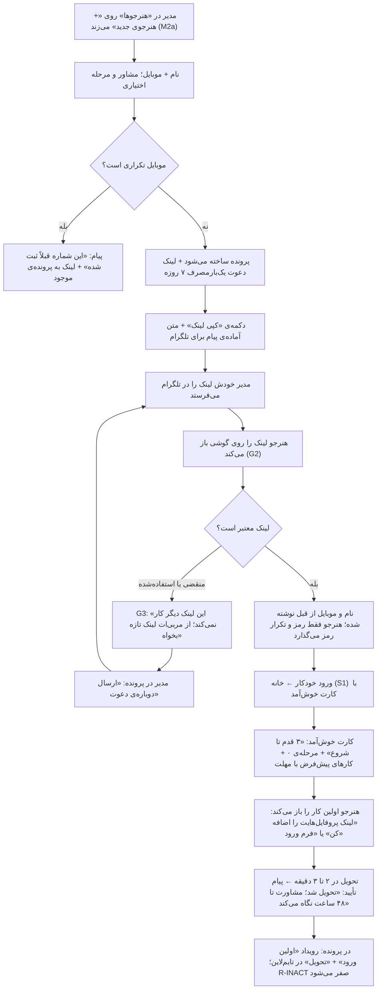
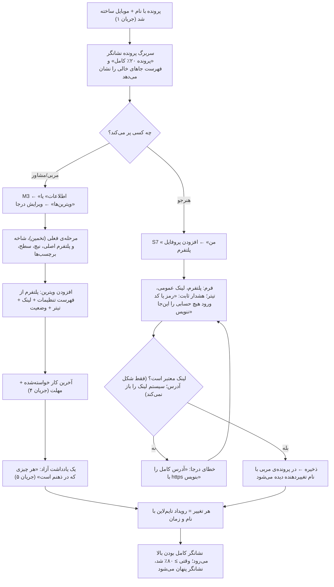
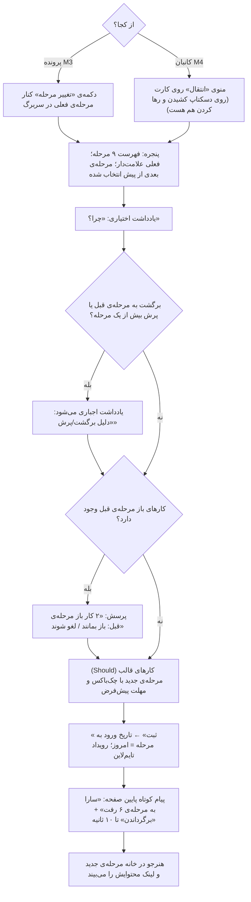
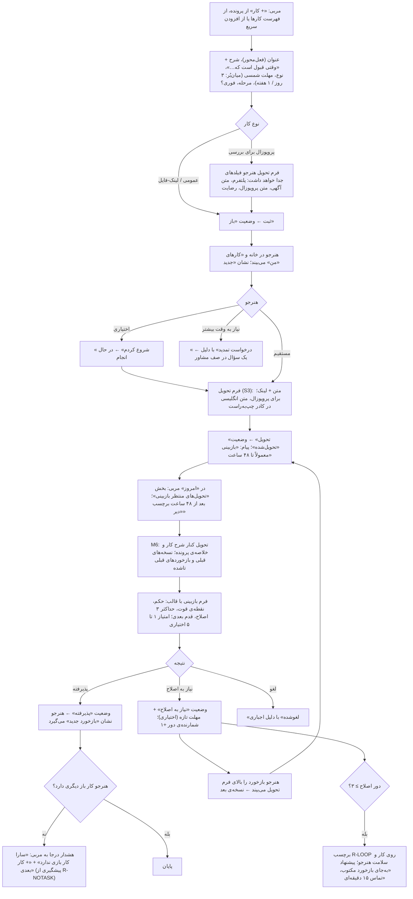
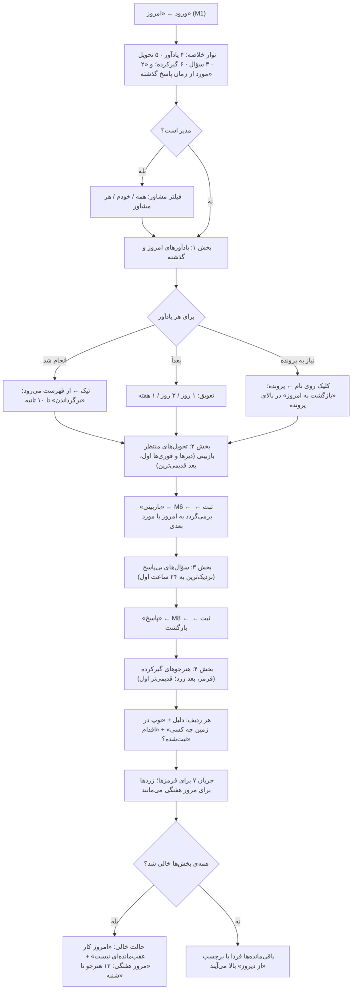
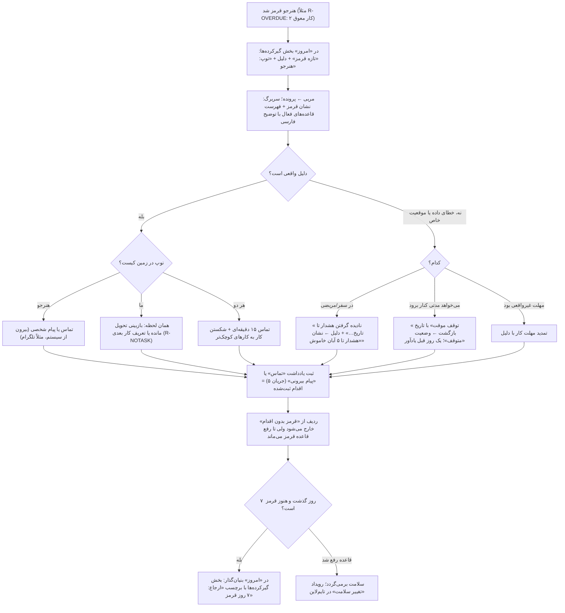
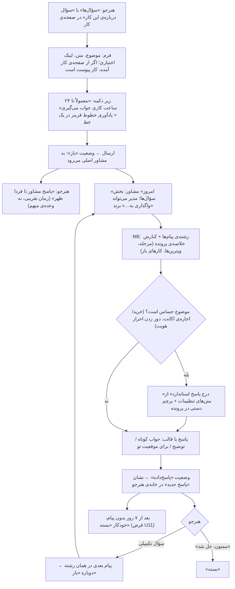
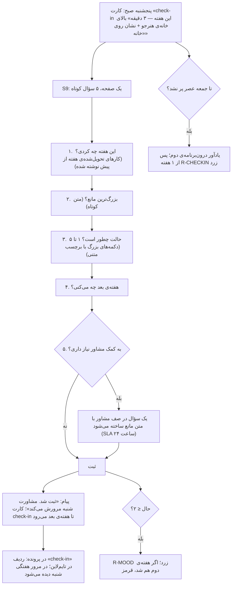

# جریان‌های کاربری — نسخه‌ی 0.1 («دفتر مربی»)

> فاز ۲ — نویسنده: ux-designer — ۲۷ مهر ۱۴۰۵ — وضعیت: پیش‌نویس برای گیت بنیان‌گذار
> کد صفحه‌ها (G، M، S) از `sitemap.md` است. امکان‌ها از `docs/02-product/prd.md`.
> نمودارها Mermaid هستند و در GitHub، VS Code (با افزونه‌ی Mermaid) و بیشتر ویرایشگرهای Markdown نمایش داده می‌شوند.

## فهرست

| # | جریان | نقش | امکان | اصل کلیدی |
|---|---|---|---|---|
| ۱ | دعوت هنرجو و اولین ورود | مدیر → هنرجو | F1، F10 | زیر ۱ دقیقه برای مدیر؛ «برد کوچک» زیر ۵ دقیقه برای هنرجو |
| ۲ | ساخت و پر کردن پرونده | مدیر/مشاور + هنرجو | F2 | فقط نام و موبایل اجباری؛ بقیه تدریجی |
| ۳ | تغییر مرحله | مدیر/مشاور | F3 | یک کلیک + یادداشت اختیاری |
| ۴ | کار ← تحویل ← بازبینی ← اصلاح | هر سه | F4 | هیچ کاری گم نشود |
| ۵ | یادداشت بعد از جلسه | مدیر/مشاور | F5 | < ۳ کلیک، روی موبایل |
| ۶ | روال صبح با «امروز» | مدیر/مشاور | F6، F7، F8 | یک صفحه، همه‌ی کارهای روز |
| ۷ | رسیدگی به هنرجوی قرمز | مدیر/مشاور | F7، F5 | اقدام ثبت‌شده در ۴۸ ساعت |
| ۸ | سؤال و پاسخ | هنرجو ↔ مشاور | F8 | هنرجو بداند کی جواب می‌آید |
| ۹ | check-in هفتگی (Should) | هنرجو → مشاور | F7 | ۳ دقیقه، پنجشنبه |

---

## ۱. دعوت هنرجو و اولین ورود (F1، F10)

**هدف:** مدیر در کمتر از ۱ دقیقه هنرجو را بسازد و لینک بفرستد. هنرجو بدون فرم طولانی وارد شود و در کمتر از ۵ دقیقه **یک کار واقعی را تمام کند** (برد کوچک: تکمیل «فرم ورود» یا «لینک پروفایلت را اضافه کن» که مستقیم «پذیرفته» یا «تحویل‌شده» می‌شود).



**نکته‌ها**
- در 0.1 پیامک نداریم؛ لینک فقط با تلگرام یا هر پیام‌رسانی که مربی استفاده می‌کند می‌رود. متن آماده‌ی پیام در M2a: «سلام [نام]، این لینک ورود تو به دفتر کار ماست: [لینک] (تا ۷ روز معتبر)».
- لینک دعوت مشاور همین جریان را دارد، با این تفاوت که فقط مدیر از «تنظیمات ← کاربران» می‌سازد و مقصد بعد از ورود «امروز» (M1) است.
- **فرض U7:** کارهای پیش‌فرض مرحله‌ی ۰ (`progress-tracking.md` بخش ۴-۳) با ساخت پرونده خودکار ساخته می‌شوند تا هنرجو هیچ‌وقت با خانه‌ی خالی روبه‌رو نشود. اگر بنیان‌گذار نخواهد، کارت خوش‌آمد فقط «پروفایلت را کامل کن» را نشان می‌دهد.

---

## ۲. ساخت و پر کردن پرونده (F2)

**هدف:** پرونده تدریجی پر شود. مربی فقط چیزی را که در ذهن دارد ثبت کند، هنرجو بخش خودش را.



**نکته‌ها**
- «کامل بودن» فقط برای مربی و فقط بر اساس فیلدهای مهاجرت (`progress-tracking.md` بخش ۲-۹) حساب می‌شود: مرحله، شاخه/پلتفرم، یک ویترین، یک کار باز، مشاور. این مستقیم به معیار G1 (پرونده‌ی کامل برای ≥ ۹۰٪) وصل است. **فرض U8.**
- ورود گروهی (M2b، Should) همین فیلدها را از اکسل می‌گیرد و قبل از ثبت، پیش‌نمایش ردیف‌های خطادار را نشان می‌دهد.

---

## ۳. تغییر مرحله (F3)



**نکته‌ها**
- «گیت» در 0.1 تأیید دستی مشاور است و وضعیت جدا در رابط ندارد. وقتی همه‌ی کارهای «اجباری برای گیت» یک مرحله «پذیرفته» شدند، در سربرگ پرونده یک راهنمای کوچک می‌آید: «همه‌ی کارهای این مرحله پذیرفته شد. آماده‌ی عبور؟» با دکمه‌ی «تغییر مرحله». **فرض U9.**
- مرحله‌های هم‌زمان ۲ و ۳: سربرگ هر دو را نشان می‌دهد («۲ ویترین + ۳ نمونه‌کار») و در کانبان کارت در ستون پایین‌تر (۲) با برچسب «+۳» است.

---

## ۴. تعریف کار ← تحویل ← بازبینی ← اصلاح (F4)



**نکته‌ها**
- «عقب‌افتاده» وضعیت نیست؛ برچسب قرمز «معوق · ۴ روز» روی کارهای باز/در حال انجام/نیاز به اصلاح که از مهلت گذشته‌اند (F4).
- تمدید مهلت را مربی در M6 با «تمدید مهلت» و دلیل انجام می‌دهد؛ تاریخچه‌ی تمدیدها زیر مهلت دیده می‌شود و تمدید سوم برچسب R-EXTEND می‌دهد. **فرض U10:** هنرجو در 0.1 خودش مهلت را تمدید نمی‌کند، فقط درخواست می‌دهد.
- کارهای «فقط تیک» (مثلاً «جلسه‌ی آشنایی را رزرو کن») با «انجام دادم» مستقیم «پذیرفته» می‌شوند و در صف بازبینی نمی‌آیند.
- (Should) واگذاری گروهی: در فرم کار، فیلد «هنرجو» چندانتخابی است؛ برای هر هنرجو یک کار مستقل ساخته می‌شود.

---

## ۵. ثبت یادداشت بعد از جلسه (F5)

**هدف:** < ۳ کلیک از هر جای پرونده؛ روی موبایل با یک دست.

```mermaid
flowchart TD
    A{"مربی کجاست؟"} -->|پرونده باز است (دسکتاپ)| B["کادر «یادداشت تازه» بالای تایم‌لاین — همیشه باز"]
    A -->|پرونده باز است (موبایل)| C["دکمه‌ی ثابت پایین: «+ یادداشت» ← برگه‌ی پایین‌صفحه"]
    A -->|جای دیگری است (موبایل)| D["دکمه‌ی وسط نوار پایین «+» ← «یادداشت» ← جستجوی نام هنرجو (۳ حرف کافی است)"]
    B --> E["نوع: یادداشت / جلسه / تماس / پیام بیرونی (پیش‌فرض: آخرین نوع استفاده‌شده)"]
    C --> E
    D --> E
    E --> F["متن"]
    F --> G["حالت: داخلی (پیش‌فرض) / اشتراکی — با برچسب روشن «هنرجو این را می‌بیند»"]
    G --> H{"قدم بعدی دارد؟ (اختیاری)"}
    H -->|کار| H1["«+ کار از این یادداشت» ← فرم کار با عنوان پیشنهادی از متن"]
    H -->|یادآور| H2["«یادآور» با میان‌بُر: فردا / ۳ روز / ۱ هفته"]
    H -->|نه| I["«ثبت»"]
    H1 --> I
    H2 --> I
    I --> J["در تایم‌لاین بالای فهرست؛ اگر اشتراکی است، هنرجو در خانه «یادداشت تازه از مشاور» می‌بیند"]
    I --> K{"هنرجو قرمز بود؟"}
    K -->|بله| K1["این یادداشت = «اقدام ثبت‌شده» ← هشدار «قرمز بدون اقدام» در امروز پاک می‌شود"]
```

**نکته‌ها**
- برای «جلسه»، متن با قالب کوتاه پیش‌فرض باز می‌شود: «خلاصه / تصمیم‌ها / کارهای بعدی». قالب پاک‌شدنی است.
- اگر اتصال قطع شد، متن در مرورگر نگه داشته می‌شود و پیام «ذخیره نشد؛ دوباره تلاش کن» با دکمه‌ی «تلاش دوباره» می‌آید (یادداشت هیچ‌وقت گم نمی‌شود).

---

## ۶. روال صبح مربی با صفحه‌ی «امروز» (F6، F7، F8)

**هدف:** ۳۰ تا ۶۰ دقیقه کار روزانه (`mentor-workflow.md` بخش ۵-۱) از یک صفحه؛ هر مورد یک کلیک تا مقصد.



**نکته‌ها**
- روی دسکتاپ چهار بخش در دو ستون کنار هم‌اند؛ روی موبایل زیر هم با پرش سریع از نوار خلاصه (هر عدد یک لینک به بخش خودش).
- برگشت از M6 یا M8 به «امروز» موقعیت اسکرول و فیلتر را حفظ می‌کند.

---

## ۷. رسیدگی به هنرجوی قرمز (F7، F5)

**قاعده‌ها از PRD F7 و `progress-tracking.md` بخش ۷-۳:** قرمز = تماس شخصی در ۴۸ ساعت کاری؛ ۷ روز قرمز بدون اقدام = گزارش به بنیان‌گذار.



**نکته‌ها**
- «خطر ریزش» (دو قاعده از R-INACT، R-CHECKIN، R-MOOD) برچسب جدا و پررنگ‌تر دارد و همیشه بالای بخش گیرکرده‌ها است.
- هنرجو هیچ‌جا «قرمز» نمی‌بیند. پیام مربی باید شخصی باشد (`mentor-workflow.md` بخش ۶-۳)؛ سیستم در 0.1 پیام خودکار نمی‌فرستد.

---

## ۸. سؤال و پاسخ (F8)



---

## ۹. check-in هفتگی هنرجو (F7 — Should)



**نکته:** اگر check-in در 0.1 ساخته نشود، کارت آن از خانه حذف می‌شود و R-CHECKIN و R-MOOD هم غیرفعال‌اند (PRD F7).

---

## فرض‌های این سند

| # | فرض |
|---|---|
| U7 | کارهای پیش‌فرض مرحله‌ی ورود با ساخت پرونده خودکار ساخته می‌شوند |
| U8 | «کامل بودن پرونده» فقط برای مربی و بر اساس فیلدهای مهاجرت محاسبه می‌شود |
| U9 | گیت مرحله در 0.1 وضعیت جدا ندارد؛ فقط راهنمای «آماده‌ی عبور؟» |
| U10 | هنرجو مهلت را خودش تمدید نمی‌کند؛ درخواست تمدید = یک سؤال |
| U11 | سؤال «پاسخ‌داده» بعد از ۷ روز بدون پیام خودکار بسته می‌شود |
