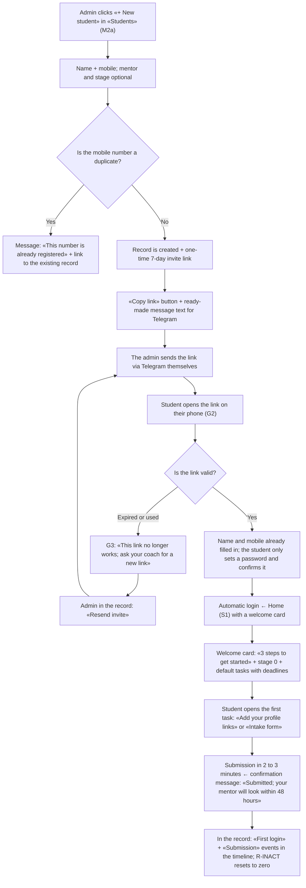
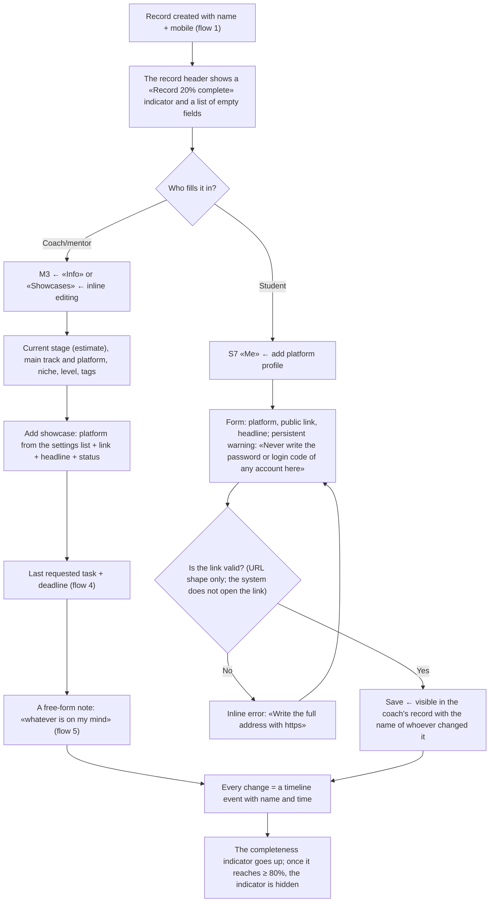
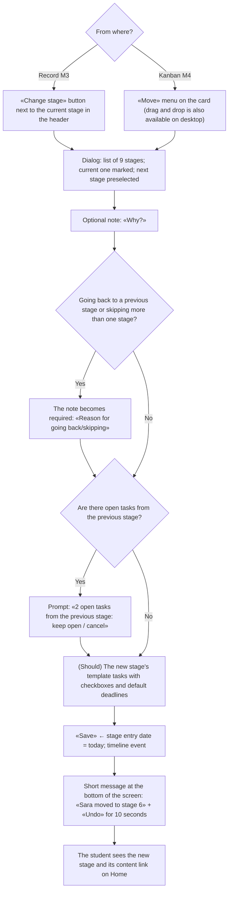
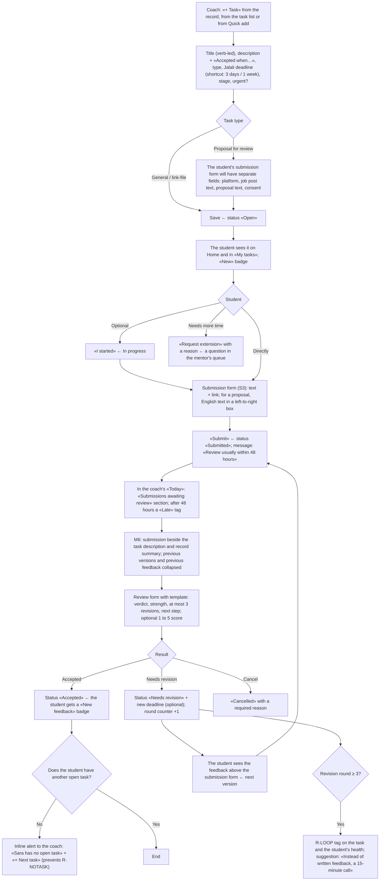
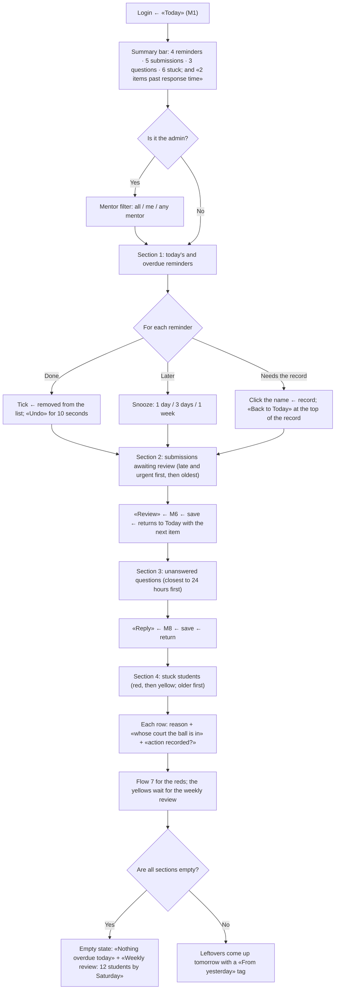
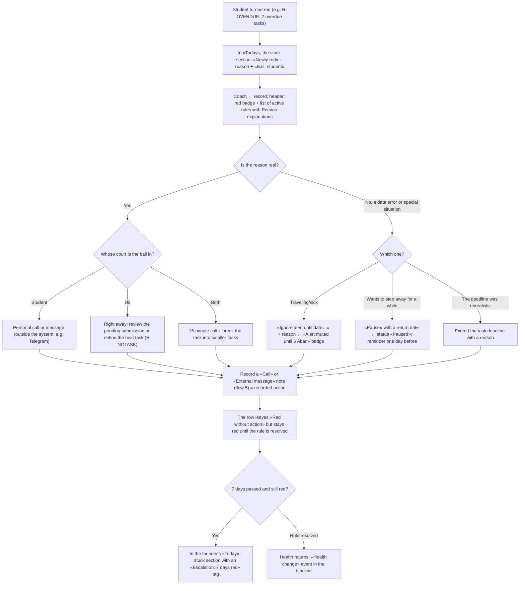
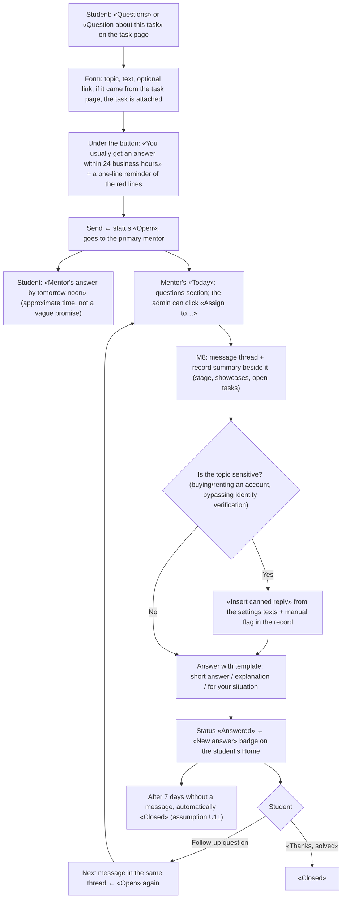
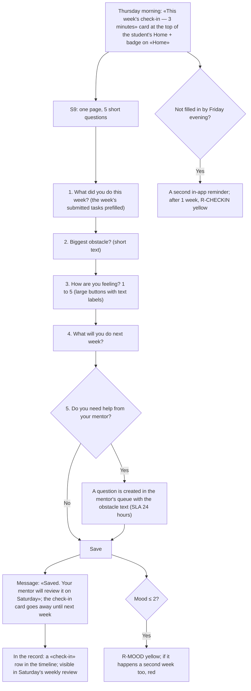

# User Flows — Version 0.1 ("Coach Office")

> Phase 2 — Author: ux-designer — 27 Mehr 1405 (2026-10-19) — Status: draft for the founder gate
> Page codes (G, M, S) come from `sitemap.md`. Features come from `docs/02-product/prd.md`.
> The diagrams are Mermaid and render in GitHub, VS Code (with the Mermaid extension) and most Markdown editors.

## Contents

| # | Flow | Role | Feature | Key principle |
|---|---|---|---|---|
| 1 | Student invite and first login | Admin → student | F1, F10 | Under 1 minute for the admin; a "small win" under 5 minutes for the student |
| 2 | Creating and filling in the record | Admin/mentor + student | F2 | Only name and mobile are required; the rest gradually |
| 3 | Stage change | Admin/mentor | F3 | One click + optional note |
| 4 | Task ← submission ← review ← revision | All three | F4 | No task gets lost |
| 5 | Note after a session | Admin/mentor | F5 | < 3 clicks, on mobile |
| 6 | Morning routine with "Today" | Admin/mentor | F6, F7, F8 | One page, all of the day's work |
| 7 | Handling a red student | Admin/mentor | F7, F5 | Action recorded within 48 hours |
| 8 | Questions and answers | Student ↔ mentor | F8 | The student knows when the answer will come |
| 9 | Weekly check-in (Should) | Student → mentor | F7 | 3 minutes, Thursday |

---

## 1. Student invite and first login (F1, F10)

**Goal:** The admin creates the student and sends the link in under 1 minute. The student logs in without a long form and in under 5 minutes **completes one real task** (small win: completing the "Intake form" or "Add your profile link", which goes directly to "Accepted" or "Submitted").



**Notes**
- There is no SMS in 0.1; the link is sent only via Telegram or whatever messenger the coach uses. Ready-made message text in M2a: "Hi [name], this is your login link to our office: [link] (valid for 7 days)".
- The mentor invite link follows the same flow, except that only the admin creates it, from "Settings ← Users", and the destination after login is "Today" (M1).
- **Assumption U7:** The default stage 0 tasks (`progress-tracking.md` section 4-3) are created automatically when the record is created, so the student never faces an empty Home. If the founder does not want this, the welcome card only shows "Complete your profile".

---

## 2. Creating and filling in the record (F2)

**Goal:** The record is filled in gradually. The coach only records what they have in mind; the student fills in their own part.



**Notes**
- "Completeness" is shown only to the coach and is calculated only from the migration fields (`progress-tracking.md` section 2-9): stage, track/platform, one showcase, one open task, mentor. This ties directly to criterion G1 (complete record for ≥ 90%). **Assumption U8.**
- Bulk import (M2b, Should) takes these same fields from Excel and, before saving, shows a preview of the rows with errors.

---

## 3. Stage change (F3)



**Notes**
- In 0.1 a "gate" is a manual mentor confirmation and has no separate status in the UI. When all of a stage's "required for gate" tasks are "Accepted", a small hint appears in the record header: "All tasks in this stage are accepted. Ready to move on?" with a "Change stage" button. **Assumption U9.**
- Concurrent stages 2 and 3: the header shows both ("2 showcase + 3 portfolio") and in the kanban the card sits in the lower column (2) with a "+3" tag.

---

## 4. Task definition ← submission ← review ← revision (F4)



**Notes**
- "Overdue" is not a status; it is a red "Overdue · 4 days" tag on open/in-progress/needs-revision tasks that are past their deadline (F4).
- The coach extends a deadline in M6 with "Extend deadline" and a reason; the extension history is visible under the deadline, and the third extension triggers an R-EXTEND tag. **Assumption U10:** In 0.1 the student does not extend the deadline themselves; they only request it.
- "Tick-only" tasks (e.g. "Book the intro session") go directly to "Accepted" with "Done" and do not enter the review queue.
- (Should) Bulk assignment: in the task form, the "Student" field is multi-select; an independent task is created for each student.

---

## 5. Recording a note after a session (F5)

**Goal:** < 3 clicks from anywhere in the record; one-handed on mobile.

```mermaid
flowchart TD
    A{"Where is the coach?"} -->|Record open (desktop)| B["«New note» box above the timeline — always open"]
    A -->|Record open (mobile)| C["Fixed bottom button: «+ Note» ← bottom sheet"]
    A -->|Somewhere else (mobile)| D["Middle bottom-bar button «+» ← «Note» ← search student name (3 letters is enough)"]
    B --> E["Type: note / session / call / external message (default: the last type used)"]
    C --> E
    D --> E
    E --> F["Text"]
    F --> G["Visibility: internal (default) / shared — with a clear label «The student sees this»"]
    G --> H{"Is there a next step? (optional)"}
    H -->|Task| H1["«+ Task from this note» ← task form with a title suggested from the text"]
    H -->|Reminder| H2["«Reminder» with shortcuts: tomorrow / 3 days / 1 week"]
    H -->|No| I["«Save»"]
    H1 --> I
    H2 --> I
    I --> J["At the top of the timeline; if shared, the student sees «New note from your mentor» on Home"]
    I --> K{"Was the student red?"}
    K -->|Yes| K1["This note = «recorded action» ← the «Red without action» alert on Today is cleared"]
```

**Notes**
- For a "session", the text opens with a short default template: "Summary / Decisions / Next tasks". The template can be deleted.
- If the connection drops, the text is kept in the browser and a "Not saved; try again" message appears with a "Retry" button (a note is never lost).

---

## 6. The coach's morning routine with the "Today" page (F6, F7, F8)

**Goal:** 30 to 60 minutes of daily work (`mentor-workflow.md` section 5-1) from one page; each item is one click from its destination.



**Notes**
- On desktop the four sections sit side by side in two columns; on mobile they are stacked, with quick jumps from the summary bar (each number is a link to its own section).
- Returning from M6 or M8 to "Today" preserves the scroll position and filter.

---

## 7. Handling a red student (F7, F5)

**Rules from PRD F7 and `progress-tracking.md` section 7-3:** red = personal contact within 48 business hours; 7 days red without action = report to the founder.



**Notes**
- "Churn risk" (two rules out of R-INACT, R-CHECKIN, R-MOOD) has a separate, bolder tag and is always at the top of the stuck section.
- The student never sees "red" anywhere. The coach's message must be personal (`mentor-workflow.md` section 6-3); in 0.1 the system does not send automatic messages.

---

## 8. Questions and answers (F8)



---

## 9. Student weekly check-in (F7 — Should)



**Note:** If check-in is not built in 0.1, its card is removed from Home and R-CHECKIN and R-MOOD are disabled too (PRD F7).

---

## Assumptions of this document

| # | Assumption |
|---|---|
| U7 | The default intake-stage tasks are created automatically when the record is created |
| U8 | "Record completeness" is calculated only for the coach and based on the migration fields |
| U9 | The stage gate has no separate status in 0.1; only the "Ready to move on?" hint |
| U10 | The student does not extend deadlines themselves; an extension request = a question |
| U11 | An "Answered" question is closed automatically after 7 days without a message |
