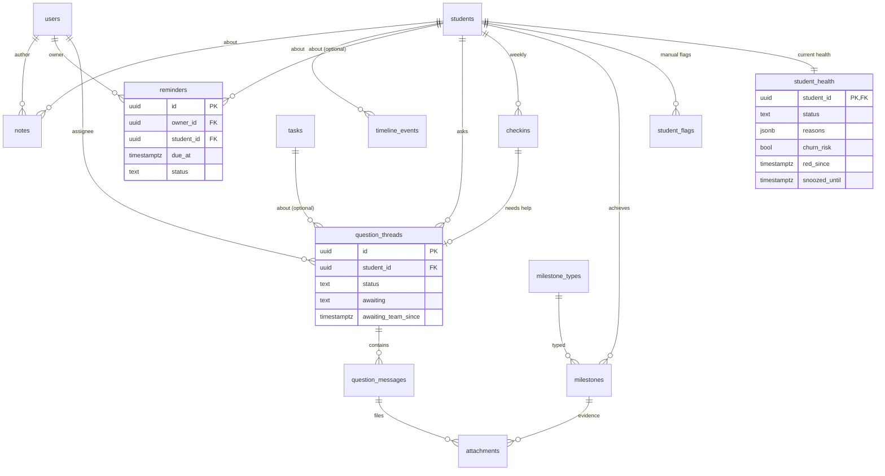
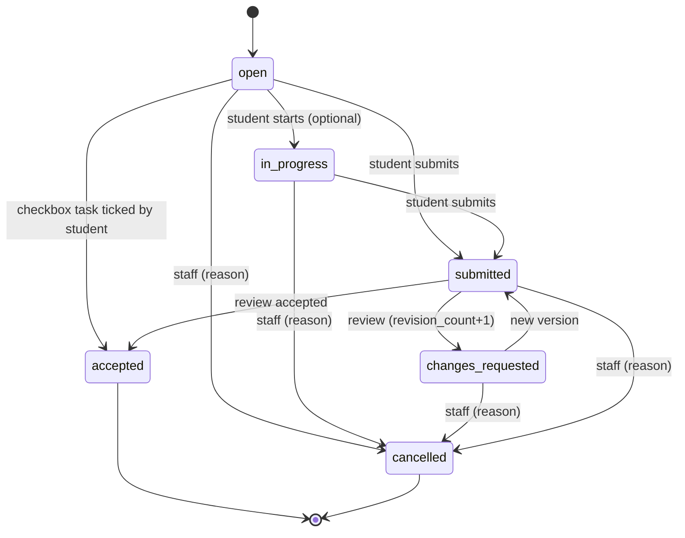

# مدل داده — UpworkCoach نسخه‌ی 0.1

> فاز ۳ — ۲۷ مهر ۱۴۰۵ — نویسنده: software-architect — وضعیت: پیش‌نویس برای گیت بنیان‌گذار
> منابع: `02-product/prd.md` (F1 تا F11، بخش ۶)، `02-product/learning/progress-tracking.md` (پرونده، کارها، سلامت)، `learning-path.md`، `mentor-workflow.md`.
> تصمیم‌های مرتبط: ADR-0003 (احراز هویت)، ADR-0004 (دسترسی)، ADR-0005 (سلامت)، ADR-0008 (زمان و متن فارسی).
> **پرداخت در این مدل نیست** (تصمیم D7). جای آن در `overview.md` بخش ۸ آمده است.

---

## ۰. قراردادهای عمومی (برای همه‌ی جدول‌ها)

| قاعده | جزئیات |
|---|---|
| کلید اصلی | `id uuid`، **UUIDv7** که برنامه می‌سازد (مرتب بر اساس زمان؛ index بهتر). استثناها در جدول‌ها ذکر شده‌اند |
| زمان | همه‌ی لحظه‌ها `timestamptz` به **UTC**. تاریخ‌های بدون ساعت (مثل `occurred_on` و `week_start`) نوع `date` دارند و **در تقویم تهران** معنا می‌شوند (ADR-0008) |
| `created_at` / `updated_at` | در همه‌ی جدول‌های قابل‌تغییر؛ `updated_at` را برنامه به‌روز می‌کند |
| مقادیر شمارشی (enum) | `text` + `CHECK (col IN (…))`، نه نوع enum پستگرس (مهاجرت ساده‌تر). مقادیر در کد یک `const` مشترک دارند |
| حذف | حذف نرم (`deleted_at`) فقط جایی که ذکر شده (یادداشت، پروفایل). بقیه یا حذف نمی‌شوند یا وضعیت «لغو/غیرفعال» دارند |
| نام‌ها | جدول جمع و snake_case؛ ستون snake_case؛ در TypeScript به camelCase نگاشت می‌شود |
| مبلغ | `numeric(12,2)` + `currency char(3)` (پیش‌فرض `USD`) |
| متن فارسی | پیش از ذخیره نرمال می‌شود (ADR-0008) |
| پیکربندی به‌جای کد | مرحله‌ها، پلتفرم‌ها، شاخه‌ها، انواع نقطه‌ی عطف، قالب کارها و آستانه‌ها **داده** هستند. رفتار خاص فقط از پرچم‌ها می‌آید (`is_open_ended`، `counts_for_north_star`)، نه از نام |

**افزونه‌های Postgres:** `pg_trgm` (جستجو)، `citext` (لازم نیست، ولی مجاز). هیچ افزونه‌ی اختصاصی ارائه‌دهنده استفاده نمی‌شود.

---

## ۱. ERD

### ۱-۱. هسته: کاربر، هنرجو، مسیر، کار


### ۱-۲. تعامل، پیگیری و سلامت



جدول‌های مستقل (بدون رابطه‌ی مهم): `settings`، `canned_responses`، `auth_throttle`، `audit_log`.

---

## ۲. جدول‌ها و فیلدها

ستون «الزامی» یعنی `NOT NULL`. «م» = مقدار پیش‌فرض.

### ۲-۱. هویت و احراز هویت (ماژول `identity`)

#### `users`
| فیلد | نوع | الزامی | توضیح |
|---|---|---|---|
| id | uuid | ✓ | — |
| phone | text، **unique** | ✓ | قالب E.164 (`+989121234567`). ورودی با ارقام فارسی، `0912…` یا `+98…` نرمال می‌شود. CHECK: `phone ~ '^\+[0-9]{10,15}$' OR erased_at IS NOT NULL` (امنیت C5: پس از حذف حساب مقدار `erased:<id>` می‌گیرد که یکتا می‌ماند و هیچ ورودی نرمال‌شده‌ای با آن برابر نمی‌شود) |
| display_name | text | ✓ | نام و نام خانوادگی |
| role | text | ✓ | `admin` \| `mentor` \| `student`. هر کاربر **یک** نقش دارد. مدیر می‌تواند مشاور اصلی هنرجو هم باشد |
| status | text | ✓ | `invited` (رمز ندارد) \| `active` \| `disabled` |
| password_hash | text | — | argon2id در قالب PHC؛ تا پذیرش دعوت خالی است. (امنیت C2) ورودی هش، رمزِ **نرمال‌شده** با `normalizePassword` است (NFKC، ارقام فارسی و عربی به لاتین، `ي`/`ى`←`ی`، `ك`←`ک`؛ بدون trim). ADR-0003 بخش ۳ |
| password_changed_at | timestamptz | — | نشست‌های قدیمی‌تر از این زمان باطل می‌شوند |
| last_login_at | timestamptz | — | — |
| last_seen_at | timestamptz | — | حداکثر هر ۱۵ دقیقه یک بار به‌روز می‌شود (برای R-INACT) |
| created_by | uuid FK users | — | — |
| erased_at | timestamptz | — | (امنیت C5) زمان اجرای حذف حساب (ناشناس‌سازی). پر بودن یعنی `status = 'disabled'` و داده‌ی شخصی پاک شده است. بخش ۶ و ADR-0010 |
| created_at، updated_at | timestamptz | ✓ | — |

#### `auth_tokens` (دعوت و بازنشانی رمز)
| فیلد | نوع | الزامی | توضیح |
|---|---|---|---|
| id | uuid | ✓ | — |
| user_id | uuid FK users | ✓ | کاربر با `status=invited` پیش از ساخت دعوت ساخته می‌شود |
| purpose | text | ✓ | `invite` \| `password_reset` |
| token_hash | text، unique | ✓ | SHA-256 توکن ۳۲ بایتی تصادفی. **خود توکن ذخیره نمی‌شود** |
| expires_at | timestamptz | ✓ | دعوت: ۷ روز (F1). بازنشانی: ۲۴ ساعت. لینک CLI (`admin:bootstrap`، `admin:reset-link`): ۱ ساعت (امنیت C1، SEC-T6/T7) |
| used_at، revoked_at | timestamptz | — | یک‌بارمصرف |
| phone_mismatch_count | smallint، م 0 | ✓ | (امنیت C1) تعداد پذیرش با موبایل غلط. با رسیدن به ۵ ← `revoked_at = now()` و `audit_log(auth.token_revoked_mismatch)` |
| used_user_agent | text | — | (امنیت C1، SEC-T5) User-Agent هنگام پذیرش؛ برای نمایش «دعوت پذیرفته شد: زمان، نوع دستگاه» به کارکنان |
| created_by | uuid FK users | — | null فقط برای لینک‌های CLI |
| created_at | timestamptz | ✓ | — |

Index: `(user_id, purpose) WHERE used_at IS NULL AND revoked_at IS NULL`. ساخت توکن جدید توکن‌های باز قبلی همان کاربر و همان هدف را باطل می‌کند.
(امنیت C1) **خود توکن هرگز در مسیر URL نمی‌آید**: لینک‌ها `…/invite#t=<token>` و `…/reset#t=<token>` هستند و توکن فقط در بدنه‌ی `POST /auth/tokens/lookup` و `/accept` به سرور می‌رسد (ADR-0003 بخش ۱–۲).

#### `sessions`
| فیلد | نوع | الزامی | توضیح |
|---|---|---|---|
| id | uuid | ✓ | — |
| user_id | uuid FK users | ✓ | — |
| token_hash | text، unique | ✓ | SHA-256 توکن کوکی |
| created_at | timestamptz | ✓ | — |
| expires_at | timestamptz | ✓ | (امنیت C2) بر اساس نقش هنگام ساخت: **هنرجو** لغزنده‌ی ۳۰ روز از آخرین استفاده و سقف مطلق ۹۰ روز از `created_at`؛ **مدیر و مشاور** لغزنده‌ی ۷ روز و سقف مطلق ۳۰ روز. تغییر نقش همه‌ی نشست‌ها را باطل می‌کند |
| last_used_at | timestamptz | ✓ | — |
| ip، user_agent | text | — | برای فهرست «دستگاه‌های من». `ip` فقط از `getClientIp(req)` (ADR-0003 بخش ۴) |
| revoked_at | timestamptz | — | — |

#### `auth_throttle` (امنیت C2)
| فیلد | نوع | توضیح |
|---|---|---|
| key | text PK | یکی از قالب‌های جدول زیر. موبایل همیشه **پس از** نرمال‌سازی E.164 و IP **فقط** از `getClientIp(req)` (IPv6 با پیشوند `/64`) |
| failures | int | — |
| window_started_at | timestamptz | شروع پنجره (طول پنجره بر اساس نوع کلید) |
| locked_until | timestamptz | — |

| قالب کلید | آستانه | قفل | نکته |
|---|---|---|---|
| `login:pi:<phone>:<ip>` | ۵ شکست / ۱۵ دقیقه | ۱۵ دقیقه | با ورود موفق پاک می‌شود |
| `login:p:<phone>` | ۲۰ شکست / ۱ ساعت | ۱ ساعت | درخواستی که کوکی دستگاه معتبر همان کاربر (`__Host-uc_dev`) را دارد از این قفل **عبور می‌کند**. با پذیرش لینک بازنشانی و با CLI `admin:reset-link` پاک می‌شود |
| `login:ip:<ip>` | ۳۰ شکست / ۱۵ دقیقه | ۱۵ دقیقه | — |
| `token:ip:<ip>` | ۳۰ درخواست ناموفق / ۱۵ دقیقه | ۱۵ دقیقه | `POST /auth/tokens/lookup` و `/accept` |
| `pwchange:u:<userId>` | ۵ شکست / ۱۵ دقیقه | ۱۵ دقیقه | رمز فعلی غلط در `change-password` |

شمارش با `INSERT … ON CONFLICT (key) DO UPDATE` در یک تراکنش (اتمی بین چند نمونه). برای موبایل‌های **ناموجود** هم دقیقاً همین شمارش انجام می‌شود (SEC-R6). ردیف‌های کهنه را `auth.cleanup` پاک می‌کند.

#### `audit_log`
رخدادهای امنیتی و مدیریتی: تغییر نقش، غیرفعال‌سازی، ساخت لینک بازنشانی، تغییر تنظیمات، خروجی CSV، ورود گروهی، تغییر مشاور.

| فیلد | نوع | توضیح |
|---|---|---|
| id | uuid | — |
| actor_id | uuid FK users | null یعنی سیستم |
| action | text | مثلاً `user.role_changed`، `settings.updated`، `export.students` |
| target_type، target_id | text، uuid | — |
| data | jsonb | قبل و بعد (بدون رمز، توکن یا لینک دعوت و بازنشانی) |
| ip | text | از `getClientIp(req)`. (امنیت C5) پس از ۹۰ روز `null` می‌شود |
| created_at | timestamptz | (امنیت C5) ردیف‌ها ۲۴ ماه نگه داشته می‌شوند. بخش ۶ |

### ۲-۲. فهرست‌ها و تنظیمات (ماژول `catalog`)

#### `tracks` (شاخه‌ی مسیر: مناقصه‌ای / کاتالوگی / مستقیم)
| فیلد | نوع | توضیح |
|---|---|---|
| id | uuid | — |
| code | text unique | `B`، `C`، `D` (برچسب، نه منطق) |
| name | text | «مناقصه‌ای»، … |
| sort_order، is_active | int، bool | — |

#### `platforms`
| فیلد | نوع | توضیح |
|---|---|---|
| id | uuid | — |
| name | text unique | Upwork، Fiverr، Contra، LinkedIn، Freelancer، Behance/Dribbble، مشتری مستقیم، سایر (seed) |
| track_id | uuid FK tracks | اختیاری |
| sort_order، is_active | int، bool | غیرفعال یعنی در فرم جدید نمی‌آید ولی داده‌ی قبلی می‌ماند |

#### `learning_paths` و `stages`
در 0.1 فقط یک مسیر پیش‌فرض داریم. جدول مسیر برای آینده (مثلاً مسیر جدا برای کاتالوگی) است و هزینه‌ای ندارد.

`learning_paths`: `id`، `name`، `is_default bool`، `created_at`.

`stages`:
| فیلد | نوع | الزامی | توضیح |
|---|---|---|---|
| id | uuid | ✓ | — |
| path_id | uuid FK | ✓ | — |
| display_code | text | ✓ | برچسب نمایشی مثل «۵». **کد به آن وابسته نیست** |
| name | text | ✓ | «پروپوزال و ارسال فعال» |
| sort_order | int | ✓ | ترتیب در مسیر و ستون‌های کانبان |
| expected_days | int | — | مدت معمول (پایه‌ی R-STALL). خالی = بدون R-STALL |
| is_open_ended | bool، م false | ✓ | مرحله‌ی باز (مثل «رشد»): R-STALL و R-NOTASK برایش اجرا نمی‌شوند. **جایگزین شرط «جز مرحله‌ی ۸»** |
| student_description | text | — | چیزی که هنرجو در «مسیر من» می‌بیند |
| content_links | jsonb | — | `[{title, url}]` لینک به محتوای آموزشی بیرونی (فرض A5) |
| is_active | bool | ✓ | غیرفعال‌سازی فقط وقتی هیچ هنرجوی فعالی در آن نیست |
| created_at، updated_at | timestamptz | ✓ | — |

Seed از `learning-path.md` بخش ۳ (۹ مرحله با `expected_days` = حد بالای بازه: ۴، ۱۰، ۱۰، ۱۴، ۵، ۴۲، خالی، خالی، خالی + `is_open_ended` برای «رشد»). اعداد را بنیان‌گذار در تنظیمات اصلاح می‌کند.

#### `task_templates` (Should)
| فیلد | نوع | توضیح |
|---|---|---|
| id | uuid | — |
| stage_id | uuid FK stages | خالی = قالب عمومی |
| title، description | text | — |
| kind | text | مثل `tasks.kind` |
| submission_type | text | مثل `tasks.submission_type` |
| default_due_days | int | مهلت پیش‌فرض از زمان ساخت |
| required_for_gate | bool | — |
| suggest_on_stage_entry | bool | با ورود هنرجو به مرحله پیشنهاد شود (F3 Should). **کار خودکار ساخته نمی‌شود؛ فقط پیشنهاد می‌شود** |
| sort_order، is_active | — | — |

Seed از `progress-tracking.md` بخش ۴-۳.

#### `milestone_types`
| فیلد | نوع | توضیح |
|---|---|---|
| id | uuid | — |
| name | text | «اولین قرارداد یا سفارش پولی»، … |
| counts_for_north_star | bool | فقط یک نوع در seed `true` دارد. **داشبورد North Star از این پرچم می‌خواند، نه از نام** |
| unique_per_student | bool | «اولین …»ها `true`؛ هر هنرجو حداکثر یکی تأییدشده |
| requires_evidence | bool | پیشنهاد هنرجو بدون مدرک پذیرفته نمی‌شود |
| sort_order، is_active | — | — |

Seed: پروفایل آماده، اولین اپلای، اولین پاسخ/مصاحبه، **اولین قرارداد یا سفارش پولی** (`counts_for_north_star`)، اولین درآمد بالای ۵۰۰ دلار (F9).

#### `canned_responses` (متن‌های استاندارد، F8 و F11)
`id`، `title`، `body`، `category` (`red_line` \| `general`)، `is_active`، `created_by`، `updated_at`. پاسخ استاندارد «خطوط قرمز» (خرید اکانت و …) در seed است.

#### `settings`
| فیلد | نوع | توضیح |
|---|---|---|
| key | text PK | — |
| value | jsonb | با schema‌ی zod همان کلید اعتبارسنجی می‌شود |
| version | int | با هر تغییر +۱. سلامت نسخه‌ی تنظیمات را کنار نتیجه ذخیره می‌کند |
| updated_by، updated_at | — | هر تغییر در `audit_log` هم ثبت می‌شود |

کلیدهای 0.1 و پیش‌فرض‌ها:

| key | پیش‌فرض | منبع |
|---|---|---|
| `health.rules` | بخش ۴-۲ همین سند | PRD F7 |
| `sla` | `{ questionHours: 24, urgentQuestionHours: 4, reviewHours: 48, redNoActionHours: 48, redEscalateDays: 7, clock: "business" }` | PRD F7، `mentor-workflow.md` بخش ۴ |
| `business_hours` | `{ timezone: "Asia/Tehran", week: { sat:[9,21], sun:[9,21], mon:[9,21], tue:[9,21], wed:[9,21], thu:[9,14], fri:null }, holidays: [] }` | `mentor-workflow.md` بخش ۴ (فرض، منتظر بنیان‌گذار) |
| `access` | `{ mentorScope: "assigned", mentorsCanInviteStudents: true }` | PRD بخش ۵ و فرض A8 |
| `questions` | `{ expectedResponseText: "معمولاً تا ۲۴ ساعت" }` | F8 |
| `checkin` | `{ enabled: false, weekday: "thu" }` | Should؛ با روشن شدن، R-CHECKIN و R-MOOD فعال می‌شوند |
| `tasks` | `{ defaultDueDays: 3 }` | `progress-tracking.md` ۴-۱ |

### ۲-۳. هنرجو و پرونده (ماژول `students`)

#### `students`
یک ردیف به ازای هر کاربر با نقش `student`. کلید اصلی همان `user_id` است (رابطه‌ی ۱:۱).

| فیلد | نوع | الزامی | پرکننده | توضیح |
|---|---|---|---|---|
| user_id | uuid PK FK users | ✓ | س | — |
| primary_mentor_id | uuid FK users | — | م | مشاور اصلی (نقش mentor یا admin). خالی = تخصیص‌نیافته (فقط مدیر می‌بیند). **منبع حقیقت دسترسی مشاور در 0.1** (ADR-0004) |
| lifecycle_status | text، م `active` | ✓ | م | `active` \| `paused` \| `graduated` \| `dropped` |
| paused_until | date | — | م | فقط برای `paused`؛ یک روز قبلش یادآور سیستمی ساخته می‌شود |
| status_reason | text | — | م | — |
| current_stage_id | uuid FK stages | ✓ | م | ستون کانبان |
| stage_entered_at | timestamptz | ✓ | س | پایه‌ی R-STALL و «چند روز در مرحله» |
| track_id | uuid FK tracks | — | م | شاخه‌ی اصلی |
| primary_platform_id | uuid FK platforms | — | م/ه | — |
| level | text | — | م | `beginner` \| `applying` \| `active` \| `advanced` (PRD بخش ۶) |
| cohort | text | — | م | دوره یا کوهورت |
| tags | text[]، م `{}` | ✓ | م | برچسب آزاد |
| messenger_handle | text | — | ه | آیدی تلگرام یا پیام‌رسان |
| primary_skill | text | — | ه | — |
| skill_level، english_writing، english_speaking | smallint (۱ تا ۵) | — | ه | CHECK بین ۱ و ۵ |
| hours_per_week | smallint | — | ه | — |
| income_goal_usd | int | — | ه | — |
| goal_90d | text | — | ه | — |
| prior_experience | text | — | ه | `none` \| `applied_no_result` \| `few_contracts` \| `active` |
| self_reported_blocker | text | — | ه | — |
| niche_statement | text | — | م/ه | جمله‌ی نیچ (خروجی مرحله‌ی ۱) |
| joined_at | timestamptz | ✓ | س | زمان ساخت پرونده (برای مهاجرت قابل‌ویرایش توسط مدیر) |
| last_activity_at | timestamptz | — | س | آخرین ورود، تحویل، پیام سؤال، check-in یا پیشنهاد نقطه‌ی عطف هنرجو. **پایه‌ی R-INACT** |
| search_text | text | ✓ | س | نرمال‌شده‌ی نام، موبایل، آیدی پیام‌رسان و برچسب‌ها (ADR-0008) |
| created_at، updated_at | timestamptz | ✓ | س | — |

Indexها: `(primary_mentor_id, lifecycle_status)`، `(current_stage_id)`، `GIN (tags)`، `GIN (search_text gin_trgm_ops)`.

**فیلدهایی که هنرجو خودش ویرایش می‌کند** (PRD بخش ۵): `messenger_handle`، `primary_skill`، `skill_level`، `english_*`، `hours_per_week`، `income_goal_usd`، `goal_90d`، `prior_experience`، `self_reported_blocker`، `primary_platform_id`. بقیه فقط با مدیر یا مشاور.

#### `mentor_assignments` (تاریخچه‌ی تخصیص)
| فیلد | نوع | توضیح |
|---|---|---|
| id | uuid | — |
| student_id | uuid FK students | — |
| mentor_id | uuid FK users | — |
| role | text، م `primary` | در 0.1 فقط `primary`. در آینده `secondary` یا `backup` (مشاور جانشین در `mentor-workflow.md`) بدون تغییر ساختار |
| started_at، ended_at | timestamptz | ردیف فعال `ended_at IS NULL` است |
| assigned_by | uuid FK users | — |
| reason | text | — |

Partial unique: `(student_id) WHERE role='primary' AND ended_at IS NULL`.
**ناوردا:** `students.primary_mentor_id` همیشه برابر ردیف فعال `primary` است. هر دو فقط در `students.service.assignMentor()` و در یک تراکنش تغییر می‌کنند.

#### `platform_profiles` (ویترین‌ها: «چه پروفایلی دارد؟»)
| فیلد | نوع | الزامی | توضیح |
|---|---|---|---|
| id | uuid | ✓ | — |
| student_id | uuid FK | ✓ | — |
| platform_id | uuid FK platforms | ✓ | — |
| kind | text | ✓ | `profile` \| `gig` \| `linkedin` \| `portfolio_page` \| `other` |
| public_url | text | — | فقط ذخیره می‌شود. **سیستم آن را باز یا fetch نمی‌کند** (بدون اسکرپ). اعتبارسنجی: فقط `https://` |
| headline | text | — | تیتر فعلی |
| rate_amount، rate_currency، rate_unit | numeric، char(3)، text | — | `rate_unit`: `hour` \| `fixed` \| `package` \| `month` |
| status | text، م `building` | ✓ | `building` \| `active` \| `restricted` \| `suspended` |
| niche | text | — | نیچ این پروفایل |
| notes | text | — | **قابل‌دیدن برای هنرجو.** یادداشت داخلی جایش در `notes` است |
| is_primary | bool | ✓ | ویترین اصلی در سربرگ پرونده؛ حداکثر یکی برای هر هنرجو (partial unique) |
| mentor_approved_at، mentor_approved_by | — | — | تأیید ویترین |
| created_by، created_at، updated_at، deleted_at | — | — | حذف نرم |

**قاعده‌ی امنیتی:** این جدول هیچ فیلدی برای رمز، ایمیل ورود یا کوکی حساب پلتفرم ندارد و نخواهد داشت.

#### `profile_snapshots`
نسخه‌های متن کامل ویترین (مقایسه‌ی پیشرفت). با تحویل کار از نوع `profile_review` ساخته می‌شود، یا دستی.

`id`، `profile_id` FK، `headline`، `body_text`، `rate_text`، `source_submission_id` FK submissions (اختیاری)، `created_by`، `created_at`.

### ۲-۴. مسیر و مرحله (ماژول `path`)

#### `stage_transitions` (تاریخچه‌ی مرحله)
| فیلد | نوع | الزامی | توضیح |
|---|---|---|---|
| id | uuid | ✓ | — |
| student_id | uuid FK | ✓ | — |
| from_stage_id | uuid FK stages | — | خالی برای `initial` |
| to_stage_id | uuid FK stages | ✓ | — |
| kind | text | ✓ | `initial` \| `advance` (عبور با تأیید گیت) \| `skip_by_assessment` (پرش در تعیین سطح یا مهاجرت) \| `advance_with_exception` (عبور با استثنا) \| `regress` (برگشت) |
| note | text | — | برای `advance_with_exception` و `regress` **الزامی** (CHECK) |
| actor_id | uuid FK users | ✓ | — |
| created_at | timestamptz | ✓ | — |

**وضعیت هر مرحله** (`locked`، `in_progress`، `passed`، `passed_by_assessment`، `passed_with_exception` در `progress-tracking.md` ۳-۱) **ذخیره نمی‌شود**. از این جدول و `sort_order` محاسبه می‌شود:
- مرحله‌ی فعلی ← `in_progress`.
- مرحله‌هایی که آخرین گذار خروج از آن‌ها `advance` بوده ← `passed`؛ `skip_by_assessment` ← `passed_by_assessment`؛ `advance_with_exception` ← `passed_with_exception`.
- مرحله‌های بعد از فعلی ← `locked`.
- `awaiting_review` (همه‌ی کارهای اجباری تحویل شده) هم محاسبه‌ای است: همه‌ی `tasks` با `required_for_gate` و `stage_id` = مرحله‌ی فعلی در `submitted` یا `accepted` باشند.

**محدودیت آگاهانه‌ی 0.1:** هر هنرجو **یک** مرحله‌ی فعلی دارد. هم‌زمانی مراحل ۲ و ۳ (`learning-path.md`) با کارهایی که `stage_id` آن‌ها مرحله‌ی ۳ است پوشش داده می‌شود، ولی ستون کانبان یکی است. اگر لازم شد، در 1.0 جدول `student_stage_progress` اضافه می‌شود. `stage_transitions` تغییر نمی‌کند.

تغییر مرحله (در یک تراکنش): درج `stage_transitions` ← به‌روزرسانی `students.current_stage_id` و `stage_entered_at = now()` ← `timeline_events(stage.changed)` ← بازمحاسبه‌ی سلامت پس از commit ← برگرداندن قالب‌های پیشنهادی مرحله‌ی جدید (F3 Should).

### ۲-۵. کارها، تحویل، بازبینی و تمدید (ماژول `tasks`)

#### `tasks`
| فیلد | نوع | الزامی | توضیح |
|---|---|---|---|
| id | uuid | ✓ | — |
| student_id | uuid FK | ✓ | — |
| title | text | ✓ | فعل‌محور |
| description | text | — | شامل معیار پذیرش |
| kind | text | ✓ | `path_assignment` \| `custom` \| `follow_up` \| `session_prep` |
| submission_type | text | ✓ | `text` \| `link` \| `file` \| `checkbox` \| `proposal_review` \| `profile_review` |
| stage_id | uuid FK stages | — | مرحله‌ی مرتبط |
| required_for_gate | bool، م false | ✓ | — |
| priority | text، م `normal` | ✓ | `normal` \| `urgent` |
| status | text، م `open` | ✓ | بخش ۳-۱ |
| due_at | timestamptz | ✓ | کاربر **تاریخ شمسی** انتخاب می‌کند؛ ذخیره = پایان آن روز به وقت تهران (23:59:59 Asia/Tehran به UTC) |
| original_due_at | timestamptz | ✓ | مهلت اولیه |
| reviewer_id | uuid FK users | ✓ | پیش‌فرض: مشاور اصلی هنرجو در زمان ساخت |
| created_by | uuid FK users | ✓ | — |
| template_id | uuid FK task_templates | — | — |
| batch_id | uuid | — | کارهایی که با یک واگذاری گروهی ساخته شده‌اند (F4 Should) |
| profile_id | uuid FK platform_profiles | — | برای `profile_review` |
| revision_count | int، م 0 | ✓ | تعداد بازبینی‌های `changes_requested` (پایه‌ی R-LOOP) |
| extension_count | int، م 0 | ✓ | تعداد تمدیدها (پایه‌ی R-EXTEND) |
| status_changed_at | timestamptz | ✓ | — |
| last_submitted_at | timestamptz | — | پایه‌ی SLA بازبینی |
| closed_at | timestamptz | — | زمان `accepted` یا `cancelled` (پایه‌ی R-NOTASK) |
| cancel_reason | text | — | برای `cancelled` الزامی |
| created_at، updated_at | timestamptz | ✓ | — |

Indexها: `(student_id, status)`؛ `(reviewer_id, last_submitted_at) WHERE status='submitted'`؛ `(due_at) WHERE status IN ('open','in_progress','changes_requested')`.

**«معوق» ستون نیست:** `status IN ('open','in_progress','changes_requested') AND due_at < now()`.
**«باز» برای R-NOTASK:** `status NOT IN ('accepted','cancelled')` (یعنی `submitted` هم باز حساب می‌شود، چون کار هنوز تمام نشده).

#### `task_extensions`
`id`، `task_id` FK، `previous_due_at`، `new_due_at`، `reason` (الزامی)، `actor_id`، `created_at`. هر درج یعنی `tasks.extension_count += 1` و `tasks.due_at = new_due_at` در همان تراکنش.

#### `submissions` (نسخه‌های تحویل)
| فیلد | نوع | الزامی | توضیح |
|---|---|---|---|
| id | uuid | ✓ | — |
| task_id | uuid FK | ✓ | — |
| version | int | ✓ | ۱، ۲، … ؛ unique `(task_id, version)` |
| body_text | text | — | — |
| links | jsonb، م `[]` | ✓ | `[{url, label}]`؛ فقط `https://` |
| platform_id | uuid FK platforms | — | برای `proposal_review` الزامی |
| job_post_text | text | — | متن آگهی (انگلیسی) — برای `proposal_review` الزامی |
| proposal_text | text | — | متن پروپوزال (انگلیسی) — برای `proposal_review` الزامی |
| profile_text | text | — | برای `profile_review` |
| ai_use_consent | bool، م false | ✓ | چک‌باکس رضایت استفاده‌ی بی‌نام در بهبود ابزارها (D6). پیش‌فرض **خاموش** |
| ai_use_consent_at | timestamptz | — | — |
| submitted_by | uuid FK users | ✓ | — |
| created_at | timestamptz | ✓ | — |

تحویل‌ها **ویرایش نمی‌شوند**. اصلاح یعنی نسخه‌ی جدید.

#### `reviews` (بازبینی و بازخورد)
| فیلد | نوع | الزامی | توضیح |
|---|---|---|---|
| id | uuid | ✓ | — |
| submission_id | uuid FK، **unique** | ✓ | هر نسخه حداکثر یک بازبینی |
| reviewer_id | uuid FK users | ✓ | — |
| outcome | text | ✓ | `accepted` \| `changes_requested` |
| feedback_text | text | ✓ | فارسی، طبق قالب `mentor-workflow.md` بخش ۶ |
| score | smallint | — | ۱ تا ۵ (اختیاری) |
| created_at، updated_at | timestamptz | ✓ | بازبین تا ۲۴ ساعت می‌تواند متن را اصلاح کند؛ `outcome` قابل‌تغییر نیست |

**مجموعه‌ی داده‌ی ارزیابی AI (G4):** `submissions` با `tasks.submission_type='proposal_review' AND ai_use_consent` به‌همراه `reviews`. این جفت «ورودی + نقد مربی» است. خروجی آن در 1.0 یک view به نام `ai_eval_proposals` خواهد بود. در 0.1 فقط شمارش آن در داشبورد مدیر نمایش داده می‌شود.

#### `attachments`
| فیلد | نوع | توضیح |
|---|---|---|
| id | uuid | — |
| storage_key | text | کلید در `FileStorage`: **UUID تصادفی** (نه شناسه‌ی ردیف، نه نام فایل کاربر) (SEC-U8) |
| original_name | text | فقط برای نمایش؛ پاک‌شده: بدون مسیر، بدون نویسه‌ی کنترل و کنترل جهت، حداکثر ۲۰۰ نویسه (SEC-U8، SEC-X5) |
| mime_type، size_bytes، width، height | — | از **خروجی بازکدگذاری‌شده**، نه از ورودی کاربر. فقط `image/jpeg`، `image/png`، `image/webp` |
| uploaded_by | uuid FK users | — |
| status | text | `pending` (آپلودشده و هنوز وصل نشده) \| `linked` |
| submission_id، question_message_id، milestone_id | uuid FK | **دقیقاً یکی** پس از وصل شدن پر است (CHECK: `status='pending'` ⇔ هر سه خالی) |
| created_at | timestamptz | — |

Index: `(uploaded_by, status)`، `(uploaded_by, created_at)`.

`pending`های قدیمی‌تر از ۲۴ ساعت را job `files.cleanup` پاک می‌کند. **دسترسی به فایل = دسترسی به والدش** (ADR-0004)؛ پیش از وصل شدن فقط آپلودکننده.

**قاعده‌های پیوست (امنیت C4):**
1. **پردازش هنگام آپلود** (`files.service.upload`، به همین ترتیب):
   1. سقف حجم **پیش از** بافر شدن بدنه: `Content-Length` بیش از `MAX_UPLOAD_BYTES` (۵ مگابایت) + ۶۴ کیلوبایت ← `413` فوری؛ جریان بدنه با شمارنده‌ی بایت خوانده و پس از سقف قطع می‌شود. `request.formData()` روی بدنه‌ی بی‌سقف صدا زده نمی‌شود (SEC-U4).
   2. **سهمیه** (SEC-U7): اگر کاربر ۲۰ پیوست `pending` دارد، یا در ۲۴ ساعت گذشته ۱۰۰ پیوست ساخته (`count(*) WHERE uploaded_by = $1 AND created_at > now() - interval '24 hours'`) ← `429 TOO_MANY_ATTEMPTS`.
   3. نوع از **محتوا**: `sharp(buf, { limitInputPixels: 40_000_000, failOn: 'error', animated: false }).metadata().format` باید `jpeg`، `png` یا `webp` باشد؛ وگرنه `415` (SVG، GIF، HEIC و PDF در 0.1 رد می‌شوند) (SEC-U1). تصویر بزرگ‌تر از ۴۰ مگاپیکسل ← `422` (SEC-U2).
   4. `.rotate()` (اعمال جهت EXIF) ← `resize({ width: 4096, height: 4096, fit: 'inside', withoutEnlargement: true })` ← بازکدگذاری به همان قالب **بدون** `withMetadata()` (EXIF، GPS، ICC و XMP حذف می‌شوند). **فایل اصلی هرگز ذخیره نمی‌شود** (SEC-U5).
   5. هم‌زمانی پردازش تصویر حداکثر ۲ در هر نمونه (`sharp.concurrency(1)` + صف ساده) (SEC-U3).
2. **وصل کردن به والد** (تحویل، پیام سؤال، نقطه‌ی عطف) فقط با یک `UPDATE` اتمی، **درون همان تراکنشی** که والد را می‌سازد:
   ```sql
   UPDATE attachments
      SET status = 'linked', <parent>_id = $parentId
    WHERE id = ANY($ids) AND status = 'pending' AND uploaded_by = $actorId
   RETURNING id;
   ```
   اگر تعداد ردیف‌های برگشتی با تعداد `ids` (پس از حذف تکراری‌ها) برابر نبود ← کل تراکنش rollback و `422 VALIDATION_FAILED` با `fields.attachmentIds`. پس پیوستِ کاربر دیگر، پیوستِ از قبل وصل‌شده و شناسه‌ی ناموجود همه یک خطا دارند. حداکثر ۱۰ پیوست در هر درخواست. پیوست وصل‌شده هرگز به والد دیگری منتقل نمی‌شود.
3. **دانلود** (`GET /attachments/:id`) و سرآیندهایش در `api.md` بخش ۱۴.

### ۲-۶. یادداشت و تایم‌لاین (ماژول `timeline`)

#### `notes` (تعامل: یادداشت، جلسه، تماس، پیام بیرونی)
| فیلد | نوع | الزامی | توضیح |
|---|---|---|---|
| id | uuid | ✓ | — |
| student_id | uuid FK | ✓ | — |
| author_id | uuid FK users | ✓ | فقط admin یا mentor |
| kind | text، م `note` | ✓ | `note` \| `session` \| `call` \| `external_message` \| `weekly_review` |
| visibility | text، م **`internal`** | ✓ | `internal` \| `shared` |
| body | text | ✓ | — |
| tags | text[] | ✓ | انگیزه، مهارت، زبان، مالی، … |
| occurred_at | timestamptz | ✓ | پیش‌فرض now؛ برای ثبت جلسه‌ی دیروز قابل‌تغییر |
| created_at، updated_at، deleted_at | timestamptz | — | ویرایش و حذف: فقط نویسنده یا مدیر |

**ناوردای امنیتی:** هیچ پرس‌وجوی سمت هنرجو جدول `notes` را بدون `visibility = 'shared' AND deleted_at IS NULL` نمی‌خواند. این شرط داخل **یک** تابع repository (`listSharedNotesForStudent`) است و تابع دیگری برای هنرجو وجود ندارد (ADR-0004).

#### `timeline_events` (رویدادهای خودکار)
| فیلد | نوع | الزامی | توضیح |
|---|---|---|---|
| id | uuid | ✓ | — |
| student_id | uuid FK | ✓ | — |
| type | text | ✓ | فهرست زیر |
| actor_id | uuid FK users | — | خالی = سیستم |
| subject_type، subject_id | text، uuid | — | مثلاً `task` و شناسه‌ی کار |
| data | jsonb | ✓ | مثلاً `{ "from": "...", "to": "...", "rule": "R-OVERDUE" }` |
| occurred_at | timestamptz | ✓ | — |

Index: `(student_id, occurred_at DESC)`.

انواع رویداد در 0.1: `student.created`، `student.updated` (`data.fields`)، `student.lifecycle_changed`، `mentor.changed`، `invite.accepted`، `stage.changed`، `profile.added`، `profile.updated`، `profile.removed`، `profile.approved`، `task.created`، `task.status_changed`، `task.due_extended`، `submission.created`، `review.created`، `question.created`، `question.answered`، `question.closed`، `checkin.submitted`، `milestone.proposed`، `milestone.approved`، `milestone.rejected`، `flag.added`، `flag.cleared`، `health.changed`، `health.snoozed`.

**تایم‌لاین پرونده** = `UNION ALL` از `timeline_events` و `notes` (حذف‌نشده)، مرتب بر `occurred_at`، با فیلتر نوع (F5). یادداشت‌ها در `timeline_events` **کپی نمی‌شوند**، پس visibility یک منبع دارد.

**هنرجو در 0.1 تایم‌لاین نمی‌بیند.** خانه‌ی هنرجو مستقیم از `tasks`، `question_threads` و `listSharedNotesForStudent` ساخته می‌شود. (`timeline_events` ستون visibility ندارد، چون در 0.1 هیچ مصرف‌کننده‌ی سمت هنرجو ندارد. اگر در 1.0 تایم‌لاین هنرجو ساخته شد، فهرست سفید نوع‌ها در کد تعریف می‌شود.)

### ۲-۷. یادآور (ماژول `reminders`)

#### `reminders`
| فیلد | نوع | الزامی | توضیح |
|---|---|---|---|
| id | uuid | ✓ | — |
| owner_id | uuid FK users | ✓ | کسی که یادآور را در «امروز» می‌بیند (admin یا mentor) |
| student_id | uuid FK | — | درباره‌ی کدام هنرجو |
| text | text | ✓ | «پیگیری پروفایل Fiverr» |
| due_at | timestamptz | ✓ | تاریخ (و ساعت اختیاری؛ پیش‌فرض ۹ صبح تهران) |
| status | text، م `open` | ✓ | `open` \| `done` \| `cancelled` |
| done_at | timestamptz | — | — |
| snooze_count | int، م 0 | ✓ | تعویق ۱، ۳ یا ۷ روز = `due_at` جدید + افزایش شمارنده |
| source | text، م `manual` | ✓ | `manual` \| `system` |
| system_key | text، unique | — | برای یادآورهای سیستمی، تا تکراری ساخته نشوند. مثلاً `pause-return:<studentId>:<date>` |
| created_by | uuid FK users | ✓ | — |
| created_at، updated_at | timestamptz | ✓ | — |

Index: `(owner_id, status, due_at)`.
«امروز» = `status='open' AND due_at < پایان امروز به وقت تهران` (شامل گذشته‌ها). **هیچ job لازم نیست.**

### ۲-۸. سؤال و پاسخ (ماژول `questions`)

#### `question_threads`
| فیلد | نوع | الزامی | توضیح |
|---|---|---|---|
| id | uuid | ✓ | — |
| student_id | uuid FK | ✓ | پرسنده |
| subject | text | ✓ | — |
| status | text، م `open` | ✓ | `open` \| `answered` \| `closed` |
| awaiting | text، م `team` | ✓ | `team` \| `student` \| `none`؛ «توپ در زمین کیست» |
| awaiting_team_since | timestamptz | — | شروع ساعت SLA؛ با پیام هنرجو پر و با پاسخ تیم خالی می‌شود |
| assignee_id | uuid FK users | ✓ | پیش‌فرض: مشاور اصلی؛ اگر هنرجو مشاور ندارد، یک مدیر |
| task_id | uuid FK tasks | — | سؤال درباره‌ی یک کار |
| priority | text، م `normal` | ✓ | `normal` \| `urgent` (هنرجو علامت می‌زند؛ SLA ۴ ساعت) |
| source | text، م `student` | ✓ | `student` \| `checkin` |
| first_response_at، last_message_at، closed_at | timestamptz | — | میانه‌ی زمان پاسخ (G2) از `first_response_at - created_at` |
| closed_by | uuid FK users | — | — |
| created_at، updated_at | timestamptz | ✓ | — |

گذارها: پیام هنرجو ← `status=open, awaiting=team` (اگر `awaiting_team_since` خالی است، مقدار now می‌گیرد). پیام تیم ← `status=answered, awaiting=student, awaiting_team_since=null`. بستن ← `closed, awaiting=none`. پیام بعدی هنرجو در رشته‌ی بسته، آن را دوباره باز می‌کند.

#### `question_messages`
`id`، `thread_id` FK، `author_id` FK users، `body` (الزامی)، `links jsonb`، `canned_response_id` (اختیاری، برای آمار)، `created_at`، `edited_at`. ویرایش فقط تا ۱۵ دقیقه و فقط توسط نویسنده.

### ۲-۹. check-in هفتگی (ماژول `checkins`، Should)

#### `checkins`
| فیلد | نوع | توضیح |
|---|---|---|
| id | uuid | — |
| student_id | uuid FK | — |
| week_start | date | **شنبه‌ی** هفته‌ی شمسی، به وقت تهران. unique `(student_id, week_start)` |
| activity_text | text | «این هفته چه کردی؟» |
| blocker | text | — |
| mood | smallint ۱ تا ۵ | پایه‌ی R-MOOD |
| next_week_plan | text | — |
| needs_help | bool | `true` یک `question_threads` با `source='checkin'` می‌سازد |
| question_id | uuid FK | — |
| submitted_at | timestamptz | — |

فرم از روز تنظیم‌شده (پیش‌فرض پنجشنبه) تا پایان جمعه‌ی همان هفته باز است. ارسال دیرتر به هفته‌ی بعد تعلق می‌گیرد.

### ۲-۱۰. نقطه‌ی عطف (ماژول `milestones`)

#### `milestones`
| فیلد | نوع | الزامی | توضیح |
|---|---|---|---|
| id | uuid | ✓ | — |
| student_id | uuid FK | ✓ | — |
| type_id | uuid FK milestone_types | ✓ | — |
| occurred_on | date | ✓ | تاریخ رخداد (تقویم تهران) |
| platform_id | uuid FK platforms | — | — |
| amount، currency | numeric(12,2)، char(3) | — | اختیاری (F9) |
| evidence_text | text | — | + پیوست تصویر در `attachments` |
| status | text | ✓ | `proposed` (پیشنهاد هنرجو) \| `approved` \| `rejected`. ثبت توسط مدیر یا مشاور مستقیم `approved` است |
| proposed_by | uuid FK users | ✓ | — |
| decided_by، decided_at | — | — | — |
| rejection_reason | text | — | — |
| created_at | timestamptz | ✓ | — |

اگر `milestone_types.unique_per_student` باشد، تأیید دوم برای همان هنرجو و همان نوع رد می‌شود (بررسی در service با قفل ردیف `students`).
**North Star (F9):** تعداد `approved` با `counts_for_north_star` در ماه جاری و تجمعی؛ میانه‌ی `occurred_on - joined_at` به روز.

### ۲-۱۱. پرچم و سلامت (ماژول `health`)

#### `student_flags` (قاعده‌ی R-FLAG)
| فیلد | نوع | توضیح |
|---|---|---|
| id | uuid | — |
| student_id | uuid FK | — |
| category | text | `financial` \| `platform_access` \| `personal` \| `language` \| `other` |
| level | text | `yellow` \| `red` |
| note | text | — |
| expires_at | timestamptz | اختیاری |
| cleared_at، cleared_by | — | — |
| created_by، created_at | — | — |

پرچم فعال: `cleared_at IS NULL AND (expires_at IS NULL OR expires_at > now())`. **هنرجو هرگز نمی‌بیند.**

#### `student_health` (وضعیت فعلی، یک ردیف به ازای هر هنرجو)
| فیلد | نوع | الزامی | توضیح |
|---|---|---|---|
| student_id | uuid PK FK | ✓ | — |
| status | text | ✓ | `green` \| `yellow` \| `red` \| `paused` \| `untracked` (`graduated` و `dropped`) |
| reasons | jsonb | ✓ | آرایه‌ی قواعد فعال، مرتب بر شدت: `[{ "rule": "R-OVERDUE", "level": "red", "ball": "student", "facts": { "overdueCount": 2, "maxOverdueDays": 9 } }]` |
| churn_risk | bool | ✓ | برچسب «خطر ریزش» |
| status_since | timestamptz | ✓ | از کی در این وضعیت است (مرتب‌سازی «قدیمی‌بودن») |
| red_since | timestamptz | — | برای قاعده‌ی تیمی «قرمز بدون اقدام» |
| computed_at | timestamptz | ✓ | — |
| settings_version | int | ✓ | نسخه‌ی `health.rules` هنگام محاسبه |
| snoozed_until | timestamptz | — | «نادیده تا تاریخ» (F7) |
| snooze_reason، snoozed_by | text، uuid | — | — |

`reasons[].facts` داده‌ی خام است و متن فارسی دلیل («۲ کار عقب، ۹ روز بی‌فعالیت») در UI از آن ساخته می‌شود، پس متن‌ها بدون مهاجرت داده عوض می‌شوند.

---

## ۳. ماشین‌های وضعیت

### ۳-۱. کار (`tasks.status`)

- تمدید مهلت در هر وضعیت غیرنهایی مجاز است (staff).
- هر گذار: `status_changed_at = now()`، `timeline_events(task.status_changed)`، و بازمحاسبه‌ی سلامت هنرجو پس از commit.

### ۳-۲. هنرجو (`students.lifecycle_status`)
`active` ⇄ `paused` (با `paused_until`)؛ `active` → `graduated` | `dropped`؛ برگشت به `active` توسط مدیر یا مشاور. وقتی `paused_until` می‌گذرد، job ساعتی سلامت هنرجو را **خودکار** به `active` برمی‌گرداند و رویداد ثبت می‌کند.

---

## ۴. وضعیت سلامت: کی و چطور محاسبه می‌شود

تصمیم کامل و دلایل در [ADR-0005](adr/0005-health-status-computation.md). خلاصه برای پیاده‌سازی:

### ۴-۱. کی
| محرک | چه کسی را | چرا |
|---|---|---|
| **پس از commit** هر عملی که ورودی قواعد را عوض می‌کند: گذار کار، تحویل، بازبینی، تمدید، ساخت یا لغو کار، تغییر مرحله، check-in، پیام هنرجو، ورود هنرجو (فقط وقتی `last_activity_at` بیش از ۱ ساعت تغییر کند)، افزودن یا برداشتن پرچم، snooze، تغییر وضعیت هنرجو | همان هنرجو | مربی بلافاصله نتیجه‌ی کارش را ببیند |
| **job ساعتی** `health.sweep` (دقیقه‌ی ۵ هر ساعت، `Asia/Tehran`) | همه‌ی هنرجوهای `active` و `paused` | قواعد زمان‌محور (بی‌فعالیتی، معوق، ماندن در مرحله) بدون هیچ رویدادی بدتر می‌شوند |
| **تغییر `health.rules`** در تنظیمات | همه (job فوری) | آستانه‌ی جدید فوراً اعمال شود |

بازمحاسبه‌ی پس از commit **best-effort** است: اگر شکست بخورد، لاگ می‌شود و sweep ساعتی درستش می‌کند. هزینه: برای ۸۰ هنرجو، sweep کمتر از یک ثانیه طول می‌کشد (حدود ۶ پرس‌وجوی تجمیعی، نه N+1).

### ۴-۲. چطور (قواعد 0.1 و پیش‌فرض `health.rules`)
تابع خالص: `evaluateHealth(input: StudentHealthInput, rules: HealthRules, now: Date) → { status, reasons, churnRisk }`. ورودی‌ها را `health.repo` جمع می‌کند. **تابع هیچ I/O ندارد** و جدول قواعد با تست واحد پوشش داده می‌شود.

| کد | ورودی | زرد | قرمز | توپ | نکته |
|---|---|---|---|---|---|
| R-INACT | `now - last_activity_at` (اگر خالی: `joined_at`) | ≥ ۷ روز | ≥ ۱۴ روز | هنرجو | — |
| R-STALL | `now - stage_entered_at` در برابر `stage.expected_days` | > ۱٫۵ × | > ۲ × | هر دو | اگر `expected_days` خالی یا `is_open_ended` باشد، اجرا نمی‌شود |
| R-OVERDUE | کارهای معوق و روزهای تأخیر هر کدام | یک کار > ۳ روز | ≥ ۲ کار معوق (هر مقدار)، یا یک کار > ۷ روز | هنرجو | تفسیر «۲ کار معوق»: هر تأخیری. قابل‌تنظیم با `redCountMinDays` (پیش‌فرض ۰) |
| R-LOOP | بیشینه‌ی `revision_count` در کارهای باز | ≥ ۳ | ≥ ۴ | هر دو | — |
| R-NOTASK | نبود کار باز؛ مدت = `now - max(closed_at آخرین کار، stage_entered_at، joined_at)` | ≥ ۳ روز | ≥ ۷ روز | تیم | اگر مرحله‌ی فعلی `is_open_ended` است، اجرا نمی‌شود |
| R-EXTEND | بیشینه‌ی `extension_count` در کارهای باز | ≥ ۳ | — | هنرجو | — |
| R-FLAG | پرچم‌های فعال | سطح پرچم | سطح پرچم | — | — |
| R-CHECKIN | هفته‌های کامل‌شده‌ی پیاپی بدون check-in، از آخرین هفته‌ی بسته به عقب (فقط هفته‌هایی که هنرجو `active` بوده و پس از `joined_at`) | ۱ | ≥ ۲ | هنرجو | فقط اگر `checkin.enabled` |
| R-MOOD | `mood` آخرین check-inها | آخرین ≤ ۲ | دو هفته‌ی پیاپی ≤ ۲ | هنرجو | فقط اگر `checkin.enabled` |

**ترکیب:**
1. اگر `lifecycle_status = paused` ← `paused`. اگر `graduated` یا `dropped` ← `untracked`. (قواعد اجرا نمی‌شوند.)
2. وضعیت = **بدترین** سطح میان قواعد فعال؛ اگر هیچ‌کدام فعال نیست ← `green`.
3. **خطر ریزش:** اگر دست‌کم ۲ قاعده از `{R-INACT, R-CHECKIN, R-MOOD}` (در هر سطحی) فعال باشند ← `red` و `churn_risk = true`. (R-LOWVOL در 1.0 به این مجموعه اضافه می‌شود.)
4. `reasons` مرتب: قرمزها، بعد زردها؛ در هر سطح بر اساس ترتیب جدول بالا.
5. اگر `status` با مقدار قبلی فرق کرد: `status_since = now`؛ اگر قرمز شد `red_since = now`، اگر از قرمز خارج شد `red_since = null`؛ و `timeline_events(health.changed)` با `{from, to, rules}`.
6. **snooze:** محاسبه ادامه دارد و ذخیره می‌شود، ولی وقتی `snoozed_until > now`، هنرجو از فهرست «گیرکرده» و بخش هنرجوهای گیرکرده‌ی «امروز» حذف می‌شود و نشان «نادیده تا …» می‌گیرد.

### ۴-۳. قواعد سمت تیم («منتظر ما»)
**ذخیره نمی‌شوند.** هنگام بارگذاری «امروز» با SQL محاسبه می‌شوند و رنگ سلامت را عوض نمی‌کنند (PRD F7):

| نشانه | پرس‌وجو | آستانه (`sla`) |
|---|---|---|
| تحویل بازبینی‌نشده | `tasks.status='submitted'` و `last_submitted_at` | `reviewHours` (۴۸) |
| سؤال بی‌پاسخ | `question_threads.awaiting='team'` و `awaiting_team_since` | `questionHours` (۲۴)؛ فوری: `urgentQuestionHours` (۴) |
| قرمز بدون اقدام | `student_health.status='red'` و نبود هیچ `notes` از طرف تیم با `occurred_at > red_since` | `redNoActionHours` (۴۸)؛ بعد از `redEscalateDays` (۷) برای همه‌ی مدیرها هم نمایش داده می‌شود |

اگر `sla.clock = "business"` باشد، مدت با `lib/business-hours.elapsedBusinessHours(from, now, business_hours)` محاسبه می‌شود؛ وگرنه ساعت تقویمی. «بیش از آستانه» = نقض؛ «کمتر از ۲۵٪ آستانه باقی‌مانده» = هشدار نارنجی (برای مرتب‌سازی صف).

### ۴-۴. چیزی که هنرجو می‌بیند
**هیچ‌چیز از سلامت.** نه وضعیت، نه دلیل، نه پرچم (`progress-tracking.md` بخش ۸ و سؤال باز ۵). هنرجو فقط برچسب «معوق» روی کارهای خودش را می‌بیند.

---

## ۵. نقاط گسترش برای 1.0 (بدون تغییر جدول‌های 0.1)

| امکان 1.0 | جدول‌های جدید | اتصال به 0.1 |
|---|---|---|
| ثبت اپلای‌ها (F12) | `opportunities` (student_id، platform_id، title، url، cost_amount، cost_unit مثل `connects`، status، sent_at، …) | قواعد R-LOWVOL و R-NOREPLY و … فقط به `evaluateHealth` و `health.rules` اضافه می‌شوند |
| ابزارهای AI (F13–F15) | `ai_runs` (tool، rubric_version، input jsonb، output jsonb، status، tokens، cost، model، cache_key)، `ai_feedback` | `tasks.submission_type` و `submissions` همان ورودی را دارند. ارجاع به مشاور = `question_threads` با `ai_run_id` (ستون nullable جدید) |
| سهمیه (F17) | `usage_quotas`، `usage_ledger` | مستقل از پرداخت |
| اعلان (F18) | `notification_preferences`، `notifications` (outbox) | از همان `timeline_events` و صف pg-boss تغذیه می‌شود |
| ثبت‌نام عمومی (F16) | — | `users.status` و `auth_tokens.purpose='otp'` |
| مشاور جانشین | — | `mentor_assignments.role='backup'` + گسترش policy |

---

## ۶. نگه‌داری داده و حذف حساب (امنیت C5)

تصمیم و دلایل در [ADR-0010](adr/0010-data-retention-and-deletion.md). این بخش قرارداد پیاده‌سازی است.

### ۶-۱. مدت نگه‌داری
| داده | مدت | سازوکار |
|---|---|---|
| `sessions` | تا انقضا یا ابطال + ۷ روز، سپس حذف | `auth.cleanup` |
| `auth_tokens` | تا انقضا، مصرف یا ابطال + ۷ روز، سپس حذف | `auth.cleanup` |
| `auth_throttle` | تا پایان پنجره یا قفل | `auth.cleanup` |
| پیوست `pending` | ۲۴ ساعت | `files.cleanup` |
| `audit_log.ip` | ۹۰ روز، سپس `null` | `auth.cleanup` (گسترش‌یافته؛ ADR-0007) |
| `audit_log` (ردیف) | ۲۴ ماه، سپس حذف. **استثنا:** ردیف‌های `user.erased` حذف نمی‌شوند (فهرست حذف‌ها برای اجرای دوباره پس از restore) | `auth.cleanup` (گسترش‌یافته) |
| داده‌ی هنرجوی `graduated` یا `dropped` | تا وقتی رابطه‌ی آموزشی هست. حذف فقط با درخواست کاربر (بخش ۶-۲). بازبینی دوره‌ای پس از ۲۴ ماه بی‌فعالیتی در 0.1 دستی است (پرس‌وجوی runbook) | — |
| `submissions` با `ai_use_consent = true` | تا حذف حساب | 1.0 پیش از هر استفاده «لغو رضایت» می‌دهد |
| لاگ برنامه / لاگ HTTP میزبان | ۳۰ روز / خاموش یا ۷ روز | devops-engineer (SEC-L5) |
| پشتیبان | ۱۴ روز روزانه + ۸ هفته هفتگی | devops-engineer (ADR-0002 بخش ۶) |

### ۶-۲. حذف حساب (ناشناس‌سازی)
- **در 0.1 هیچ endpoint حذفی وجود ندارد.** حذف فقط با CLI مدیر انجام می‌شود:
  `pnpm admin:erase-user --id <uuid> --confirm "<displayName فعلی>" --requested-on YYYY-MM-DD`
  اگر `--confirm` با نام فعلی برابر نبود، یا کاربر از قبل `erased_at` داشت، کاری انجام نمی‌شود.
- تابع `identity.service.eraseUser(tx, { userId, requestedOn })` همه‌ی تغییرهای زیر را در **یک تراکنش** انجام می‌دهد. حذف فایل‌ها از storage **پس از commit** انجام می‌شود (اگر شکست خورد، لاگ می‌شود و اجرای دوباره‌ی CLI فقط فایل‌های باقی‌مانده را پاک می‌کند؛ کلیدها پیش از حذف ردیف‌ها جمع می‌شوند).
- **قاعده‌ی کلی:** متن آزاد و هر چیزی که هویت یا اکانت پلتفرم را نشان دهد پاک می‌شود؛ **ساختار** (شناسه‌ها، وضعیت‌ها، تاریخ‌ها، شمارنده‌ها، نوع‌ها، مرحله‌ها) می‌ماند تا تاریخچه‌ی کار مربی و آمار (North Star، زمان پاسخ، تعداد بازبینی) درست بماند.

**حذف هنرجو:**

| جدول | عمل |
|---|---|
| `users` | `display_name = 'کاربر حذف‌شده'`، `phone = 'erased:' \|\| id`، `password_hash = null`، `status = 'disabled'`، `erased_at = now()` |
| `sessions`، `auth_tokens` | حذف همه‌ی ردیف‌های کاربر |
| `auth_throttle` | حذف کلیدهایی که موبایل قبلی یا `userId` را دارند |
| `students` | `messenger_handle`، `primary_skill`، `goal_90d`، `self_reported_blocker`، `niche_statement`، `income_goal_usd`، `status_reason`، `cohort` ← `null`؛ `tags = '{}'`؛ `search_text = 'کاربر حذف‌شده'`؛ `lifecycle_status = 'dropped'`. مرحله، شاخه، سطح، `joined_at` می‌مانند |
| `platform_profiles`، `profile_snapshots` | **حذف کامل** (لینک پروفایل ح۳ است). `tasks.profile_id` ← `null` |
| `submissions` | `body_text`، `job_post_text`، `proposal_text`، `profile_text` ← `null`؛ `links = '[]'`؛ `ai_use_consent = false` |
| `reviews` روی تحویل‌های او | `feedback_text = '[حذف شد]'`. `outcome`، `score` و زمان‌ها می‌مانند (آمار بازبینی مربی) |
| `tasks` | `description` و `cancel_reason` ← `null`. عنوان، وضعیت و زمان‌ها می‌مانند |
| `task_extensions`، `stage_transitions`، `mentor_assignments` | `reason` و `note` (اگر پر است) ← `'[حذف شد]'` (مقدار ثابت، نه `null`، تا CHECKهای «الزامی» مثل `note` برای `regress` نشکنند) |
| `question_threads` | `subject = '[حذف شد]'`؛ رشته‌های باز ← `closed`. زمان‌ها (SLA و زمان پاسخ) می‌مانند |
| `question_messages` در رشته‌های او (**هر نویسنده‌ای**) | `body = '[حذف شد]'`، `links = '[]'` (پاسخ مشاور هم ممکن است جزئیات هنرجو را تکرار کند) |
| `checkins` | `activity_text`، `blocker`، `next_week_plan` ← `null`. `mood` و `week_start` می‌مانند |
| `milestones` | `evidence_text`، `amount`، `rejection_reason` ← `null`. نوع، وضعیت و `occurred_on` می‌مانند (North Star بی‌نام) |
| `attachments` (همه‌ی والدهای این هنرجو + `pending`های خودش) | حذف فایل از storage و ردیف |
| `notes` درباره‌ی او، `student_flags` | **حذف کامل** (سخت، نه نرم) |
| `student_health` | `reasons = '[]'`، `snooze_reason = null`، `status = 'untracked'` |
| `reminders` درباره‌ی او | `text = '[حذف شد]'`؛ بازها ← `cancelled` |
| `timeline_events` درباره‌ی او | `data = '{}'`. `type` و `occurred_at` می‌مانند |
| `audit_log` | ردیف‌ها می‌مانند؛ موبایل‌های داخل `data` ماسک می‌شوند (`+98•••••4567`)؛ `ip` ردیف‌هایی که `actor_id` او است ← `null`؛ یک ردیف `user.erased` با `target_id`، `data = { requestedOn, via: 'cli' }` |

**حذف مدیر یا مشاور:** همان تغییرهای `users`، `sessions`، `auth_tokens` و `auth_throttle`. CLI **رد می‌کند** اگر کاربر آخرین مدیر فعال است، یا هنوز مشاور اصلی هنرجویی است، یا یادآور باز یا سؤال باز به نام اوست (اول باید با `PUT /students/:id/mentor` و `PUT /questions/:id/assignee` منتقل شوند). یادداشت‌ها، بازخوردها و پیام‌هایی که نوشته برای پرونده‌ی هنرجوها **می‌مانند** و نویسنده «کاربر حذف‌شده» نمایش داده می‌شود.

**غیرفعال‌سازی** (`status = 'disabled'`) حذف نیست؛ فقط ورود را می‌بندد و برگشت‌پذیر است.

**پشتیبان‌ها:** داده‌ی حذف‌شده تا پایان دوره‌ی نگه‌داری پشتیبان (حداکثر ۸ هفته) در پشتیبان‌ها می‌ماند. runbook بازیابی (devops-engineer) پس از هر restore، `eraseUser` را برای همه‌ی `target_id`های `user.erased` در `audit_log` **فعلی** (پیش از restore صادر شده) دوباره اجرا می‌کند.

**نمایش در API:** کاربر با `erased_at` در `GET /users` با `erasedAt` می‌آید؛ هر عمل نوشتنی روی او (`PATCH /users/:id`، `invite-link`، `reset-link`، `role`) ← `409 CONFLICT`. هنرجوی حذف‌شده `dropped` است و در فهرست‌های پیش‌فرض نمی‌آید.
