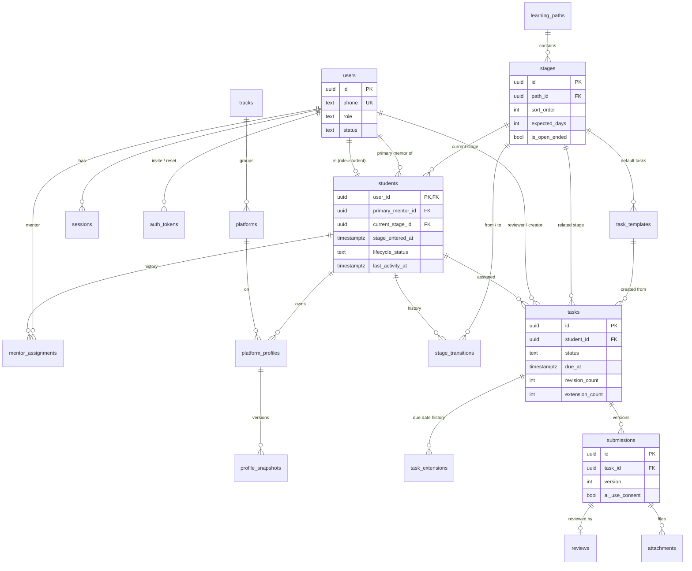
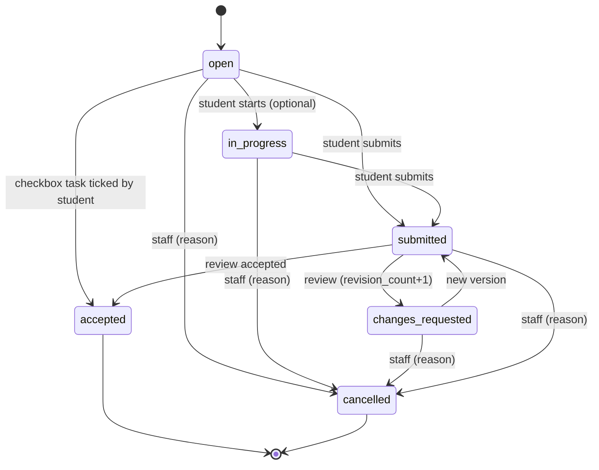

# Data Model — UpworkCoach v0.1

> Phase 3 — 27 Mehr 1405 (2026-10-19) — author: software-architect — status: draft for the founder's gate
> Sources: `02-product/prd.md` (F1 to F11, section 6), `02-product/learning/progress-tracking.md` (case file, tasks, health), `learning-path.md`, `mentor-workflow.md`.
> Related decisions: ADR-0003 (authentication), ADR-0004 (access control), ADR-0005 (health), ADR-0008 (time and Persian text).
> **Payments are not in this model** (decision D7). Their place is described in `overview.md` section 8.
> **Update 30 Mehr 1405 (2026-10-22): aligned with the code of sprints 1 to 4** (migrations `apps/web/drizzle/0001` to `0004`). The tables and columns that were built match this document; differences and new decisions are marked "(aligned with code, sprint N)". Remaining code work is in `docs/05-delivery/followups.md`.

---

## 0. General conventions (for all tables)

| Rule | Details |
|---|---|
| Primary key | `id uuid`, **UUIDv7** generated by the application (time-ordered; better index locality). Exceptions are noted in the tables |
| Time | All instants are `timestamptz` in **UTC**. Dates without a time of day (such as `occurred_on` and `week_start`) use the `date` type and **are interpreted in the Tehran calendar** (ADR-0008) |
| `created_at` / `updated_at` | On all mutable tables; `updated_at` is maintained by the application |
| Enumerated values (enum) | `text` + `CHECK (col IN (…))`, not a Postgres enum type (simpler migrations). The values share a single `const` in code |
| Deletion | Soft delete (`deleted_at`) only where stated (notes, profiles). Everything else is either never deleted or has a "cancelled/inactive" status |
| Names | Tables are plural and snake_case; columns are snake_case; mapped to camelCase in TypeScript |
| Amounts | `numeric(12,2)` + `currency char(3)` (default `USD`) |
| Persian text | Normalized before storage (ADR-0008) |
| Configuration instead of code | Stages, platforms, tracks, milestone types, task templates and thresholds are **data**. Special behavior comes only from flags (`is_open_ended`, `counts_for_north_star`), not from names |

**Postgres extensions:** `pg_trgm` (search), `citext` (not needed, but allowed). No provider-specific extension is used.
(Aligned with code, sprint 2; architecture decision) `0002_students_path.sql` starts with `CREATE EXTENSION IF NOT EXISTS pg_trgm` and **stays there** so that the local environment, CI and the Iranian host all work without a manual step. On Azure Flexible Server, before the first `db:migrate`, `azure.extensions` must include `PG_TRGM` and the migrate role must be a member of `azure_pg_admin` (followup F-10, devops-engineer). If a host does not allow the migrate role to create extensions, the runbook creates the extension once with an admin role, and `IF NOT EXISTS` lets the migration pass without error.

**seed (aligned with code, sprints 2 to 4):** `src/modules/catalog/seed.ts` with fixed IDs and `ON CONFLICT DO NOTHING` (running it again adds or overwrites nothing). It runs with `pnpm db:migrate` (after migration) or `pnpm db:seed`, not inside `runMigrations`. Contents: 3 tracks, 8 platforms, the default path and 9 stages, 16 task templates, 5 milestone types, the standard "red lines" response, and `settings.checkin`.

---

## 1. ERD

### 1-1. Core: user, student, path, task



### 1-2. Interaction, follow-up and health


Standalone tables (no significant relationships): `settings`, `canned_responses`, `auth_throttle`, `audit_log`.

---

## 2. Tables and fields

The "Required" column means `NOT NULL`. "Def." = default value.

### 2-1. Identity and authentication (`identity` module)

#### `users`
| Field | Type | Required | Description |
|---|---|---|---|
| id | uuid | ✓ | — |
| phone | text, **unique** | ✓ | E.164 format (`+989121234567`). Input with Persian digits, `0912…` or `+98…` is normalized. (Aligned with code, sprint 1) In 0.1 the application layer (`lib/phone`) accepts **Iranian mobile numbers only** (`+989` + 9 digits); the database CHECK intentionally also accepts international numbers so they can be opened up later without a migration. CHECK: `phone ~ '^\+[0-9]{10,15}$' OR erased_at IS NOT NULL` (security C5: after account erasure the value becomes `erased:<id>`, which stays unique and never equals any normalized input) |
| display_name | text | ✓ | First and last name |
| role | text | ✓ | `admin` \| `mentor` \| `student`. Each user has **one** role. An admin can also be a student's primary mentor |
| status | text | ✓ | `invited` (no password) \| `active` \| `disabled` |
| password_hash | text | — | argon2id in PHC format; empty until the invite is accepted. (Security C2) The hash input is the **normalized** password from `normalizePassword` (NFKC, Persian and Arabic digits to Latin, `ي`/`ى`→`ی`, `ك`→`ک`; no trim). ADR-0003 section 3 |
| password_changed_at | timestamptz | — | Sessions older than this time are invalidated |
| last_login_at | timestamptz | — | — |
| last_seen_at | timestamptz | — | Updated at most once every 15 minutes (for R-INACT) |
| created_by | uuid FK users | — | — |
| erased_at | timestamptz | — | (Security C5) Time the account erasure (anonymization) was executed. When set, it means `status = 'disabled'` and the personal data has been wiped. Section 6 and ADR-0010 |
| invite_accepted_at | timestamptz | — | **(Architecture decision, answer to the open question of sprint 1; not yet in code: followup F-01)** Time the **invite** was accepted (not a reset). Written in the same transaction that consumes the token. Source of `inviteAcceptedAt` in `GET /users` and the case file (SEC-T5), because `auth_tokens` rows are deleted 7 days after use (section 6-1) |
| invite_accepted_user_agent | text | — | **(Same decision; F-01)** User-Agent at invite acceptance, at most 512 characters; source of `inviteAcceptedDevice`. On account erasure ← `null` |
| created_at, updated_at | timestamptz | ✓ | — |

#### `auth_tokens` (invite and password reset)
| Field | Type | Required | Description |
|---|---|---|---|
| id | uuid | ✓ | — |
| user_id | uuid FK users | ✓ | A user with `status=invited` is created before the invite is created |
| purpose | text | ✓ | `invite` \| `password_reset` |
| token_hash | text, unique | ✓ | SHA-256 of a random 32-byte token. **The token itself is not stored** |
| expires_at | timestamptz | ✓ | Invite: 7 days (F1). Reset: 24 hours. CLI link (`admin:bootstrap`, `admin:reset-link`): 1 hour (security C1, SEC-T6/T7) |
| used_at, revoked_at | timestamptz | — | Single use |
| phone_mismatch_count | smallint, def. 0 | ✓ | (Security C1) Number of acceptance attempts with a wrong mobile number. On reaching 5 ← `revoked_at = now()` and `audit_log(auth.token_revoked_mismatch)` |
| used_user_agent | text | — | (Security C1, SEC-T5) User-Agent at acceptance. (Aligned with code, sprint 1) Because the row is deleted 7 days after use, the persistent "invite accepted" display is read from `users.invite_accepted_*` (F-01) |
| created_by | uuid FK users | — | null only for CLI links |
| created_at | timestamptz | ✓ | — |

Index: `(user_id, purpose) WHERE used_at IS NULL AND revoked_at IS NULL`. Creating a new token revokes the same user's earlier open tokens of the same purpose.
(Aligned with code, sprint 1) `password_reset` is created only for an `active` user (`invited`/`disabled` ← `409`). The `admin:reset-link` CLI creates a one-hour **`invite`** token for an `invited` user so that the first admin whose setup link has expired is not locked out.
(Security C1) **The token itself never appears in the URL path**: the links are `…/invite#t=<token>` and `…/reset#t=<token>`, and the token reaches the server only in the body of `POST /auth/tokens/lookup` and `/accept` (ADR-0003 sections 1–2).

#### `sessions`
| Field | Type | Required | Description |
|---|---|---|---|
| id | uuid | ✓ | — |
| user_id | uuid FK users | ✓ | — |
| token_hash | text, unique | ✓ | SHA-256 of the cookie token |
| created_at | timestamptz | ✓ | — |
| expires_at | timestamptz | ✓ | (Security C2) Based on role at creation time: **student** sliding 30 days from last use with an absolute cap of 90 days from `created_at`; **admin and mentor** sliding 7 days with an absolute cap of 30 days. A role change invalidates all sessions. (Aligned with code, sprint 1) This column is the **sliding expiry** and is extended on every API and RSC request, at most once every 15 minutes; the cookie's `Max-Age` equals the absolute cap (ADR-0003 section 9) |
| last_used_at | timestamptz | ✓ | — |
| ip, user_agent | text | — | For the "my devices" list. `ip` only from `getClientIp(req)` (ADR-0003 section 4) |
| revoked_at | timestamptz | — | — |

#### `auth_throttle` (security C2)
| Field | Type | Description |
|---|---|---|
| key | text PK | One of the formats in the table below. The mobile number is always **after** E.164 normalization, and the IP **only** from `getClientIp(req)` (IPv6 with a `/64` prefix) |
| failures | int | — |
| window_started_at | timestamptz | Start of the window (window length depends on the key type) |
| locked_until | timestamptz | — |

| Key format | Threshold | Lock | Note |
|---|---|---|---|
| `login:pi:<phone>:<ip>` | 5 failures / 15 minutes | 15 minutes | Cleared on successful login |
| `login:p:<phone>` | 20 failures / 1 hour | 1 hour | A request carrying the same user's valid device cookie (`__Host-uc_dev`) **bypasses** this lock. Cleared when a reset link is accepted and by the `admin:reset-link` CLI |
| `login:ip:<ip>` | 30 failures / 15 minutes | 15 minutes | — |
| `token:ip:<ip>` | 30 failed requests / 15 minutes | 15 minutes | `POST /auth/tokens/lookup` and `/accept` |
| `pwchange:u:<userId>` | 5 failures / 15 minutes | 15 minutes | Wrong current password in `change-password` |

Counting uses `INSERT … ON CONFLICT (key) DO UPDATE` in a single transaction (atomic across multiple instances). The exact same counting is also done for **nonexistent** mobile numbers (SEC-R6). Stale rows are removed by `auth.cleanup`.

#### `audit_log`
Security and administrative events: role change, deactivation, creation of a reset link, settings change, CSV export, bulk import, mentor change.

| Field | Type | Description |
|---|---|---|
| id | uuid | — |
| actor_id | uuid FK users | null means the system |
| action | text | For example `user.role_changed`, `settings.updated`, `export.students` |
| target_type, target_id | text, uuid | — |
| data | jsonb | Before and after (without passwords, tokens, or invite and reset links) |
| ip | text | From `getClientIp(req)`. (Security C5) Becomes `null` after 90 days |
| created_at | timestamptz | (Security C5) Rows are kept for 24 months. Section 6 |

### 2-2. Catalogs and settings (`catalog` module)

#### `tracks` (path track: bidding / catalog / direct)
| Field | Type | Description |
|---|---|---|
| id | uuid | — |
| code | text unique | `B`, `C`, `D` (a label, not logic) |
| name | text | "Bidding", … |
| sort_order, is_active | int, bool | — |

#### `platforms`
| Field | Type | Description |
|---|---|---|
| id | uuid | — |
| name | text unique | Upwork, Fiverr, Contra, LinkedIn, Freelancer, Behance/Dribbble, direct client, other (seed) |
| track_id | uuid FK tracks | Optional |
| sort_order, is_active | int, bool | Inactive means it does not appear in new forms but existing data stays |

#### `learning_paths` and `stages`
In 0.1 we have only one default path. The path table is for the future (for example, a separate path for the catalog track) and costs nothing.

`learning_paths`: `id`, `name`, `is_default bool`, `created_at`.

`stages`:
| Field | Type | Required | Description |
|---|---|---|---|
| id | uuid | ✓ | — |
| path_id | uuid FK | ✓ | — |
| display_code | text | ✓ | Display label such as "5". **Code does not depend on it** |
| name | text | ✓ | "Proposals and active sending" |
| sort_order | int | ✓ | Order in the path and the Kanban columns |
| expected_days | int | — | Typical duration (basis of R-STALL). Empty = no R-STALL |
| is_open_ended | bool, def. false | ✓ | Open-ended stage (such as "Growth"): R-STALL and R-NOTASK are not run for it. **Replaces the condition "except stage 8"** |
| student_description | text | — | What the student sees in "My path" |
| content_links | jsonb | — | `[{title, url}]` links to external learning content (assumption A5) |
| is_active | bool | ✓ | Deactivation only when no **`active`** student is in it (aligned with code, sprint 2: `paused`/`graduated`/`dropped` do not block) and only through `POST /stages/:id/deactivate` |
| created_at, updated_at | timestamptz | ✓ | — |

**Concurrency of deactivation and stage change (architecture decision, answer to the open question of sprint 2):** no extra row lock is added. If two concurrent transactions (deactivating X and moving a student to X) both succeed, the result is "an active student in an inactive stage", which the system already displays correctly (`stage.isActive = false` in the DTOs, a Kanban column for an inactive stage that has students) and which the admin fixes by reactivating or changing the stage. With one admin and about 80 students the likelihood is negligible and a lock would be useless complexity. If 1.0 has multiple admins, add `SELECT … FOR UPDATE` on the stage row in both paths.

Seed from `learning-path.md` section 3 (9 stages with `expected_days` = upper bound of the range: 4, 10, 10, 14, 5, 42, empty, empty, empty + `is_open_ended` for "Growth"). The founder corrects the numbers in settings.

#### `task_templates` (Should)
| Field | Type | Description |
|---|---|---|
| id | uuid | — |
| stage_id | uuid FK stages | Empty = general template |
| title, description | text | — |
| kind | text | Same as `tasks.kind` |
| submission_type | text | Same as `tasks.submission_type` |
| default_due_days | int | Default deadline from creation time |
| required_for_gate | bool | — |
| suggest_on_stage_entry | bool | Suggest when the student enters the stage (F3 Should). **A task is not created automatically; it is only suggested** |
| sort_order, is_active | — | — |

Seed from `progress-tracking.md` section 4-3.

#### `milestone_types`
| Field | Type | Description |
|---|---|---|
| id | uuid | — |
| name | text | "First contract or paid order", … |
| counts_for_north_star | bool | Only one type is `true` in the seed. **The North Star dashboard reads this flag, not the name** |
| unique_per_student | bool | The "First …" types are `true`; each student has at most one approved |
| requires_evidence | bool | A student proposal without evidence is not accepted |
| sort_order, is_active | — | — |

Seed: profile ready, first apply, first reply/interview, **first contract or paid order** (`counts_for_north_star`), first income above 500 dollars (F9).

#### `canned_responses` (standard texts, F8 and F11)
`id`, `title`, `body`, `category` (`red_line` \| `general`), `is_active`, `created_by`, `updated_at`. The standard "red lines" response (buying accounts, etc.) is in the seed.

#### `settings`
| Field | Type | Description |
|---|---|---|
| key | text PK | — |
| value | jsonb | Validated with the zod schema of that key |
| version | int | +1 on every change. Health stores the settings version next to its result |
| updated_by, updated_at | — | Every change is also recorded in `audit_log` |

0.1 keys and defaults:

| key | Default | Source |
|---|---|---|
| `health.rules` | Section 4-2 of this document | PRD F7 |
| `sla` | `{ questionHours: 24, urgentQuestionHours: 4, reviewHours: 48, reviewHoursNonGate: 72, redNoActionHours: 48, redEscalateDays: 7, clock: "business" }` | PRD F7, `mentor-workflow.md` section 4. **(Architecture decision, answer to the open questions of sprints 3 and 4)** `reviewHours` is the review threshold for **gate** tasks (`required_for_gate = true`) and the new key `reviewHoursNonGate` (default 72) is for all other tasks. The current code measures everything against `reviewHours` (followup F-09). A stored value without the new key is filled with the default 72 (no data migration) |
| `business_hours` | `{ timezone: "Asia/Tehran", week: { sat:[9,21], sun:[9,21], mon:[9,21], tue:[9,21], wed:[9,21], thu:[9,14], fri:null }, holidays: [] }` | `mentor-workflow.md` section 4 (assumption, awaiting the founder) |
| `access` | `{ mentorScope: "assigned", mentorsCanInviteStudents: true }` | PRD section 5 and assumption A8 |
| `questions` | `{ expectedResponseText: "معمولاً تا ۲۴ ساعت" }` ("usually within 24 hours") | F8 |
| `checkin` | `{ enabled: true, weekday: "thu" }` (aligned with code, sprint 4: decision E5 = on; the row is stored in the seed) | Should; when on, R-CHECKIN and R-MOOD are active |
| `tasks` | `{ defaultDueDays: 3 }` | `progress-tracking.md` 4-1 |

(Aligned with code, sprints 1 and 4) A missing row = the default value with `version = 0`. `GET /settings` returns all keys with `value` and `version`; `PUT /settings` saves several keys in a single transaction. Changing `health.rules` or `checkin` ← an immediate health sweep. The text `questions.expectedResponseText` is normalized when saved (ADR-0008; tanwin is removed).

### 2-3. Student and case file (`students` module)

#### `students`
One row per user with the `student` role. The primary key is the same `user_id` (a 1:1 relationship).

| Field | Type | Required | Filled by | Description |
|---|---|---|---|---|
| user_id | uuid PK FK users | ✓ | system | — |
| primary_mentor_id | uuid FK users | — | mentor | Primary mentor (role mentor or admin). Empty = unassigned (only the admin sees it). **The source of truth for mentor access in 0.1** (ADR-0004) |
| lifecycle_status | text, def. `active` | ✓ | mentor | `active` \| `paused` \| `graduated` \| `dropped` |
| paused_until | date | — | mentor | Only for `paused`; must be **after** today in Tehran (aligned with code, sprint 2). One day before it, a system reminder is created, which is cancelled if the student leaves the pause early (sprint 3) |
| status_reason | text | — | mentor | — |
| current_stage_id | uuid FK stages | ✓ | mentor | Kanban column |
| stage_entered_at | timestamptz | ✓ | system | Basis of R-STALL and "days in stage" |
| track_id | uuid FK tracks | — | mentor | Main track |
| primary_platform_id | uuid FK platforms | — | mentor/student | — |
| level | text | — | mentor | `beginner` \| `applying` \| `active` \| `advanced` (PRD section 6) |
| cohort | text | — | mentor | Cohort or intake |
| tags | text[], def. `{}` | ✓ | mentor | Free-form tags |
| messenger_handle | text | — | student | Telegram or messenger ID |
| primary_skill | text | — | student | — |
| skill_level, english_writing, english_speaking | smallint (1 to 5) | — | student | CHECK between 1 and 5 |
| hours_per_week | smallint | — | student | — |
| income_goal_usd | int | — | student | — |
| goal_90d | text | — | student | — |
| prior_experience | text | — | student | `none` \| `applied_no_result` \| `few_contracts` \| `active` |
| self_reported_blocker | text | — | student | — |
| niche_statement | text | — | mentor/student | Niche sentence (output of stage 1) |
| joined_at | timestamptz | ✓ | system | Time the case file was created (admin-editable for migration) |
| last_activity_at | timestamptz | — | system | Last login, submission, question message, check-in, or student milestone proposal. **Basis of R-INACT** |
| search_text | text | ✓ | system | Normalized name, mobile number, messenger ID and tags (ADR-0008). (Architecture decision, answer to the open question of sprint 2) Every change to the student's `users.display_name` or `users.phone` (in `PATCH /users/:id`, not yet built: F-02) must rebuild this column with `buildSearchText` in the **same transaction** |
| created_at, updated_at | timestamptz | ✓ | system | — |

Indexes: `(primary_mentor_id, lifecycle_status)`, `(current_stage_id)`, `GIN (tags)`, `GIN (search_text gin_trgm_ops)`.

**Fields the student edits themselves** (PRD section 5): `messenger_handle`, `primary_skill`, `skill_level`, `english_*`, `hours_per_week`, `income_goal_usd`, `goal_90d`, `prior_experience`, `self_reported_blocker`, `primary_platform_id`. The rest only by the admin or mentor.

#### `mentor_assignments` (assignment history)
| Field | Type | Description |
|---|---|---|
| id | uuid | — |
| student_id | uuid FK students | — |
| mentor_id | uuid FK users | — |
| role | text, def. `primary` | In 0.1 only `primary`. In the future `secondary` or `backup` (the backup mentor in `mentor-workflow.md`) without a structural change |
| started_at, ended_at | timestamptz | The active row has `ended_at IS NULL` |
| assigned_by | uuid FK users | — |
| reason | text | — |

Partial unique: `(student_id) WHERE role='primary' AND ended_at IS NULL`.
**Invariant:** `students.primary_mentor_id` always equals the active `primary` row. Both change only in `students.service.assignMentor()` and in a single transaction.
(Aligned with code, sprints 2 to 4) The admin can create a student without a mentor or pass `mentorId: null` (the active row is closed and no new row is created). On a mentor change, the previous mentor's open reminders and open questions about this student are moved, in the same transaction, to the new mentor, or, if the new one is `null`, to the **acting admin**.

#### `platform_profiles` (storefronts: "what profile do they have?")
| Field | Type | Required | Description |
|---|---|---|---|
| id | uuid | ✓ | — |
| student_id | uuid FK | ✓ | — |
| platform_id | uuid FK platforms | ✓ | — |
| kind | text | ✓ | `profile` \| `gig` \| `linkedin` \| `portfolio_page` \| `other` |
| public_url | text | — | Only stored. **The system never opens or fetches it** (no scraping). Validation: `https://` only |
| headline | text | — | Current headline |
| rate_amount, rate_currency, rate_unit | numeric, char(3), text | — | `rate_unit`: `hour` \| `fixed` \| `package` \| `month` |
| status | text, def. `building` | ✓ | `building` \| `active` \| `restricted` \| `suspended` |
| niche | text | — | Niche of this profile |
| notes | text | — | **Visible to the student.** The internal note belongs in `notes` |
| is_primary | bool | ✓ | Main storefront in the case file header; at most one per student (partial unique) |
| mentor_approved_at, mentor_approved_by | — | — | Storefront approval |
| created_by, created_at, updated_at, deleted_at | — | — | Soft delete |

**Security rule:** this table has no field for a platform account's password, login email, or cookie, and never will.

#### `profile_snapshots`
Full-text versions of the storefront (to compare progress). Created when a `profile_review` task is submitted, or manually.

`id`, `profile_id` FK, `headline`, `body_text`, `rate_text`, `source_submission_id` FK submissions (optional), `created_by`, `created_at`. (Aligned with code, sprint 3) The `source_submission_id` FK was added in `0003`.

### 2-4. Path and stage (`path` module)

#### `stage_transitions` (stage history)
| Field | Type | Required | Description |
|---|---|---|---|
| id | uuid | ✓ | — |
| student_id | uuid FK | ✓ | — |
| from_stage_id | uuid FK stages | — | Empty for `initial` |
| to_stage_id | uuid FK stages | ✓ | — |
| kind | text | ✓ | `initial` \| `advance` (passing with gate approval) \| `skip_by_assessment` (skip at level assessment or migration) \| `advance_with_exception` (passing with an exception) \| `regress` (going back) |
| note | text | — | **Required** for `advance_with_exception` and `regress` (CHECK) |
| actor_id | uuid FK users | ✓ | — |
| created_at | timestamptz | ✓ | — |

**The status of each stage** (`locked`, `in_progress`, `passed`, `passed_by_assessment`, `passed_with_exception` in `progress-tracking.md` 3-1) **is not stored**. It is computed from this table and `sort_order`:
- The current stage ← `in_progress`.
- Stages whose last exit transition was `advance` ← `passed`; `skip_by_assessment` ← `passed_by_assessment`; `advance_with_exception` ← `passed_with_exception`.
- Stages after the current one ← `locked`.
- `awaiting_review` (all mandatory tasks submitted) is also computed: all `tasks` with `required_for_gate` and `stage_id` = the current stage are in `submitted` or `accepted`.

**Deliberate 0.1 limitation:** each student has **one** current stage. The concurrency of stages 2 and 3 (`learning-path.md`) is covered by tasks whose `stage_id` is stage 3, but the Kanban column is a single one. If needed, a `student_stage_progress` table will be added in 1.0. `stage_transitions` does not change.

Stage change (in a single transaction): insert `stage_transitions` ← update `students.current_stage_id` and `stage_entered_at = now()` ← `timeline_events(stage.changed)` ← recompute health after commit ← return the suggested templates of the new stage (F3 Should).

(Aligned with code, sprint 2) **The transition direction matches its kind:** `regress` only to a stage with a lower `sort_order`; `advance`, `skip_by_assessment` and `advance_with_exception` only forward (skipping allowed). The same stage or a wrong direction ← `409 INVALID_TRANSITION`; an inactive destination ← `422`. Database CHECK: `note` is required for `regress` and `advance_with_exception`, and only `initial` has no origin.
(Aligned with code, sprint 4) The same transaction can create the tasks of the `createTemplateIds` templates and cancel the `cancelTaskIds` tasks (`api.md` section 5); any error rolls back the whole transaction.
**"Days in stage"** (`daysInStage`, aligned with code, sprint 2) = complete 24-hour days since `stage_entered_at`. `overExpected` (Kanban and list): more than `expected_days` ← `warn`, more than 2 times ← `over`; an open-ended stage or one without a duration ← `none`. (The health R-STALL threshold is separate: 1.5 and 2 times.)

### 2-5. Tasks, submission, review and extension (`tasks` module)

#### `tasks`
| Field | Type | Required | Description |
|---|---|---|---|
| id | uuid | ✓ | — |
| student_id | uuid FK | ✓ | — |
| title | text | ✓ | Action-oriented |
| description | text | — | Includes the acceptance criterion |
| kind | text | ✓ | `path_assignment` \| `custom` \| `follow_up` \| `session_prep` |
| submission_type | text | ✓ | `text` \| `link` \| `file` \| `checkbox` \| `proposal_review` \| `profile_review` |
| stage_id | uuid FK stages | — | Related stage |
| required_for_gate | bool, def. false | ✓ | — |
| priority | text, def. `normal` | ✓ | `normal` \| `urgent` |
| status | text, def. `open` | ✓ | Section 3-1 |
| due_at | timestamptz | ✓ | The user picks a **Jalali date**; stored = end of that day in Tehran time (23:59:59 Asia/Tehran converted to UTC) |
| original_due_at | timestamptz | ✓ | Initial deadline |
| reviewer_id | uuid FK users | ✓ | Default: the student's primary mentor at creation time |
| created_by | uuid FK users | ✓ | — |
| template_id | uuid FK task_templates | — | — |
| batch_id | uuid | — | Tasks created by a single bulk assignment (F4 Should) |
| profile_id | uuid FK platform_profiles | — | For `profile_review` |
| revision_count | int, def. 0 | ✓ | Number of `changes_requested` reviews (basis of R-LOOP) |
| extension_count | int, def. 0 | ✓ | Number of extensions (basis of R-EXTEND) |
| status_changed_at | timestamptz | ✓ | — |
| last_submitted_at | timestamptz | — | Basis of the review SLA |
| closed_at | timestamptz | — | Time of `accepted` or `cancelled` (basis of R-NOTASK) |
| cancel_reason | text | — | Required for `cancelled` |
| created_at, updated_at | timestamptz | ✓ | — |

Indexes: `(student_id, status)`; `(reviewer_id, last_submitted_at) WHERE status='submitted'`; `(due_at) WHERE status IN ('open','in_progress','changes_requested')`.

**"Overdue" is not a column:** `status IN ('open','in_progress','changes_requested') AND due_at < now()`. (Aligned with code, sprint 3) `overdueDays` = Tehran calendar days after the deadline, minimum 1.
**Creation defaults (aligned with code, sprint 3):** `kind = custom` and `submission_type = text` unless from a template; without a template `title` is required; the deadline comes from the template's days or `settings.tasks.defaultDueDays`; a deadline in the past ← `422`; `reviewer_id` = the active primary mentor, otherwise the creator.
**"Next-version deadline" (aligned with code, sprint 4):** a `changes_requested` review can change `due_at` with `nextDueDate`. This is **not an extension**: no `task_extensions` row is created, `extension_count` and `original_due_at` are untouched, and the trace remains in `timeline_events(review.created).data` with `previousDueAt` and `nextDueAt`. The reasoning is in ADR-0005, section "Alignment with the implementation".
**"Open" for R-NOTASK:** `status NOT IN ('accepted','cancelled')` (that is, `submitted` also counts as open, because the task is not finished yet).

#### `task_extensions`
`id`, `task_id` FK, `previous_due_at`, `new_due_at`, `reason` (required), `actor_id`, `created_at`. Every insert means `tasks.extension_count += 1` and `tasks.due_at = new_due_at` in the same transaction. (Aligned with code, sprint 3) Only through `POST /tasks/:id/extend`, only in a non-final status, and only to a time after the current deadline. The review's `nextDueDate` is **not** recorded here (sprint 4).

#### `submissions` (submission versions)
| Field | Type | Required | Description |
|---|---|---|---|
| id | uuid | ✓ | — |
| task_id | uuid FK | ✓ | — |
| version | int | ✓ | 1, 2, …; unique `(task_id, version)` |
| body_text | text | — | — |
| links | jsonb, def. `[]` | ✓ | `[{url, label}]`; `https://` only |
| platform_id | uuid FK platforms | — | Required for `proposal_review` |
| job_post_text | text | — | Job post text (English) — required for `proposal_review` |
| proposal_text | text | — | Proposal text (English) — required for `proposal_review` |
| profile_text | text | — | For `profile_review` |
| ai_use_consent | bool, def. false | ✓ | Consent checkbox for anonymous use in improving the tools (D6). Default **off** |
| ai_use_consent_at | timestamptz | — | — |
| submitted_by | uuid FK users | ✓ | — |
| created_at | timestamptz | ✓ | — |

Submissions are **not edited**. A correction means a new version.

#### `reviews` (review and feedback)
| Field | Type | Required | Description |
|---|---|---|---|
| id | uuid | ✓ | — |
| submission_id | uuid FK, **unique** | ✓ | Each version has at most one review |
| reviewer_id | uuid FK users | ✓ | — |
| outcome | text | ✓ | `accepted` \| `changes_requested` |
| feedback_text | text | ✓ | Persian, following the template in `mentor-workflow.md` section 6 |
| score | smallint | — | 1 to 5 (optional) |
| created_at, updated_at | timestamptz | ✓ | The reviewer can correct the text for up to 24 hours; `outcome` cannot be changed. (Aligned with code, sprint 3) The 24-hour window also applies to the admin; **any staff member in scope** can record a review, and the review's `reviewer_id` = that actor (not necessarily `tasks.reviewer_id`) |

**AI evaluation dataset (G4):** `submissions` with `tasks.submission_type='proposal_review' AND ai_use_consent` together with `reviews`. This pair is "input + coach's critique". In 1.0 its output will be a view named `ai_eval_proposals`. In 0.1 only its count is shown on the admin dashboard.

#### `attachments`
| Field | Type | Description |
|---|---|---|
| id | uuid | — |
| storage_key | text | Key in `FileStorage`: a **random UUID** (not the row ID, not the user's file name) (SEC-U8) |
| original_name | text | For display only; sanitized: no path, no control or direction-control characters, at most 200 characters (SEC-U8, SEC-X5) |
| mime_type, size_bytes, width, height | — | From the **re-encoded output**, not from user input. Only `image/jpeg`, `image/png`, `image/webp` |
| uploaded_by | uuid FK users | — |
| status | text | `pending` (uploaded and not yet linked) \| `linked` |
| submission_id, question_message_id, milestone_id | uuid FK | **Exactly one** is set after linking (CHECK: `status='pending'` ⇔ all three empty). (Aligned with code, sprints 3 and 4) The FKs `question_message_id` and `milestone_id` were added in `0004`; the open question of sprint 3 is closed |
| created_at | timestamptz | — |

Index: `(uploaded_by, status)`, `(uploaded_by, created_at)`.

The `files.cleanup` job removes `pending` rows older than 24 hours. **Access to a file = access to its parent** (ADR-0004); before linking, only the uploader.

**Attachment rules (security C4):**
1. **Processing at upload** (`files.service.upload`, in this order):
   1. Size cap **before** the body is buffered: `Content-Length` above `MAX_UPLOAD_BYTES` (5 MB) + 64 KB ← immediate `413`; the body stream is read with a byte counter and cut off after the cap. `request.formData()` is not called on an unbounded body (SEC-U4).
   2. **Quota** (SEC-U7): if the user has 20 `pending` attachments, or has created 100 in the last 24 hours (`count(*) WHERE uploaded_by = $1 AND created_at > now() - interval '24 hours'`) ← `429 TOO_MANY_ATTEMPTS`.
   3. Type from the **content**: `sharp(buf, { limitInputPixels: 40_000_000, failOn: 'error', animated: false }).metadata().format` must be `jpeg`, `png` or `webp`; otherwise `415` (SVG, GIF, HEIC and PDF are rejected in 0.1) (SEC-U1). An image larger than 40 megapixels ← `422` (SEC-U2).
   4. `.rotate()` (apply EXIF orientation) ← `resize({ width: 4096, height: 4096, fit: 'inside', withoutEnlargement: true })` ← re-encode to the same format **without** `withMetadata()` (EXIF, GPS, ICC and XMP are stripped). **The original file is never stored** (SEC-U5).
   5. Image processing concurrency is at most 2 per instance (`sharp.concurrency(1)` + a simple queue) (SEC-U3).
2. **Linking to the parent** (submission, question message, milestone) only through one atomic `UPDATE`, **inside the same transaction** that creates the parent:
   ```sql
   UPDATE attachments
      SET status = 'linked', <parent>_id = $parentId
    WHERE id = ANY($ids) AND status = 'pending' AND uploaded_by = $actorId
   RETURNING id;
   ```
   If the number of returned rows does not equal the number of `ids` (after removing duplicates) ← the whole transaction rolls back and `422 VALIDATION_FAILED` with `fields.attachmentIds`. So another user's attachment, an already-linked attachment and a nonexistent ID all produce the same error. At most 10 attachments per request. A linked attachment is never moved to another parent.
3. **Download** (`GET /attachments/:id`) and its headers are in `api.md` section 14.

### 2-6. Notes and timeline (`timeline` module)

#### `notes` (interaction: note, session, call, external message)
| Field | Type | Required | Description |
|---|---|---|---|
| id | uuid | ✓ | — |
| student_id | uuid FK | ✓ | — |
| author_id | uuid FK users | ✓ | admin or mentor only |
| kind | text, def. `note` | ✓ | `note` \| `session` \| `call` \| `external_message` \| `weekly_review` |
| visibility | text, def. **`internal`** | ✓ | `internal` \| `shared` |
| body | text | ✓ | — |
| tags | text[] | ✓ | motivation, skill, language, financial, … |
| occurred_at | timestamptz | ✓ | Default now; changeable to record yesterday's session |
| created_at, updated_at, deleted_at | timestamptz | — | Edit and delete: author or admin only |

**Security invariant:** no student-side query reads the `notes` table without `visibility = 'shared' AND deleted_at IS NULL`. This condition lives inside **one** repository function (`listSharedNotesForStudent`) and no other function exists for students (ADR-0004).

#### `timeline_events` (automatic events)
| Field | Type | Required | Description |
|---|---|---|---|
| id | uuid | ✓ | — |
| student_id | uuid FK | ✓ | — |
| type | text | ✓ | List below |
| actor_id | uuid FK users | — | Empty = system |
| subject_type, subject_id | text, uuid | — | For example `task` and the task ID |
| data | jsonb | ✓ | For example `{ "from": "...", "to": "...", "rule": "R-OVERDUE" }` |
| occurred_at | timestamptz | ✓ | — |

Index: `(student_id, occurred_at DESC)`.

Event types in 0.1: `student.created`, `student.updated` (`data.fields`), `student.lifecycle_changed`, `mentor.changed`, `invite.accepted`, `stage.changed`, `profile.added`, `profile.updated`, `profile.removed`, `profile.approved`, `task.created`, `task.status_changed`, `task.due_extended`, `submission.created`, `review.created`, `question.created`, `question.answered`, `question.closed`, `checkin.submitted`, `milestone.proposed`, `milestone.approved`, `milestone.rejected`, `flag.added`, `flag.cleared`, `health.changed`, `health.snoozed`.

(Aligned with code, sprints 3 and 4) Rules for `data`:
- The same rule as `audit_log`: keys such as `token`, `url`, `link`, `password` are rejected (an application error, not stored). IDs are stored raw and the API provides the names in `refs`.
- `task.created` carries the task title; `stage.changed`: `{ from, to, kind }`; `task.status_changed`: `{ from, to }`; `review.created`: `{ taskId, version, outcome, score, previousDueAt?, nextDueAt? }`; `profile.added/updated/approved/removed`: `{ platformId, platformName, kind }` (+ `fields` for `updated`; events from before sprint 4 do not have these keys).
- Each student's first health computation does not create a `health.changed` event (section 4-2).

**The case file timeline** = `UNION ALL` of `timeline_events` and `notes` (not deleted), ordered by `occurred_at`, with a type filter (F5). Notes are **not copied** into `timeline_events`, so visibility has a single source.

**In 0.1 the student does not see a timeline.** The student home is built directly from `tasks`, `question_threads` and `listSharedNotesForStudent`. (`timeline_events` has no visibility column because it has no student-side consumer in 0.1. If a student timeline is built in 1.0, a whitelist of types will be defined in code.)

### 2-7. Reminders (`reminders` module)

#### `reminders`
| Field | Type | Required | Description |
|---|---|---|---|
| id | uuid | ✓ | — |
| owner_id | uuid FK users | ✓ | The person who sees the reminder in "Today" (admin or mentor) |
| student_id | uuid FK | — | Which student it is about |
| text | text | ✓ | "Follow up on Fiverr profile" |
| due_at | timestamptz | ✓ | Date (and optional time; default 9 am Tehran) |
| status | text, def. `open` | ✓ | `open` \| `done` \| `cancelled` |
| done_at | timestamptz | — | — |
| snooze_count | int, def. 0 | ✓ | Snooze of 1, 3 or 7 days = new `due_at` + counter increment |
| source | text, def. `manual` | ✓ | `manual` \| `system` |
| system_key | text, unique | — | For system reminders, so duplicates are not created. For example `pause-return:<studentId>:<date>` |
| created_by | uuid FK users | ✓ | — |
| created_at, updated_at | timestamptz | ✓ | — |

Index: `(owner_id, status, due_at)`.
"Today" = `status='open' AND due_at < end of today in Tehran time` (including past ones). **No job is needed.**
(Aligned with code, sprint 3) Snooze is computed from the later of "now" and the current `due_at`; a repeated "done" has no effect. For the admin, `GET /reminders` without `ownerId` returns only their own, but the admin's "Today" without a mentor filter shows everyone's reminders.

### 2-8. Questions and answers (`questions` module)

#### `question_threads`
| Field | Type | Required | Description |
|---|---|---|---|
| id | uuid | ✓ | — |
| student_id | uuid FK | ✓ | The asker |
| subject | text | ✓ | — |
| status | text, def. `open` | ✓ | `open` \| `answered` \| `closed` |
| awaiting | text, def. `team` | ✓ | `team` \| `student` \| `none`; "whose court the ball is in" |
| awaiting_team_since | timestamptz | — | Start of the SLA clock; set by a student message and cleared by a team reply |
| assignee_id | uuid FK users | ✓ | Default: the **active** primary mentor; if none, (aligned with code, sprint 4) the **oldest active admin**; if there is no active admin, creating the question ← `409` |
| task_id | uuid FK tasks | — | A question about a task |
| priority | text, def. `normal` | ✓ | `normal` \| `urgent` (the student marks it; 4-hour SLA) |
| source | text, def. `student` | ✓ | `student` \| `checkin` |
| first_response_at, last_message_at, closed_at | timestamptz | — | Median response time (G2) from `first_response_at - created_at` |
| closed_by | uuid FK users | — | — |
| created_at, updated_at | timestamptz | ✓ | — |

Transitions: a student message ← `status=open, awaiting=team` (if `awaiting_team_since` is empty, it takes now). A team message ← `status=answered, awaiting=student, awaiting_team_since=null`. Closing ← `closed, awaiting=none`. The student's next message in a closed thread reopens it.

#### `question_messages`
`id`, `thread_id` FK, `author_id` FK users, `body` (required), `links jsonb`, `canned_response_id` (optional, for statistics), `created_at`, `edited_at`. Editing is allowed only for 15 minutes and only by the author. (Architecture decision, aligned with code, sprint 4) In 0.1 there is **no edit endpoint**; the `edited_at` column is reserved and the capability goes to the backlog (followup F-16).
(Aligned with code, sprint 4) `cannedResponseId` is accepted only from staff; a staff message on a closed thread ← `409`; a student message reopens a closed thread.

### 2-9. Weekly check-in (`checkins` module, Should)

#### `checkins`
| Field | Type | Description |
|---|---|---|
| id | uuid | — |
| student_id | uuid FK | — |
| week_start | date | The **Saturday** of the Jalali week, in Tehran time. unique `(student_id, week_start)` |
| activity_text | text | "What did you do this week?" |
| blocker | text | — |
| mood | smallint 1 to 5 | Basis of R-MOOD |
| next_week_plan | text | — |
| needs_help | bool | `true` creates a `question_threads` row with `source='checkin'` |
| question_id | uuid FK | — |
| submitted_at | timestamptz | — |

~~The form is open from the configured day (default Thursday) until the end of Friday of the same week. A later submission belongs to the next week.~~
(Aligned with code, sprint 4; replaces the sentence above) A check-in is accepted **on any day of the week** and attributed to the **current** week (Saturday to Friday, Tehran); the uniqueness of `(student_id, week_start)` prevents a second submission (`409`). "Open" (`open` in `GET /me/checkins/current`) means from the configured day onward and is only for the reminder in the UI. Reason: it is simpler and no check-in is lost. `needs_help` creates the question in the same transaction.

### 2-10. Milestones (`milestones` module)

#### `milestones`
| Field | Type | Required | Description |
|---|---|---|---|
| id | uuid | ✓ | — |
| student_id | uuid FK | ✓ | — |
| type_id | uuid FK milestone_types | ✓ | — |
| occurred_on | date | ✓ | Date of occurrence (Tehran calendar) |
| platform_id | uuid FK platforms | — | — |
| amount, currency | numeric(12,2), char(3) | — | Optional (F9) |
| evidence_text | text | — | + image attachment in `attachments` |
| status | text | ✓ | `proposed` (student proposal) \| `approved` \| `rejected`. A record entered by the admin or mentor is directly `approved` |
| proposed_by | uuid FK users | ✓ | — |
| decided_by, decided_at | — | — | — |
| rejection_reason | text | — | — |
| created_at | timestamptz | ✓ | — |

If `milestone_types.unique_per_student` is set, a second approval for the same student and the same type is rejected (checked in the service with a row lock on `students`).
**North Star (F9):** the count of `approved` with `counts_for_north_star` in the current month and cumulatively; the median of `occurred_on - joined_at` in days. (Aligned with code, sprint 4) "Day" = the Tehran day of `occurred_on` minus the Tehran day of `joined_at`, only for each student's **first** approved North Star milestone. "Current month" = the current **Jalali** month (`lib/jalali.jalaliMonthRange`).
(Aligned with code, sprint 4) A student proposal is only `proposed` and approve/reject only from `proposed`; rejected ones do not appear in `GET /me/milestones`.

### 2-11. Flags and health (`health` module)

#### `student_flags` (the R-FLAG rule)
| Field | Type | Description |
|---|---|---|
| id | uuid | — |
| student_id | uuid FK | — |
| category | text | `financial` \| `platform_access` \| `personal` \| `language` \| `other` |
| level | text | `yellow` \| `red` |
| note | text | — |
| expires_at | timestamptz | Optional |
| cleared_at, cleared_by | — | — |
| created_by, created_at | — | — |

Active flag: `cleared_at IS NULL AND (expires_at IS NULL OR expires_at > now())`. **The student never sees it.**

#### `student_health` (current status, one row per student)
| Field | Type | Required | Description |
|---|---|---|---|
| student_id | uuid PK FK | ✓ | — |
| status | text | ✓ | `green` \| `yellow` \| `red` \| `paused` \| `untracked` (`graduated` and `dropped`) |
| reasons | jsonb | ✓ | Array of active rules, ordered by severity: `[{ "rule": "R-OVERDUE", "level": "red", "ball": "student", "facts": { "overdueCount": 2, "maxOverdueDays": 9 } }]` |
| churn_risk | bool | ✓ | "Churn risk" label |
| status_since | timestamptz | ✓ | Since when it has been in this status (sorting by "staleness") |
| red_since | timestamptz | — | For the team rule "red without action" |
| computed_at | timestamptz | ✓ | — |
| settings_version | int | ✓ | Version of `health.rules` at computation time |
| snoozed_until | timestamptz | — | "Ignore until date" (F7) |
| snooze_reason, snoozed_by | text, uuid | — | — |

`reasons[].facts` is raw data, and the Persian reason text ("2 overdue tasks, 9 days inactive") in the UI is built from it, so the texts can change without a data migration.

---

## 3. State machines

### 3-1. Task (`tasks.status`)

- A deadline extension is allowed in any non-final status (staff).
- Every transition: `status_changed_at = now()`, `timeline_events(task.status_changed)`, and recomputation of the student's health after commit.

### 3-2. Student (`students.lifecycle_status`)
`active` ⇄ `paused` (with `paused_until`); `active` → `graduated` | `dropped`; returning to `active` is done by the admin or mentor. When `paused_until` passes, the hourly health job **automatically** returns the student to `active` and records an event. (Aligned with code, sprint 4) Implementation: `students/lifecycle-auto.ts`, which `health.sweep` calls before computing.

---

## 4. Health status: when and how it is computed

The full decision and reasons are in [ADR-0005](adr/0005-health-status-computation.md). Summary for implementation:

### 4-1. When
| Trigger | Whom | Why |
|---|---|---|
| **After commit** of any action that changes the rule inputs: task transition, submission, review, extension, task creation or cancellation, stage change, check-in, student message, student login (only when `last_activity_at` changes by more than 1 hour), adding or removing a flag, snooze, change of student status | That student | So the coach immediately sees the result of their work |
| **Hourly job** `health.sweep` (minute 5 of every hour, `Asia/Tehran`) | All `active` and `paused` students | Time-based rules (inactivity, overdue, time in stage) get worse without any event |
| **Change of `health.rules`** in settings | Everyone (immediate job) | So the new thresholds apply right away |

Recomputation after commit is **best-effort**: if it fails, it is logged and the hourly sweep fixes it. Cost: for 80 students the sweep takes less than a second (about 6 aggregate queries, not N+1).

(Aligned with code, sprint 4) Implementation details:
- Post-commit triggers in code: student creation, status and stage change, task create/extend/cancel/start/submit/review, flag, snooze, check-in, student message, milestone proposal, and student login/activity (once an hour). A per-student `pg_advisory_xact_lock`.
- An **immediate sweep** on a change of a stage's `expected_days` or `is_open_ended`, and on saving `health.rules` or `checkin`. This sweep runs **inside the same request** (after the settings commit, best-effort), not as a queued pg-boss job; for the 0.1 volume it takes under a second. If the volume grows, convert it to `boss.send('health.sweep')`.
- The hourly sweep reads only `active` and `paused`; `graduated`/`dropped` are stored as `untracked` with the status change itself and are no longer computed.
- `GET /students/:id/health` computes on the spot if there is no row. After the first `db:migrate` on a database that has students, run `POST /admin/health/recompute` once (or wait for the hourly sweep).

### 4-2. How (0.1 rules and the default `health.rules`)
A pure function: `evaluateHealth(input: StudentHealthInput, rules: HealthRules, now: Date) → { status, reasons, churnRisk }`. `health.repo` gathers the inputs. **The function does no I/O** and the rule table is covered by unit tests.

| Code | Input | Yellow | Red | Ball | Note |
|---|---|---|---|---|---|
| R-INACT | `now - last_activity_at` (if empty: `joined_at`) | ≥ 7 days | ≥ 14 days | student | — |
| R-STALL | `now - stage_entered_at` against `stage.expected_days` | > 1.5 × | > 2 × | both | Not run if `expected_days` is empty or `is_open_ended` |
| R-OVERDUE | Overdue tasks and the days of delay of each | One task > 3 days | ≥ 2 overdue tasks (any amount), or one task > 7 days | student | Interpretation of "2 overdue tasks": any delay. Configurable with `redCountMinDays` (default 0) |
| R-LOOP | Maximum `revision_count` among open tasks | ≥ 3 | ≥ 4 | both | — |
| R-NOTASK | No open task; duration = `now - max(closed_at of the last task, stage_entered_at, joined_at)` | ≥ 3 days | ≥ 7 days | team | Not run if the current stage is `is_open_ended` |
| R-EXTEND | Maximum `extension_count` among open tasks | ≥ 3 | — | student | — |
| R-FLAG | Active flags | flag level | flag level | — | — |
| R-CHECKIN | Consecutive completed weeks without a check-in, counting backward from the last closed week (only weeks in which the student was `active` and after `joined_at`) | 1 | ≥ 2 | student | Only if `checkin.enabled` |
| R-MOOD | `mood` of the latest check-ins | latest ≤ 2 | two consecutive weeks ≤ 2 | student | Only if `checkin.enabled` |

**Implemented interpretations (aligned with code, sprint 4):**
- **R-OVERDUE** does **not** count a `submitted` task as overdue (the ball is with the reviewer), but **R-NOTASK** counts it as open.
- **R-CHECKIN** counts only weeks whose form window (the day `checkin.weekday`) opened **after** the start of the student's active period (joining or the last return to `active`); at most 12 weeks back.
- **R-MOOD**: the latest check-in this week or last week with `mood ≤ maxMood` (default 2) ← yellow; `redConsecutiveWeeks` consecutive weeks (default 2) ← red.

**Combination:**
1. If `lifecycle_status = paused` ← `paused`. If `graduated` or `dropped` ← `untracked`. (The rules are not run.)
2. Status = the **worst** level among the active rules; if none is active ← `green`.
3. **Churn risk:** if at least 2 rules from `{R-INACT, R-CHECKIN, R-MOOD}` (at any level) are active ← `red` and `churn_risk = true`. (R-LOWVOL is added to this set in 1.0.)
4. `reasons` ordered: reds, then yellows; within each level by the order of the table above.
5. If `status` differs from the previous value: `status_since = now`; if it became red `red_since = now`, if it left red `red_since = null`; and `timeline_events(health.changed)` with `{from, to, rules}`. (Aligned with code, sprint 4) The event is also recorded when only the `(rule, level)` set changes; each student's **first** computation creates no event. Database CHECK: `status = 'red'` ⇔ `red_since IS NOT NULL`.
6. **snooze:** computation continues and is stored, but while `snoozed_until > now` the student is removed from the "stuck" list and the stuck-students section of "Today", and gets an "Ignored until …" marker.

### 4-3. Team-side rules ("waiting on us")
**They are not stored.** They are computed with SQL when "Today" loads and do not change the health color (PRD F7):

| Indicator | Query | Threshold (`sla`) |
|---|---|---|
| Unreviewed submission | `tasks.status='submitted'` and `last_submitted_at` | Gate task: `reviewHours` (48); non-gate task: `reviewHoursNonGate` (72) (architecture decision; the current code measures everything against 48: F-09) |
| Unanswered question | `question_threads.awaiting='team'` and `awaiting_team_since` | `questionHours` (24); urgent: `urgentQuestionHours` (4) |
| Red without action | `student_health.status='red'` and no `notes` from the team with `occurred_at > red_since` | `redNoActionHours` (48); after `redEscalateDays` (7) it is also shown to all admins. (Aligned with code, sprint 4) "Action" = **any** non-deleted staff note (any `kind` and any `visibility`) after `red_since`. An item after `redEscalateDays` comes with `escalated: true`, and an admin viewing with another mentor's filter sees it too |

If `sla.clock = "business"`, the duration is computed with `lib/business-hours.elapsedBusinessHours(from, now, business_hours)`; otherwise calendar hours. "Beyond the threshold" = a breach; "less than 25% of the threshold remaining" = an orange warning (for queue ordering).

### 4-4. What the student sees
**Nothing about health.** Not the status, not the reasons, not the flags (`progress-tracking.md` section 8 and open question 5). The student sees only the "Overdue" label on their own tasks.

---

## 5. Extension points for 1.0 (without changing the 0.1 tables)

| 1.0 capability | New tables | Connection to 0.1 |
|---|---|---|
| Application tracking (F12) | `opportunities` (student_id, platform_id, title, url, cost_amount, cost_unit such as `connects`, status, sent_at, …) | The rules R-LOWVOL, R-NOREPLY, etc. are only added to `evaluateHealth` and `health.rules` |
| AI tools (F13–F15) | `ai_runs` (tool, rubric_version, input jsonb, output jsonb, status, tokens, cost, model, cache_key), `ai_feedback` | `tasks.submission_type` and `submissions` already carry the same input. Referral to a mentor = `question_threads` with `ai_run_id` (a new nullable column) |
| Quota (F17) | `usage_quotas`, `usage_ledger` | Independent of payments |
| Notifications (F18) | `notification_preferences`, `notifications` (outbox) | Fed from the same `timeline_events` and the pg-boss queue |
| Public sign-up (F16) | — | `users.status` and `auth_tokens.purpose='otp'` |
| Backup mentor | — | `mentor_assignments.role='backup'` + policy extension |

---

## 6. Data retention and account erasure (security C5)

The decision and reasons are in [ADR-0010](adr/0010-data-retention-and-deletion.md). This section is the implementation contract.

### 6-1. Retention periods
| Data | Period | Mechanism |
|---|---|---|
| `sessions` | Until expiry or revocation + 7 days, then deleted | `auth.cleanup` |
| `auth_tokens` | Until expiry, use or revocation + 7 days, then deleted | `auth.cleanup`. (Aligned with code, sprint 1; architecture decision for SEC-T5) This period is **not** changed and no exception is built into cleanup; the persistent "invite accepted" data is kept in `users.invite_accepted_at` and `users.invite_accepted_user_agent` (F-01). Reason: the hash of a consumed token should not be kept merely for a display label, and two columns on `users` are the simplest and most explicit source |
| `auth_throttle` | Until the end of the window or lock | `auth.cleanup` |
| `pending` attachment | 24 hours | `files.cleanup` |
| `audit_log.ip` | 90 days, then `null` | `auth.cleanup` (extended; ADR-0007) |
| `audit_log` (row) | 24 months, then deleted. **Exception:** `user.erased` rows are not deleted (the list of erasures, to re-run after a restore) | `auth.cleanup` (extended) |
| Data of a `graduated` or `dropped` student | As long as the educational relationship exists. Deleted only at the user's request (section 6-2). Periodic review after 24 months of inactivity is manual in 0.1 (a runbook query) | — |
| `submissions` with `ai_use_consent = true` | Until account erasure | 1.0 provides "withdraw consent" before any use |
| Application log / host HTTP log | 30 days / off or 7 days | devops-engineer (SEC-L5) |
| Backup | 14 days daily + 8 weeks weekly | devops-engineer (ADR-0002 section 6) |

### 6-2. Account erasure (anonymization)
- **In 0.1 there is no deletion endpoint.** Erasure is done only through the admin CLI:
  `pnpm admin:erase-user --id <uuid> --confirm "<current displayName>" --requested-on YYYY-MM-DD`
  If `--confirm` does not equal the current name, or the user already has `erased_at`, nothing is done.
- The function `identity.service.eraseUser(tx, { userId, requestedOn })` performs all the changes below in **a single transaction**. File deletion from storage is done **after commit** (if it fails, it is logged and re-running the CLI removes only the remaining files; keys are collected before the rows are deleted).
- **General rule:** free text and anything that reveals identity or a platform account is erased; the **structure** (IDs, statuses, dates, counters, types, stages) stays so that the coach's work history and statistics (North Star, response time, review counts) remain correct.

**Student erasure:**

| Table | Action |
|---|---|
| `users` | `display_name = 'کاربر حذف‌شده'` ("Deleted user"), `phone = 'erased:' \|\| id`, `password_hash = null`, `status = 'disabled'`, `erased_at = now()`, `invite_accepted_user_agent = null` (after F-01) |
| `sessions`, `auth_tokens` | Delete all of the user's rows |
| `auth_throttle` | Delete keys that contain the former mobile number or the `userId` |
| `students` | `messenger_handle`, `primary_skill`, `goal_90d`, `self_reported_blocker`, `niche_statement`, `income_goal_usd`, `status_reason`, `cohort` ← `null`; `tags = '{}'`; `search_text = 'کاربر حذف‌شده'` ("Deleted user"); `lifecycle_status = 'dropped'`. Stage, track, level, `joined_at` stay |
| `platform_profiles`, `profile_snapshots` | **Fully deleted** (the profile link is sensitivity Class 3, highly sensitive (`security.md` section 1)). `tasks.profile_id` ← `null` |
| `submissions` | `body_text`, `job_post_text`, `proposal_text`, `profile_text` ← `null`; `links = '[]'`; `ai_use_consent = false` |
| `reviews` on their submissions | `feedback_text = '[حذف شد]'` ("[deleted]"). `outcome`, `score` and times stay (the coach's review statistics) |
| `tasks` | `description` ← `null`; `cancel_reason` (if set) ← `'[حذف شد]'` ("[deleted]") (aligned with code, sprint 3: not `null`, so the "cancel reason required" CHECK does not break). Title, status and times stay (the title in `timeline_events(task.created).data` is erased when `data` is erased) |
| `task_extensions`, `stage_transitions`, `mentor_assignments` | `reason` and `note` (if set) ← `'[حذف شد]'` ("[deleted]") (a constant value, not `null`, so "required" CHECKs such as `note` for `regress` do not break) |
| `question_threads` | `subject = '[حذف شد]'` ("[deleted]"); open threads ← `closed`. Times (SLA and response time) stay |
| `question_messages` in their threads (**any author**) | `body = '[حذف شد]'` ("[deleted]"), `links = '[]'` (a mentor's reply may also repeat the student's details) |
| `checkins` | `activity_text`, `blocker`, `next_week_plan` ← `null`. `mood` and `week_start` stay |
| `milestones` | `evidence_text`, `amount`, `rejection_reason` ← `null`. Type, status and `occurred_on` stay (an anonymous North Star) |
| `attachments` (all parents of this student + their own `pending` ones) | Delete the file from storage and the row. (Aligned with code, sprint 3) Files are removed after commit; if deleting a file fails, its row stays as an old `pending` so `files.cleanup` tries again |
| `notes` about them, `student_flags` | **Fully deleted** (hard, not soft) |
| `student_health` | `reasons = '[]'`, `snooze_reason = null`, `status = 'untracked'` |
| `reminders` about them | `text = '[حذف شد]'` ("[deleted]"); open ones ← `cancelled` |
| `timeline_events` about them | `data = '{}'`. `type` and `occurred_at` stay |
| `audit_log` | Rows stay; mobile numbers inside `data` are masked (`+98•••••4567`); `ip` of rows whose `actor_id` is them ← `null`; one `user.erased` row with `target_id`, `data = { requestedOn, via: 'cli' }` |

**Admin or mentor erasure:** the same changes to `users`, `sessions`, `auth_tokens` and `auth_throttle`. The CLI **refuses** if the user is the last active admin, or is still the primary mentor of a student, or has an open reminder or open question in their name (these must first be transferred with `PUT /students/:id/mentor` and `PUT /questions/:id/assignee`). Notes, feedback and messages they wrote **stay** in the students' case files, and the author is shown as "Deleted user" (`کاربر حذف‌شده`).

**Deactivation** (`status = 'disabled'`) is not erasure; it only blocks login and is reversible.

**Backups:** erased data stays in backups until the end of the backup retention period (at most 8 weeks). After every restore, the recovery runbook (devops-engineer) re-runs `eraseUser` for all `target_id`s of `user.erased` in the **current** `audit_log` (issued before the restore).

**Display in the API:** a user with `erased_at` appears in `GET /users` with `erasedAt`; any write action on them (`PATCH /users/:id`, `invite-link`, `reset-link`, `role`) ← `409 CONFLICT`. An erased student is `dropped` and does not appear in the default lists.
