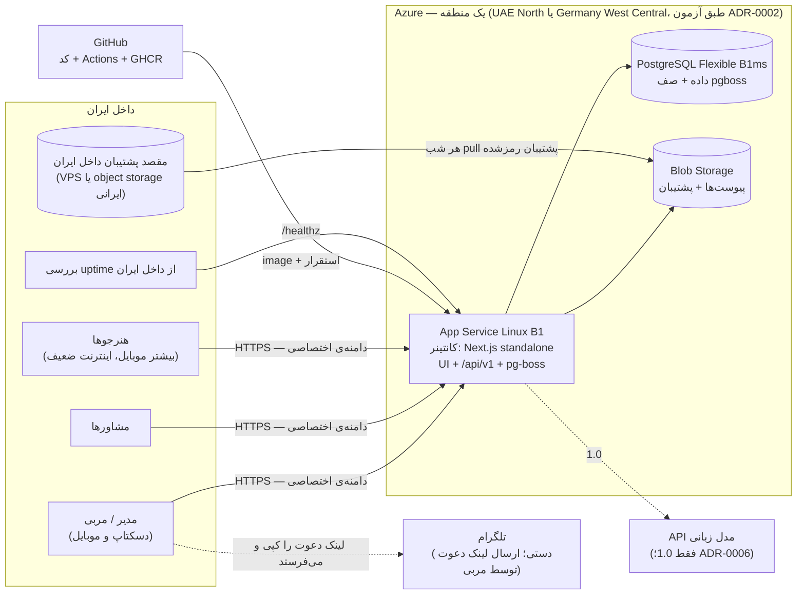
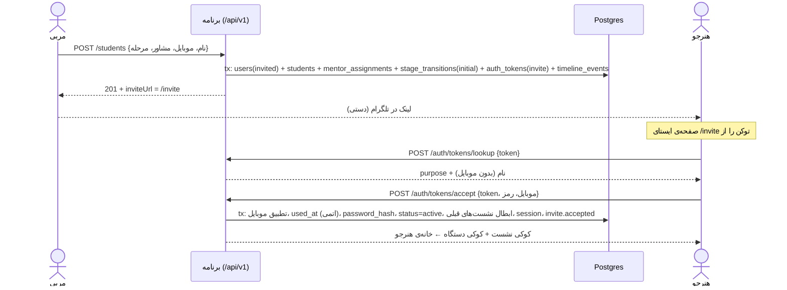
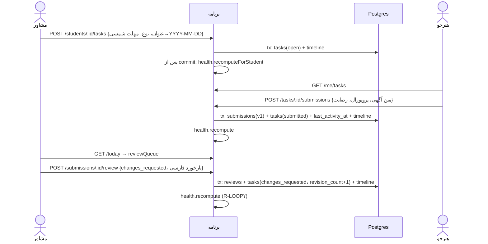
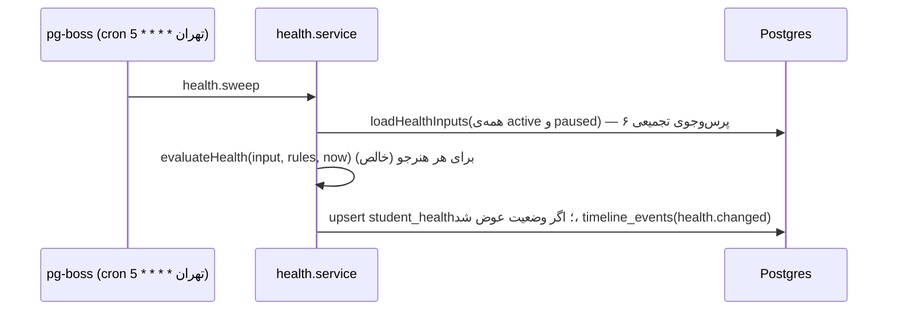

# نمای کلی معماری — UpworkCoach نسخه‌ی 0.1 («دفتر مربی»)

> فاز ۳ — ۲۷ مهر ۱۴۰۵ — نویسنده: software-architect — وضعیت: پیش‌نویس برای گیت بنیان‌گذار
> ورودی‌ها: `CLAUDE.md`، `STATUS.md`، `02-product/prd.md`، `mvp-scope.md`، `learning/progress-tracking.md`، `01-discovery/risks.md`، تصمیم بنیان‌گذار درباره‌ی میزبانی (Vercel یا Azure؛ ۲۷ مهر ۱۴۰۵)
> سندهای هم‌خانواده: [`tech-stack.md`](tech-stack.md) · [`data-model.md`](data-model.md) · [`api.md`](api.md) · [`adr/`](adr/README.md)

---

## ۱. در یک نگاه

- **یک برنامه‌ی وب** (Next.js، TypeScript) که هم رابط فارسی و RTL را می‌سازد، هم REST API را، هم کارهای زمان‌بندی‌شده را اجرا می‌کند.
- **یک دیتابیس** PostgreSQL که داده، صف و زمان‌بند (pg-boss) را نگه می‌دارد.
- **یک ذخیره‌ساز فایل** برای پیوست تصویر، پشت یک آداپتور.
- میزبانی 0.1 روی **Azure** (App Service کانتینری + PostgreSQL Flexible + Blob)، با این شرط که **بدون بازنویسی به میزبان ایرانی منتقل شود** (ADR-0002).
- **مونولیت ماژولار**: ماژول‌ها مرز روشن دارند ولی در یک پردازه اجرا می‌شوند. میکروسرویس نداریم.
- **بدون AI و پرداخت در 0.1.** جای AI در 1.0 مشخص است (ADR-0006). جای پرداخت در بخش ۸.

---

## ۲. نمای زمینه و استقرار

**نکته‌ی حیاتی (ADR-0002، ریسک H1):** در قطعی اینترنت بین‌الملل، کاربران داخل ایران به برنامه دسترسی ندارند. به گفته‌ی NetBlocks، این وضعیت در ۲۰۲۶ برای بیشتر سال برقرار بوده است. پاسخ معماری: قابلیت انتقال + پشتیبان روزانه داخل ایران + runbook انتقال تمرین‌شده.

---

## ۳. ماژول‌ها و مرزها

```mermaid
flowchart TB
    subgraph web["apps/web — یک پردازه"]
        UI["UI (RSC + کلاینت)<br/>app/(staff) · app/(student) · app/(auth)"]
        API["REST /api/v1<br/>Route Handlerهای نازک"]

        subgraph core["ماژول‌های دامنه (modules/*)"]
            identity["identity<br/>کاربر، نشست، دعوت، بازنشانی"]
            access["access<br/>نقش و دامنه‌ی هنرجو"]
            catalog["catalog<br/>پلتفرم، شاخه، نوع نقطه‌ی عطف،<br/>متن استاندارد، تنظیمات"]
            students["students<br/>پرونده، تخصیص مشاور، پروفایل‌ها"]
            path["path<br/>مرحله‌ها، گذار مرحله، کانبان"]
            tasks["tasks<br/>کار، قالب، تحویل، بازبینی، تمدید"]
            timeline["timeline<br/>یادداشت، رویداد، تایم‌لاین"]
            reminders["reminders"]
            questions["questions<br/>رشته، پیام"]
            checkins["checkins (Should)"]
            milestones["milestones<br/>+ North Star"]
            health["health<br/>قواعد، sweep، پرچم، snooze"]
            today["today<br/>read-model «امروز»، «گیرکرده»"]
            files["files<br/>FileStorage"]
            admin["admin<br/>CSV ورود/خروج، audit"]
        end

        subgraph infra["server/ و lib/"]
            db["db (Drizzle)"]
            jobs["jobs (pg-boss)"]
            jalali["jalali، business-hours، text-fa، phone"]
        end
    end

    UI --> API
    UI -- "خواندن در RSC" --> core
    API --> core
    core --> infra
```

### جدول مرزها
| ماژول | صاحب جدول‌ها | به چه کسی وابسته است (فقط از service) | چه کسی از آن استفاده می‌کند |
|---|---|---|---|
| `identity` | `users`، `sessions`، `auth_tokens`، `auth_throttle` | `catalog` (تنظیمات) | همه (`actor`) |
| `access` | — | `catalog` (`access.mentorScope`)، `identity` (`isActiveStaffUser`)؛ (هماهنگ با کد، اسپرینت ۲ تا ۴) خواندنی SQL روی جدول‌های والد برای `loadInScope` و `assertRefs` (read-model؛ ADR-0004 بند 6-1) | همه‌ی ماژول‌هایی که داده‌ی هنرجو دارند |
| `catalog` | `tracks`، `platforms`، `milestone_types`، `canned_responses`، `settings`، `learning_paths`، `stages`، `task_templates` | — | همه |
| `students` | `students`، `mentor_assignments`، `platform_profiles`، `profile_snapshots` | `identity`، `access`، `catalog`، `timeline` | `path`، `tasks`، `today`، `health` |
| `path` | `stage_transitions` (+ نوشتن `students.current_stage_id` از طریق `students.service`) | `students`، `catalog`، `timeline` | `today`، `health` |
| `tasks` | `tasks`، `task_extensions`، `submissions`، `reviews` | `students`، `catalog`، `files`، `timeline` | `today`، `health` |
| `timeline` | `notes`، `timeline_events` | — | همه (نوشتن رویداد) |
| `reminders` | `reminders` | `access` | `today`، `students` (انتقال هنگام تغییر مشاور) |
| `questions` | `question_threads`، `question_messages` | `students`، `files`، `timeline` | `today`، `checkins` |
| `checkins` | `checkins` | `questions`، `timeline` | `health` |
| `milestones` | `milestones` | `catalog`، `files`، `timeline` | — |
| `health` | `student_health`، `student_flags` | خواندنی SQL روی `students`، `tasks`، `stages`، `checkins` (read-model) | `today`، `students` (سربرگ) |
| `today` | — (فقط خواندنی) | خواندنی SQL روی چند جدول | UI |
| `files` | `attachments` | `FileStorage` | `tasks`، `questions`، `milestones` |
| `admin` | `audit_log` | همه (فقط از service) | — |

**قواعد مرز** (جزئیات در `tech-stack.md` بخش ۳):
1. ماژول جدول ماژول دیگر را **نمی‌نویسد**. استثنا ندارد.
2. خواندن مستقیم SQL از جدول دیگران فقط برای read-modelهای `health`، `today` و (هماهنگ با کد، اسپرینت ۲) `access` مجاز است، آن هم فقط خواندنی. JOINهای نمایشی فقط‌خواندنی repo یک ماژول با جدول‌های فهرستی (`users`، `stages`، `tracks`، `platforms`) هم مجازند (ADR-0004 بند 6-2). برای شکستن چرخه‌ی import، هر ماژول کدی را که فقط schema خودش را لازم دارد در فایل جدا نگه می‌دارد (`students/activity.ts`، `*/erasure.ts`، `path/transitions.ts`، `tasks/counts.ts`، `questions/transfer.ts`).
3. رویداد تایم‌لاین را هر ماژول با `timeline.record(tx, event)` **در همان تراکنش** خودش می‌نویسد.
4. بازمحاسبه‌ی سلامت پس از commit با `health.recomputeForStudent(id)` صدا زده می‌شود (best-effort؛ ADR-0005).
5. ماژول‌های 1.0 (`ai`، `opportunities`، `notifications`) به هسته وابسته‌اند، **هرگز برعکس**.

---

## ۴. جریان‌های داده‌ی اصلی

### ۴-۱. ساخت هنرجو و ورود اول (F1، F2)

(امنیت C1) توکن هرگز در مسیر URL نمی‌آید؛ جزئیات در ADR-0003 بخش ۲.

### ۴-۲. کار ← تحویل ← بازبینی ← سلامت (F4، F7)

### ۴-۳. sweep ساعتی سلامت (ADR-0005، ADR-0007)

### ۴-۴. صفحه‌ی «امروز» (F6)
یک درخواست `GET /today` چهار بخش را با پرس‌وجوهای جدا ولی هم‌زمان (`Promise.all`) می‌سازد. همه با `staffStudentScope(actor)` فیلتر می‌شوند: یادآورهای امروز و گذشته، صف بازبینی، سؤال‌های منتظر تیم، هنرجوهای گیرکرده (از `student_health`، بدون snooze) و فهرست «منتظر ما» (SLA؛ `data-model.md` ۴-۳).

---

## ۵. دغدغه‌های مشترک

| دغدغه | راه‌حل | مرجع |
|---|---|---|
| احراز هویت | دعوت + موبایل و رمز؛ نشست دیتابیسی؛ argon2id؛ محدودیت نرخ | ADR-0003 |
| دسترسی | `staffStudentScope` در service و repo؛ DTO جدا برای هنرجو؛ ماتریس تست + تست قناری | ADR-0004 |
| یادداشت داخلی | یک تابع خواندن برای هنرجو؛ پیش‌فرض `internal` | ADR-0004، `data-model.md` ۲-۶ |
| زمان و تقویم | UTC در ذخیره، `Asia/Tehran` در منطق، شمسی در نمایش؛ API فقط تاریخ میلادی | ADR-0008 |
| جستجوی فارسی | نرمال‌سازی + `pg_trgm` | ADR-0008 |
| کارایی روی اینترنت ضعیف | رندر سرور؛ JS کم در صفحه‌های هنرجو؛ فونت محلی با `font-display: swap`؛ فشرده‌سازی؛ بدون دامنه‌ی خارجی؛ هدف: خانه‌ی هنرجو کمتر از ۳ ثانیه روی 3G (F10) | `tech-stack.md` |
| حریم خصوصی | بدون فیلد رمز پلتفرم؛ حذف EXIF؛ رضایت صریح برای داده‌ی AI؛ لاگ بدون بدنه‌ی درخواست و بدون توکن | PRD بخش ۶ و ۸ |
| حذف حساب و نگه‌داری داده (PRD بخش ۸) | (امنیت C5) درخواست با پیام به مربی؛ اجرا با CLI مدیر `pnpm admin:erase-user` ظرف حداکثر ۳۰ روز؛ ناشناس‌سازی در یک تراکنش: متن آزاد و داده‌ی هویتی پاک، ساختار و آمار می‌ماند. endpoint حذف در 0.1 نداریم. مدت نگه‌داری هر داده در `data-model.md` بخش ۶ | ADR-0010 |
| پشتیبان | خودکار Azure (۷ روز) + `pg_dump` شبانه‌ی رمزشده در دو جا، یکی داخل ایران | ADR-0002 بخش ۶ |
| مشاهده‌پذیری | لاگ JSON (pino) با `requestId`؛ `/healthz`؛ uptime از داخل ایران؛ هشدار وقتی sweep سلامت بیش از ۳ ساعت اجرا نشده | ADR-0007 |

---

## ۶. مقیاس و کارایی (فرض A1: ۳۰ تا ۸۰ هنرجو، سقف طراحی ۵۰۰ کاربر)

- بزرگ‌ترین پرس‌وجو `GET /students` و `GET /today` است: چند صد ردیف با index. یک B1ms کافی است.
- `health.sweep` برای ۵۰۰ هنرجو: ۶ پرس‌وجوی تجمیعی و ۵۰۰ ارزیابی درون‌حافظه‌ای؛ کمتر از ۲ ثانیه.
- کش لایه‌ی برنامه لازم نیست. صفحه‌های کارکنان `dynamic` هستند. فقط assetهای ثابت cache بلندمدت می‌گیرند.
- اگر از ۵۰۰ گذشت: اول B2s برای دیتابیس، بعد دو نمونه‌ی App Service (pg-boss و نشست دیتابیسی آماده‌ی چندنمونه‌ای‌اند).

---

## ۷. مسیر به 1.0 بدون بازنویسی

| امکان 1.0 | چه اضافه می‌شود | چه چیزی دست نمی‌خورد |
|---|---|---|
| ابزارهای AI (F13–F15) | ماژول `ai` + `LlmGateway` + job `ai.run` + جدول‌های `ai_runs` | هسته؛ صف از قبل هست (ADR-0006) |
| ثبت اپلای‌ها (F12) | ماژول `opportunities` + قواعد سلامت تازه در `evaluateHealth` | ساختار `student_health` و sweep |
| اعلان (F18) | ماژول `notifications` + `SmsProvider` / `TelegramProvider` + job `notify.send` که از رویدادها تغذیه می‌شود | `timeline_events` منبع رویداد است |
| ثبت‌نام عمومی (F16) | `auth_tokens.purpose='otp'` + مسیر ثبت‌نام | جریان دعوت می‌ماند |
| سهمیه (F17) | `usage_quotas`، `usage_ledger` | — |

## ۸. پرداخت (بیرون از دامنه؛ فقط جای آن)
پرداخت تا تصمیم بنیان‌گذار درباره‌ی مدل درآمد معلق است (D7) و **هیچ جدول یا سرویس پرداختی در 0.1 طراحی نشده است**. وقتی لازم شد، یک ماژول مستقل `billing` اضافه می‌شود. این ماژول جدول‌های خودش را دارد (پلن، سفارش، تراکنش) و درگاه ایرانی (زرین‌پال، IDPay یا کارت‌به‌کارت با تأیید دستی) را پشت رابط `PaymentGateway` قرار می‌دهد، تا تعویض درگاه به کد دیگر ماژول‌ها دست نزند. خروجی آن فقط «حق دسترسی» (entitlement: فعال بودن ابزارها، سقف سهمیه، تاریخ پایان) است که ماژول سهمیه‌ی F17 از آن می‌خواند. پس هسته و `ai` هیچ‌وقت مستقیم به پرداخت وابسته نمی‌شوند. یک نکته‌ی میزبانی هم هست: callback درگاه‌های ایرانی ممکن است به سرور خارج از ایران نرسد یا درگاه درخواست از IP خارجی را نپذیرد (**تأیید نشد**). این موضوع در ADR همان زمان، کنار گزینه‌ی رله‌ی داخلی، بررسی می‌شود.

---

## ۹. هماهنگی با ایجنت‌های دیگر
خروجی ai-engineer، security-reviewer و devops-engineer در زمان نگارش هنوز وجود ندارد، پس تناقضی برای حل نبود. نقطه‌های تحویل:

| ایجنت | چه چیزی را باید بازبینی یا تکمیل کند |
|---|---|
| **security-reviewer** | ADR-0003 (رمز، نشست، CSRF، محدودیت نرخ)، ADR-0004 (ماتریس و تست قناری)، ریسک‌های H5 و H7 در ADR-0002، سیاست حذف حساب، لاگ‌ها |
| **devops-engineer** | آزمون دسترسی از ایران (ADR-0002 بخش ۵)، زیرساخت به‌صورت کد، CI/CD، پشتیبان دوجایی و runbook انتقال، uptime از داخل ایران، `Always On` |
| **ai-engineer** | ADR-0006 به‌عنوان قرارداد؛ داده‌ی ارزیابی از `submissions` و `reviews`؛ هر نیاز اضافه = ADR تازه |
| **ux-designer** | API بخش ۸ («امروز») و DTOهای فهرست هنرجو را با وایرفریم‌ها تطبیق دهد. اگر فیلدی در وایرفریم هست که اینجا نیست، به معمار گزارش شود |
| **backend-engineer / frontend-engineer** | `tech-stack.md` بخش ۳ (قواعد کدنویسی) الزامی است |

## ۱۰. تناقض‌ها با اسناد قبلی و نحوه‌ی حل
| مورد | سند قبلی | تصمیم این فاز |
|---|---|---|
| میزبانی 0.1 | PRD بخش ۸ و A4: «بدون وابستگی خارجی، قابل‌میزبانی در ایران» | با تصمیم بنیان‌گذار: Azure، با الزام «**قابل‌انتقال** به میزبان ایرانی» (ADR-0002). PRD ویرایش نشد؛ مدیر پروژه در `STATUS.md` ثبت کند |
| SLA تیم | PRD F7: «۴۸ ساعت» و «۲۴ ساعت»؛ `mentor-workflow.md`: ساعت **کاری** و ۷۲ ساعت برای بازبینی غیرگیت | پیش‌فرض ساعت کاری و ۴۸ ساعت برای همه‌ی بازبینی‌ها؛ هر دو قابل‌تنظیم (سؤال باز) |
| مرحله‌های هم‌زمان ۲ و ۳ | `learning-path.md` | در 0.1 یک مرحله‌ی فعلی؛ کارهای مرحله‌ی ۳ با `stage_id` قابل‌تعریف‌اند (`data-model.md` ۲-۴) |
| «جز مرحله‌ی ۸» در R-NOTASK | PRD F7 | پرچم داده‌ای `is_open_ended`، نه شماره‌ی مرحله |
| فیلدهای ✔ در `progress-tracking.md` که به 1.0 وابسته‌اند (قیف، خروجی AI، قراردادها) | `progress-tracking.md` بخش ۲ | در 0.1 نیستند (طبق `mvp-scope.md`)؛ جایشان در `data-model.md` بخش ۵ |

## ۱۱. سؤال‌های باز برای بنیان‌گذار
1. **حساب و پرداخت Azure** به نام چه کسی و از کجاست و آیا با شرایط Microsoft سازگار است؟ (ADR-0002، Q1)
2. **مشاوره‌ی حقوقی** درباره‌ی نگهداری داده‌ی کاربران ایرانی روی سرور خارج. (Q2)
3. **آستانه‌ی مهاجرت اضطراری** در قطعی اینترنت (پیشنهاد: ۷۲ ساعت) و بودجه‌ی مقصد پشتیبان داخل ایران (حدود ۰٫۵ تا ۱ میلیون تومان در ماه). (Q3)
4. **دامنه:** دامنه‌ی اختصاصی دارید؟ `.ir` یا `.com`؟ (برای لینک‌های دعوت و انتقال بعدی لازم است.)
5. **SLA:** ساعت کاری یا ساعت تقویمی؟ ساعت‌ها و روزهای پاسخ‌گویی تیم؟
6. آیا **check-in هفتگی** در 0.1 ساخته شود؟ (Should؛ R-CHECKIN و R-MOOD و «خطر ریزش» به آن وابسته‌اند.)
