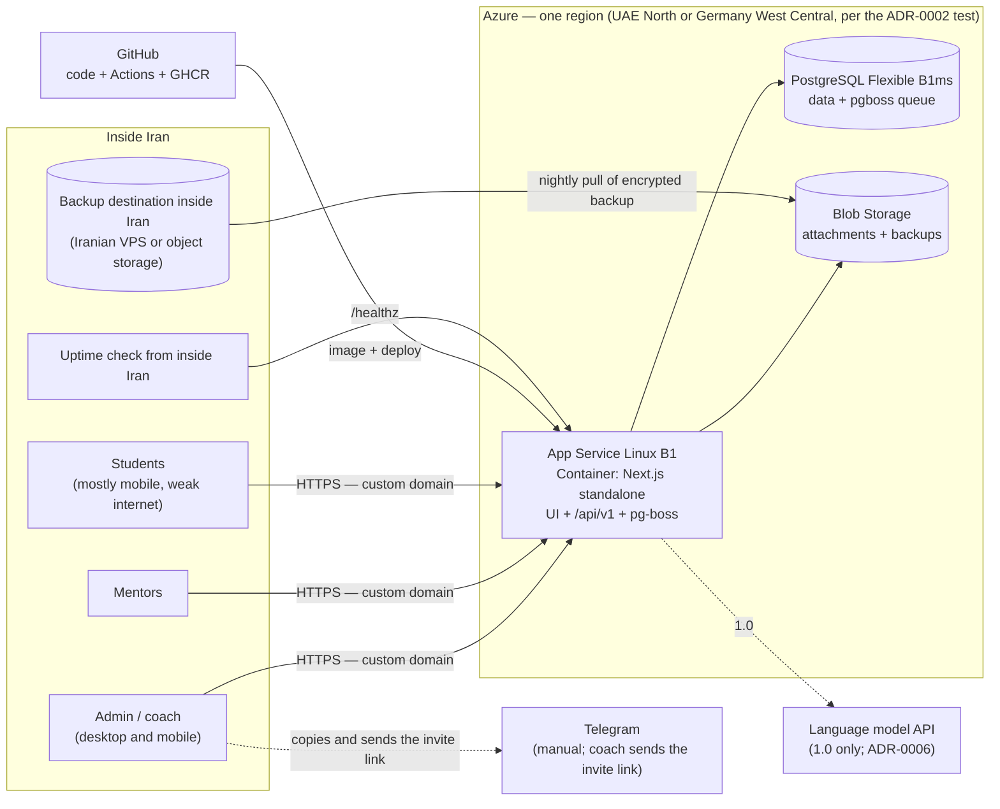
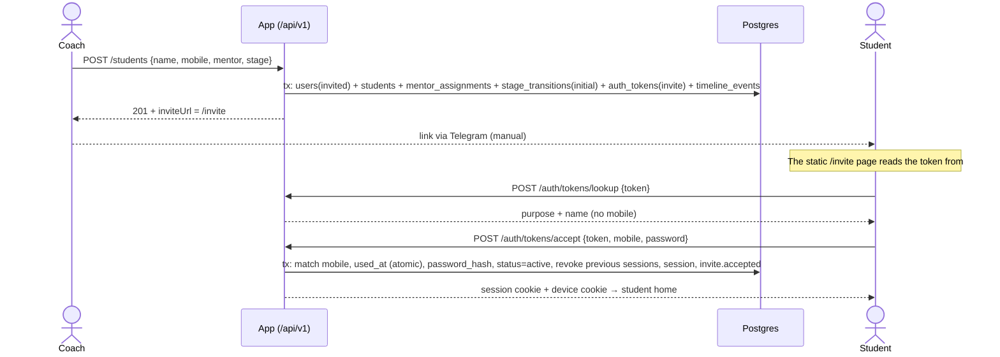
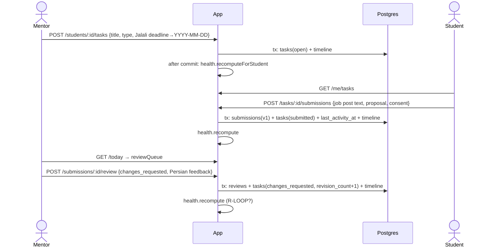

# Architecture Overview — UpworkCoach version 0.1 ("Coach Office")

> Phase 3 — 27 Mehr 1405 (2026-10-19) — Author: software-architect — Status: draft for the founder gate
> Inputs: `CLAUDE.md`, `STATUS.md`, `02-product/prd.md`, `mvp-scope.md`, `learning/progress-tracking.md`, `01-discovery/risks.md`, the founder's hosting decision (Vercel or Azure; 27 Mehr 1405 (2026-10-19))
> Sibling documents: [`tech-stack.md`](tech-stack.md) · [`data-model.md`](data-model.md) · [`api.md`](api.md) · [`adr/`](adr/README.md)

---

## 1. At a glance

- **One web app** (Next.js, TypeScript) that builds the Persian RTL interface, serves the REST API, and runs the scheduled jobs.
- **One PostgreSQL database** that holds the data, the queue and the scheduler (pg-boss).
- **One file store** for image attachments, behind an adapter.
- 0.1 is hosted on **Azure** (containerized App Service + PostgreSQL Flexible + Blob), on the condition that it **can be moved to an Iranian host without a rewrite** (ADR-0002).
- **Modular monolith**: modules have clear boundaries but run in one process. No microservices.
- **No AI and no payments in 0.1.** The place for AI in 1.0 is defined (ADR-0006). The place for payments is in section 8.

---

## 2. Context and deployment view



**Critical note (ADR-0002, risk H1):** during an international internet shutdown, users inside Iran cannot reach the app. According to NetBlocks, this has been the situation for most of 2026. Architectural response: portability + a daily backup inside Iran + a rehearsed migration runbook.

---

## 3. Modules and boundaries

```mermaid
flowchart TB
    subgraph web["apps/web — one process"]
        UI["UI (RSC + client)<br/>app/(staff) · app/(student) · app/(auth)"]
        API["REST /api/v1<br/>thin Route Handlers"]

        subgraph core["Domain modules (modules/*)"]
            identity["identity<br/>user, session, invite, reset"]
            access["access<br/>role and student scope"]
            catalog["catalog<br/>platform, track, milestone type,<br/>canned response, settings"]
            students["students<br/>profile, mentor assignment, platform profiles"]
            path["path<br/>stages, stage transition, kanban"]
            tasks["tasks<br/>task, template, submission, review, extension"]
            timeline["timeline<br/>note, event, timeline"]
            reminders["reminders"]
            questions["questions<br/>thread, message"]
            checkins["checkins (Should)"]
            milestones["milestones<br/>+ North Star"]
            health["health<br/>rules, sweep, flag, snooze"]
            today["today<br/>'Today' and 'Stuck' read-model"]
            files["files<br/>FileStorage"]
            admin["admin<br/>CSV import/export, audit"]
        end

        subgraph infra["server/ and lib/"]
            db["db (Drizzle)"]
            jobs["jobs (pg-boss)"]
            jalali["jalali, business-hours, text-fa, phone"]
        end
    end

    UI --> API
    UI -- "reads in RSC" --> core
    API --> core
    core --> infra
```



### Boundary table
| Module | Owns tables | Depends on (via service only) | Used by |
|---|---|---|---|
| `identity` | `users`, `sessions`, `auth_tokens`, `auth_throttle` | `catalog` (settings) | everyone (`actor`) |
| `access` | — | `catalog` (`access.mentorScope`), `identity` (`isActiveStaffUser`); (aligned with the code, sprints 2 to 4) read-only SQL on parent tables for `loadInScope` and `assertRefs` (read-model; ADR-0004 clause 6-1) | every module that holds student data |
| `catalog` | `tracks`, `platforms`, `milestone_types`, `canned_responses`, `settings`, `learning_paths`, `stages`, `task_templates` | — | everyone |
| `students` | `students`, `mentor_assignments`, `platform_profiles`, `profile_snapshots` | `identity`, `access`, `catalog`, `timeline` | `path`, `tasks`, `today`, `health` |
| `path` | `stage_transitions` (+ writes `students.current_stage_id` via `students.service`) | `students`, `catalog`, `timeline` | `today`, `health` |
| `tasks` | `tasks`, `task_extensions`, `submissions`, `reviews` | `students`, `catalog`, `files`, `timeline` | `today`, `health` |
| `timeline` | `notes`, `timeline_events` | — | everyone (writing events) |
| `reminders` | `reminders` | `access` | `today`, `students` (transfer on mentor change) |
| `questions` | `question_threads`, `question_messages` | `students`, `files`, `timeline` | `today`, `checkins` |
| `checkins` | `checkins` | `questions`, `timeline` | `health` |
| `milestones` | `milestones` | `catalog`, `files`, `timeline` | — |
| `health` | `student_health`, `student_flags` | read-only SQL on `students`, `tasks`, `stages`, `checkins` (read-model) | `today`, `students` (header) |
| `today` | — (read-only) | read-only SQL on several tables | UI |
| `files` | `attachments` | `FileStorage` | `tasks`, `questions`, `milestones` |
| `admin` | `audit_log` | everyone (via service only) | — |

**Boundary rules** (details in `tech-stack.md` section 3):
1. A module **does not write** another module's tables. No exceptions.
2. Direct SQL reads from other modules' tables are allowed only for the `health`, `today` and (aligned with the code, sprint 2) `access` read-models, and only read-only. Read-only display JOINs in a module's repo against lookup tables (`users`, `stages`, `tracks`, `platforms`) are also allowed (ADR-0004 clause 6-2). To break import cycles, each module keeps code that only needs its own schema in a separate file (`students/activity.ts`, `*/erasure.ts`, `path/transitions.ts`, `tasks/counts.ts`, `questions/transfer.ts`).
3. Each module writes timeline events with `timeline.record(tx, event)` **in its own transaction**.
4. Health recomputation is called after commit with `health.recomputeForStudent(id)` (best-effort; ADR-0005).
5. The 1.0 modules (`ai`, `opportunities`, `notifications`) depend on the core, **never the reverse**.

---

## 4. Main data flows

### 4-1. Creating a student and first login (F1, F2)

(Security C1) The token never appears in the URL path; details in ADR-0003 section 2.

### 4-2. Task → submission → review → health (F4, F7)


### 4-3. Hourly health sweep (ADR-0005, ADR-0007)
```mermaid
sequenceDiagram
    participant B as pg-boss (cron 5 * * * * Tehran)
    participant H as health.service
    participant D as Postgres
    B->>H: health.sweep
    H->>D: loadHealthInputs(all active and paused) — 6 aggregate queries
    H->>H: evaluateHealth(input, rules, now) per student (pure)
    H->>D: upsert student_health; if the status changed, timeline_events(health.changed)
```

### 4-4. The "Today" page (F6)
A single `GET /today` request builds four sections with separate but concurrent queries (`Promise.all`). All are filtered by `staffStudentScope(actor)`: today's and overdue reminders, the review queue, questions waiting on the team, stuck students (from `student_health`, excluding snoozed) and the "Waiting on us" list (SLA; `data-model.md` 4-3).

---

## 5. Cross-cutting concerns

| Concern | Solution | Reference |
|---|---|---|
| Authentication | Invite + mobile and password; database session; argon2id; rate limiting | ADR-0003 |
| Access | `staffStudentScope` in service and repo; separate DTOs for students; test matrix + canary test | ADR-0004 |
| Internal notes | A single read function for students; default `internal` | ADR-0004, `data-model.md` 2-6 |
| Time and calendar | UTC in storage, `Asia/Tehran` in logic, Jalali in display; the API uses Gregorian dates only | ADR-0008 |
| Persian search | Normalization + `pg_trgm` | ADR-0008 |
| Performance on weak internet | Server rendering; little JS on student pages; local font with `font-display: swap`; compression; no external domains; target: student home under 3 seconds on 3G (F10) | `tech-stack.md` |
| Privacy | No platform password field; EXIF removal; explicit consent for AI data; logs without request bodies and without tokens | PRD sections 6 and 8 |
| Account deletion and data retention (PRD section 8) | (Security C5) Request by message to the coach; executed with the admin CLI `pnpm admin:erase-user` within at most 30 days; anonymization in a single transaction: free text and identity data are wiped, structure and statistics remain. No deletion endpoint in 0.1. Retention period for each piece of data in `data-model.md` section 6 | ADR-0010 |
| Backup | Azure automatic (7 days) + nightly encrypted `pg_dump` in two places, one inside Iran | ADR-0002 section 6 |
| Observability | JSON logs (pino) with `requestId`; `/healthz`; uptime from inside Iran; alert when the health sweep has not run for more than 3 hours | ADR-0007 |

---

## 6. Scale and performance (assumption A1: 30 to 80 students, design ceiling of 500 users)

- The largest queries are `GET /students` and `GET /today`: a few hundred indexed rows. One B1ms is enough.
- `health.sweep` for 500 students: 6 aggregate queries and 500 in-memory evaluations; under 2 seconds.
- No application-layer cache is needed. Staff pages are `dynamic`. Only static assets get long-term caching.
- If it exceeds 500: first B2s for the database, then two App Service instances (pg-boss and database sessions are multi-instance ready).

---

## 7. Path to 1.0 without a rewrite

| 1.0 feature | What is added | What stays untouched |
|---|---|---|
| AI tools (F13–F15) | `ai` module + `LlmGateway` + `ai.run` job + `ai_runs` tables | The core; the queue already exists (ADR-0006) |
| Application tracking (F12) | `opportunities` module + new health rules in `evaluateHealth` | The `student_health` structure and the sweep |
| Notifications (F18) | `notifications` module + `SmsProvider` / `TelegramProvider` + a `notify.send` job fed by events | `timeline_events` is the event source |
| Public sign-up (F16) | `auth_tokens.purpose='otp'` + a sign-up route | The invite flow stays |
| Quotas (F17) | `usage_quotas`, `usage_ledger` | — |

## 8. Payments (out of scope; only its place)
Payments are on hold until the founder decides on the revenue model (D7), and **no payment table or service has been designed in 0.1**. When needed, a standalone `billing` module will be added. That module has its own tables (plan, order, transaction) and puts the Iranian gateway (ZarinPal, IDPay, or card-to-card with manual confirmation) behind a `PaymentGateway` interface, so swapping gateways does not touch any other module's code. Its only output is an "entitlement" (tools enabled, quota ceiling, end date), which the F17 quota module reads. So the core and `ai` never depend on payments directly. There is also a hosting caveat: Iranian gateways' callbacks may not reach a server outside Iran, or the gateway may refuse requests from a foreign IP (**not verified**). This will be examined in the ADR at that time, alongside the option of a domestic relay.

---

## 9. Coordination with other agents
The outputs of ai-engineer, security-reviewer and devops-engineer did not exist yet at the time of writing, so there were no contradictions to resolve. Hand-off points:

| Agent | What it must review or complete |
|---|---|
| **security-reviewer** | ADR-0003 (password, session, CSRF, rate limiting), ADR-0004 (matrix and canary test), risks H5 and H7 in ADR-0002, the account deletion policy, logs |
| **devops-engineer** | Access test from Iran (ADR-0002 section 5), infrastructure as code, CI/CD, two-location backup and migration runbook, uptime from inside Iran, `Always On` |
| **ai-engineer** | ADR-0006 as the contract; evaluation data from `submissions` and `reviews`; any additional need = a new ADR |
| **ux-designer** | Reconcile API section 8 ("Today") and the student list DTOs with the wireframes. If a field exists in the wireframes that is not here, report it to the architect |
| **backend-engineer / frontend-engineer** | `tech-stack.md` section 3 (coding rules) is mandatory |

## 10. Contradictions with earlier documents and how they were resolved
| Item | Earlier document | Decision in this phase |
|---|---|---|
| 0.1 hosting | PRD section 8 and A4: "no external dependencies, hostable in Iran" | By the founder's decision: Azure, with the requirement of being "**portable** to an Iranian host" (ADR-0002). The PRD was not edited; the project lead should record it in `STATUS.md` |
| Team SLA | PRD F7: "48 hours" and "24 hours"; `mentor-workflow.md`: **business** hours and 72 hours for non-gate reviews | Default of business hours and 48 hours for all reviews; both configurable (open question) |
| Concurrent stages 2 and 3 | `learning-path.md` | In 0.1 there is one current stage; stage 3 tasks can be defined with `stage_id` (`data-model.md` 2-4) |
| "Except stage 8" in R-NOTASK | PRD F7 | Data flag `is_open_ended`, not a stage number |
| Fields marked ✔ in `progress-tracking.md` that depend on 1.0 (funnel, AI output, contracts) | `progress-tracking.md` section 2 | Not in 0.1 (per `mvp-scope.md`); their place is in `data-model.md` section 5 |

## 11. Open questions for the founder
1. **The Azure account and payment**: in whose name and from where, and is it compatible with Microsoft's terms? (ADR-0002, Q1)
2. **Legal advice** on storing Iranian users' data on a server abroad. (Q2)
3. **Emergency migration threshold** during an internet shutdown (proposal: 72 hours) and the budget for the backup destination inside Iran (about 0.5 to 1 million toman per month). (Q3)
4. **Domain:** do you have a custom domain? `.ir` or `.com`? (Needed for invite links and later migration.)
5. **SLA:** business hours or calendar hours? The team's response hours and days?
6. Should the **weekly check-in** be built in 0.1? (Should; R-CHECKIN, R-MOOD and "churn risk" depend on it.)
