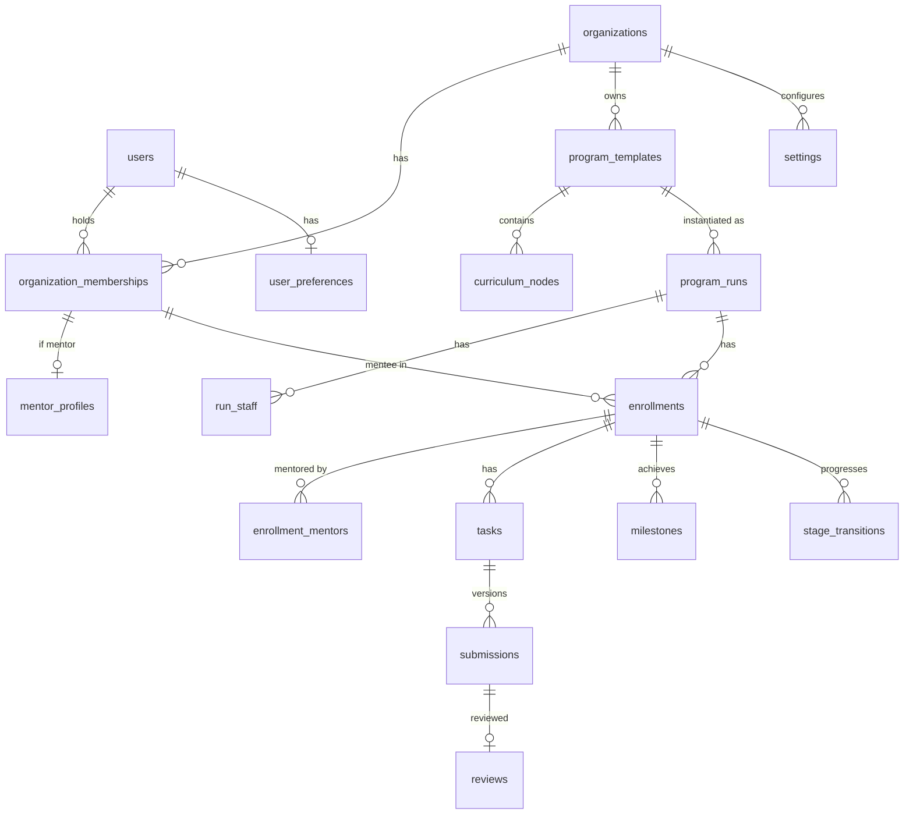

# بازبینی معماری: تبدیل «دفتر مربی» به SaaS چندسازمانی مربیگری

- **تاریخ:** ۶ آبان ۱۴۰۵ (2026-10-28)
- **ورودی:** سند «Coach Office — Product Evolution & Architecture Review» از بنیان‌گذار
- **وضعیت:** پیشنهاد؛ **منتظر تأیید بنیان‌گذار**. تا تأیید، هیچ تغییری در کد یا دیتابیس انجام نمی‌شود.
- **روش:** خواندن مستقیم کد در `apps/web/src` و migrationهای `apps/web/drizzle`. هر جا چیزی از کد تأیید نشده، صریح گفته شده است. تست‌ها در این بازبینی دوباره اجرا نشدند.

---

## ۰. مشاوره پیش از برنامه (خلاصه برای بنیان‌گذار)

1. **تکامل، نه بازنویسی.** کد فعلی یک «مونولیت ماژولار» مرتب است (حدود ۴۶ هزار خط TypeScript، ۱۳ ماژول دامنه، ۸۰ فایل تست). کنترل دسترسی در یک نقطه (`modules/access/scope.ts`) متمرکز است. چرخه‌ی «تکلیف ← تحویل نسخه‌دار ← بازبینی ← درخواست اصلاح ← تحویل دوباره» که در بند ۸ سند خواسته‌اید، **همین حالا تقریباً کامل وجود دارد**. بازنویسی یعنی دور ریختن چند ماه کار تست‌شده.
2. **بزرگ‌ترین تغییر، دو چیز است، نه بیست چیز:**
   - **سازمان (tenant):** امروز همه‌ی داده‌ها سراسری‌اند و نقش هر کاربر یک ستون ثابت روی `users` است.
   - **برنامه (Program):** امروز فقط **یک مسیر سراسری** داریم و هر هنرجو **یک مربی اصلی** و **یک مرحله‌ی جاری** دارد. مدل «قالب ← اجرا ← عضویت» باید جایگزین شود.
   بقیه‌ی خواسته‌ها (داشبوردها، صف بازبینی، پیشرفت، سلامت) بیشتر «گسترش» هستند تا «ساخت از صفر».
3. **پیشنهاد: «آماده‌ی چندسازمانی، با یک سازمان در عمل».** ستون `organization_id` و عضویت سازمانی را **همین حالا** اضافه کنیم؛ الان که داده کم است ارزان‌ترین زمان آن است. ولی ثبت‌نام خودکار سازمان، کنسول مدیر پلتفرم، اشتراک و white-label را تا بعد از پایلوت تکانش عقب بیندازیم. مدیر پلتفرم فعلاً با اسکریپت خط فرمان کار می‌کند (همان الگوی `admin:create` فعلی).
4. **سند شما را در سه جا ساده‌تر پیشنهاد می‌کنم:**
   - **نسخه‌بندی قالب:** به‌جای جدول‌های جدای نسخه، هنگام ساخت یک «اجرا» محتوای قالب **کپی (snapshot)** می‌شود. همان هدف («تغییر قالب، اجراهای فعال را خراب نکند») با پیچیدگی خیلی کمتر.
   - **Cohort = اجرای گروهی:** هر «اجرا» (Program Run) یا گروهی است یا تک‌نفره. «چند cohort» یعنی چند اجرا از یک قالب. زیرگروه داخل یک اجرا (cohort داخل cohort) به بعد از MVP می‌رود.
   - **نقش‌ها:** شش نقش سند درست است، ولی برای پایلوت «مالک» و «مدیر سازمان» یک سطح دسترسی دارند (فقط مالک می‌تواند مدیر دیگر را عزل کند). «مدیر برنامه» یک نقش **در سطح برنامه** است، نه سازمان.
5. **ریسک‌هایی که قبل از قرارداد با تکانش باید بدانید (فنی نیستند ولی معماری را عوض می‌کنند):**
   - **Vercel رایگان (Hobby) فقط برای استفاده‌ی غیرتجاری است.** تکانش مشتری تجاری است ← پلن Pro (ماهی ۲۰ دلار) یا میزبان دیگر لازم است.
   - **Supabase رایگان** پشتیبان‌گیری قابل‌بازیابی ندارد و پروژه‌ی بی‌استفاده را بعد از یک هفته متوقف می‌کند. با داده‌ی واقعی یک آکادمی، پلن Pro یا پشتیبان شبانه‌ی مستقل لازم است.
   - **ریسک قطعی اینترنت بین‌الملل در ایران** (در STATUS.md ثبت شده: قطعی ۸۸ روزه در ۲۰۲۶). برای یک آکادمی ایرانی با هنرجوی زیاد، این ریسک از همه جدی‌تر است. خوشبختانه برنامه از اول «قابل‌انتقال» ساخته شده (Docker و Postgres استاندارد)، پس استقرار جداگانه‌ی تکانش روی سرور داخل ایران ممکن است. این تصمیم را **باید با خود تکانش** گرفت.
6. **این تغییر جهت محصول است، نه یک اسپرینت.** طبق فرآیند پروژه (CLAUDE.md)، قبل از کد باید PRD، دامنه‌ی MVP و ADRها به‌روز شوند و شما تأیید کنید. برنامه‌ی زیر همین را رعایت می‌کند (اسپرینت ۰).
7. **چیزی که از دست نمی‌رود:** امکانات ویژه‌ی فریلنسری (پروفایل‌های پلتفرمی، بررسی پروپوزال، شاخص «اولین قرارداد») حذف نمی‌شوند. همه‌ی آن‌ها «افزونه‌ی برنامه‌ی فریلنسری» می‌شوند که برنامه‌ی Upwork تکانش از آن استفاده می‌کند.

### سؤال‌هایی که فقط شما (یا تکانش) می‌توانید جواب بدهید
| # | سؤال | چرا مهم است |
|---|---|---|
| Q1 | تکانش چند مشاور و چند هنرجوی فعال دارد؟ چند برنامه‌ی هم‌زمان؟ | اندازه‌ی دیتابیس، پلن میزبانی، کارایی داشبوردها |
| Q2 | تاریخ شروع پایلوت با تکانش؟ قرارداد یا توافق رسمی دارید؟ | اولویت‌بندی و اینکه کدام اسپرینت‌ها فشرده شوند |
| Q3 | داده‌ی تکانش کجا باشد: خارج (Vercel/Supabase) یا سرور داخل ایران؟ | معماری استقرار، ریسک قطعی، مسائل حقوقی |
| Q4 | هنرجوهای فعلی خود شما چه می‌شوند؟ یک سازمان شخصی جدا («دفتر مربی شما») یا داخل تکانش؟ | migration داده‌ی موجود |
| Q5 | قالب برنامه را چه کسی می‌سازد: هر مشاور برای خودش، یا فقط مدیر آکادمی؟ | دامنه‌ی «تأیید قالب» و نقش مدیر برنامه |
| Q6 | انگلیسی برای پایلوت لازم است یا فقط «زیرساخت» کافی است؟ | حجم کار ترجمه (حدود ۲۵۰۰ خط متن فارسی در کد) |
| Q7 | آیا مدیر آکادمی باید یادداشت‌های خصوصی مشاورها را ببیند؟ (سند می‌گوید نه) | امروز مدیر همه چیز را می‌بیند؛ تغییرش به بازطراحی دسترسی نیاز دارد |
| Q8 | ورود با شماره موبایل (فعلی) برای تکانش کافی است؟ ارسال پیامک لازم است؟ | امروز دعوت و بازنشانی رمز با لینک دستی است و پیامکی در کار نیست |

### پاسخ‌های بنیان‌گذار (۶ آبان ۱۴۰۵)
| # | پاسخ | اثر روی برنامه |
|---|---|---|
| جهت کلی | **تأیید شد:** تکامل همین برنامه؛ اول اسپرینت ۰، بعد چندسازمانی | — |
| Q1 | تکانش ۱۰ مشاور و بیش از ۳۰۰۰ هنرجو دارد؛ پایلوت با **۳ مشاور و ۱۰۰ هنرجو** شروع می‌شود | حجم پایلوت برای پلن‌های فعلی کم است؛ ایندکس‌ها و داشبوردها برای ۳۰۰۰ هنرجو طراحی شوند |
| Q2 | تاریخ شروع پایلوت هنوز گفته نشده | باز |
| Q3 | فعلاً روی **Vercel و Supabase**؛ تصمیم سرور بعد از تکمیل | پشتیبان مستقل و تصمیم پلن تجاری Vercel همچنان لازم است |
| Q4 | هنرجوهای فعلی بنیان‌گذار **داخل تکانش** می‌روند | سازمان پیش‌فرض migration همان تکانش است؛ سازمان شخصی جدا لازم نیست |
| Q5 | **مدیر و مشاور** هر دو قالب می‌سازند؛ قالب مشاور برای استفاده در کل آکادمی به تأیید مدیر نیاز دارد | وضعیت دید قالب: خصوصی، منتظر تأیید، سازمانی (ADR-0012) |
| Q6 | انگلیسی برای پایلوت لازم نیست، ولی **به‌زودی برای ارائه به سرمایه‌گذار** لازم می‌شود | زیرساخت در اسپرینت ۲؛ ترجمه‌ی صفحه‌های اصلی بلافاصله پس از پایلوت (یا یک نسخه‌ی دموی انگلیسی) |
| Q7 | **نه؛ یادداشت خصوصی مشاور از مدیر پنهان می‌ماند** | سطح دید `private` (ADR-0011) |
| Q8 | هنوز جواب داده نشده | باز |
| سؤال تازه | زمان‌بندی جلسه‌ها؛ و دو نوع «پلن»: منتورینگ تک‌به‌تک و منتورینگ برنامه‌محور | بخش ۰-۱ پایین |
| «پلن» | یعنی **بسته‌ی قابل‌فروش** (مثل «تک‌به‌تک: ۸ جلسه در ۲ ماه» یا «دوره‌ی ۸ هفته‌ای») | بسته = قالب با سهمیه‌ی جلسه و مدت اعتبار؛ پرداخت همچنان بیرون از دامنه (ADR-0012) |
| زمان‌بندی | **ساده در MVP**: ثبت جلسه با زمان و لینک، وضعیت، یادداشت و اقدام بعدی؛ بدون همگام‌سازی تقویم و رزرو خودکار | ADR-0012؛ حدود ۱ هفته به نقشه‌ی راه اضافه شد |

### ۰-۱. زمان‌بندی جلسه و دو نوع منتورینگ (پیشنهاد، منتظر تأیید)
**وضعیت فعلی (از کد):** زمان‌بندی جلسه **وجود ندارد**. فقط می‌شود بعد از جلسه یک یادداشت از نوع «جلسه» ثبت کرد (`notes.kind = 'session'`) و کاری از نوع «آمادگی جلسه» (`session_prep`) داد. در سند شما هم «تقویم و جلسه‌ی زنده» در P2 بود.

**پیشنهاد:** منتورینگ تک‌به‌تک بدون جلسه عملاً معنی ندارد، پس یک **زمان‌بندی جلسه‌ی ساده** را به MVP بیاوریم و بقیه را عقب بیندازیم:
- **در MVP:** جدول `mentoring_sessions` (زمان، مدت، مربی، یک هنرجو یا یک اجرای گروهی، لینک یا محل به‌صورت متن، وضعیت: برنامه‌ریزی‌شده / برگزارشده / لغوشده / غیبت)؛ یادداشت جلسه و «اقدام‌های بعدی» که به کار تبدیل می‌شوند؛ جلسه‌های پیش‌رو در داشبورد مربی و هنرجو و صفحه‌ی «امروز». تلاش: حدود ۱ هفته.
- **بعد از MVP:** همگام‌سازی با Google Calendar، رزرو خودکار با ساعت‌های آزاد مربی، ساخت خودکار لینک جلسه‌ی آنلاین، یادآور پیامکی.

**دو نوع منتورینگ روی یک هسته** (بند ۴-۲ سند رعایت می‌شود):
| | منتورینگ برنامه‌محور | منتورینگ تک‌به‌تک |
|---|---|---|
| پایه | اجرای یک قالب برنامه (مراحل، تکالیف، نقاط عطف) | رابطه‌ی منتورینگ آزاد، بدون قالب ثابت |
| شرکت‌کننده | گروهی (cohort) یا تک‌نفره | یک هنرجو و یک یا چند مربی |
| محور | پیشروی در مسیر | هدف‌ها، جلسه‌ها، اقدام‌های بعدی |
| پیشرفت | فعالیت‌های الزامیِ تکمیل‌شده | هدف‌ها و نقاط عطف تأییدشده |
| در مدل داده | `program_runs.kind = 'program'` | `program_runs.kind = 'one_on_one'` (بدون قالب یا با قالب اختیاری) |

هر دو از همان عضویت، کار، تحویل، بازبینی، یادداشت، جلسه و سلامت استفاده می‌کنند.

**«پلن» اگر به معنی بسته‌ی قابل‌فروش باشد** (مثلاً «تک‌به‌تک: ۸ جلسه در ۲ ماه»): می‌شود یک قالب از نوع تک‌به‌تک با «تعداد جلسه و مدت» تعریف کرد تا مصرف جلسه‌ها شمرده شود. خود فروش و پرداخت طبق تصمیم قبلی بیرون از دامنه می‌ماند. **معنای «پلن» باید با بنیان‌گذار روشن شود.**

---

## A. ارزیابی وضعیت فعلی

### A-1. معماری و استک (تأییدشده از کد)
| لایه | فناوری | محل |
|---|---|---|
| فریم‌ورک | Next.js 16 (App Router)، React 19، TypeScript 6 | `apps/web` |
| استایل | Tailwind CSS 4، فونت Vazirmatn محلی | `src/app/layout.tsx`، `src/fonts` |
| دیتابیس | PostgreSQL 16+ با Drizzle ORM؛ ۶ migration | `src/modules/*/schema.ts`، `drizzle/` |
| اعتبارسنجی | zod 4 در مرز API و تنظیمات | `modules/*/contracts.ts` |
| احراز هویت | پیاده‌سازی داخلی: موبایل + رمز (argon2id)، نشست تصادفی هش‌شده، توکن دعوت و بازنشانی، قفل ورود، reauth | `modules/identity`، `server/auth` |
| کارهای زمان‌بندی | pg-boss داخل Postgres، یا حالت `http-trigger` برای میزبان serverless | `server/jobs` |
| فایل | پورت `FileStorage` با آداپتورهای local، supabase (فعال در تولید)، azure-blob و s3 (stub) | `server/storage` |
| ساختار | مونولیت ماژولار: `route` نازک ← `service(actor, …)` ← `repo`؛ هر ماژول صاحب جدول‌های خودش | `src/modules/*` |
| تست | Vitest (واحد و یکپارچه با Postgres جاسازی‌شده)، Playwright (e2e)؛ ۸۰ فایل تست، از جمله ماتریس دسترسی | `tests/`، `*.test.ts` |
| CI | lint با Biome، typecheck، تست، `pnpm audit`، gitleaks، منع Server Actions، Dependabot | `.github/workflows/ci.yml` |
| استقرار فعلی | Vercel (Hobby) + Supabase (Postgres و Storage) | `docs/07-launch/supabase-storage.md` |

### A-2. امکانات پیاده‌شده (تأییدشده از مسیرهای `app/` و `api/v1`)
- **حساب و تیم:** دعوت با لینک، پذیرش دعوت، ورود و خروج، تغییر رمز، لینک بازنشانی که مدیر می‌سازد، نشست‌ها، قفل ورود، reauth، صفحه‌ی «تیم» (فقط مدیر).
- **هنرجو:** پرونده‌ی کامل (هدف، سطح، مهارت، انگلیسی، ساعت در هفته، نیچ و …)، چرخه‌ی وضعیت (فعال، توقف، فارغ‌التحصیل، انصراف)، جستجوی فارسی (trigram)، ورود و خروجی CSV.
- **پروفایل‌های پلتفرمی:** چند پروفایل برای هر هنرجو، نسخه‌های متنی (snapshot) و تأیید مربی.
- **مسیر:** یک مسیر پیش‌فرض با مراحل قابل‌تنظیم، کانبان (`/api/v1/board`)، گذار مرحله با گیت و تأیید مربی، لینک محتوای بیرونی برای هر مرحله.
- **کارها (تکالیف):** چند نوع کار و چند نوع تحویل (متن، لینک، فایل، چک‌باکس، بررسی پروپوزال، بررسی پروفایل)، مهلت به روز تهران، تمدید مهلت با سابقه، تحویل **نسخه‌دار و غیرقابل‌ویرایش**، بازبینی با نتیجه‌ی «پذیرفته» یا «نیاز به اصلاح»، شمارش دورهای اصلاح، **صف بازبینی**، قالب کار، تخصیص گروهی (`batchId`).
- **ارتباط:** رشته‌ی سؤال و جواب با مسئول، اولویت و SLA؛ پاسخ‌های آماده؛ چک‌این هفتگی با حال و هوا.
- **پیگیری:** یادداشت و تایم‌لاین (داخلی یا اشتراکی)، یادآورها، صفحه‌ی «امروز».
- **سلامت هنرجو:** ۹ قاعده‌ی قطعی (عدم فعالیت، درجا زدن، کار عقب‌افتاده، دور اصلاح، بی‌کاری، تمدید، پرچم، چک‌این، حال بد)، آستانه‌ها در تنظیمات، فهرست «گیرکرده‌ها»، بازمحاسبه‌ی ساعتی.
- **نقاط عطف:** پیشنهاد هنرجو با مدرک و تأیید مربی، شاخص North Star («اولین قرارداد» و …) در صفحه‌ی نتایج.
- **امنیت و حریم خصوصی:** CSP با nonce، هدرهای امنیتی، پاک‌سازی حساب (erasure)، نگه‌داری داده (retention)، لاگ ممیزی، فایل خصوصی فقط تصویر.

### A-3. نیمه‌کاره یا فقط در schema
| مورد | وضعیت |
|---|---|
| مربی دوم و پشتیبان | نقش‌های `secondary` و `backup` در `mentor_assignments` تعریف شده‌اند ولی **هیچ کدی از آن‌ها استفاده نمی‌کند**؛ دسترسی فقط از `primary_mentor_id` می‌آید |
| چند مسیر | جدول `learning_paths` هست ولی فقط یک مسیر پیش‌فرض استفاده می‌شود |
| Cohort | فقط یک فیلد متنی آزاد (`students.cohort`) است، نه موجودیت |
| رابط کاربری چند پیگیری بالا | F-01، F-02، F-06، F-11، F-12، F-14 (بک‌اند آماده، UI مانده؛ `docs/05-delivery/followups.md`) |
| کارهای زمان‌بندی روی Vercel | `JOBS_MODE` روی تولید تنظیم نشده یا نامشخص است |
| اعلان | فقط یادآور داخلی؛ ارسال پیامک، ایمیل یا اعلان درون‌برنامه‌ای نیست |

### A-4. موجودیت‌های دیتابیس (۲۹ جدول)
| ماژول | جدول‌ها |
|---|---|
| identity | `users` (نقش سراسری: admin/mentor/student)، `auth_tokens`، `sessions`، `auth_throttle` |
| catalog | `settings` (سراسری)، `tracks`، `platforms`، `learning_paths`، `stages`، `task_templates`، `milestone_types`، `canned_responses` |
| students | `students` (یک `primary_mentor_id`، یک `current_stage_id`)، `mentor_assignments`، `platform_profiles`، `profile_snapshots` |
| path | `stage_transitions` |
| tasks | `tasks` (مستقیم به هنرجو، یک `reviewer_id`)، `task_extensions`، `submissions`، `reviews` |
| timeline | `notes` (internal/shared)، `timeline_events` |
| دیگر | `reminders`، `question_threads`، `question_messages`، `checkins`، `milestones`، `student_flags`، `student_health`، `attachments`، `audit_log` |

**هیچ جدولی ستون سازمان ندارد.** نام‌های یکتا (مثل نام پلتفرم و کد track) سراسری‌اند.

### A-5. چندزبانگی و راست‌به‌چپ
- `<html lang="fa" dir="rtl">` **ثابت** در `app/layout.tsx`. هیچ کتابخانه‌ی i18n نصب نیست.
- حدود **۲۵۰۰ خط متن فارسی** در **۲۲۷ فایل** مستقیم داخل کد است، از جمله پیام‌های خطای سرور (`server/http/errors.ts`) و پیام‌های zod.
- **نقطه‌ی قوت:** در کامپوننت‌ها از کلاس‌های منطقی Tailwind استفاده شده (۸۸ مورد `ms-`/`me-`/`ps-`/`pe-`/`start-`/`end-`) و **هیچ** کلاس فیزیکی (`ml-`، `left-` …) نیست. پس سوییچ RTL به LTR از نظر چیدمان ارزان است.
- تاریخ: کتابخانه‌ی داخلی `lib/jalali` و `lib/tehran-day`؛ زمان‌ها در UTC ذخیره می‌شوند (ADR-0008). ولی منطقه‌ی زمانی در تنظیمات **`z.literal('Asia/Tehran')`** است؛ یعنی فعلاً قابل‌تغییر نیست.
- نرمال‌سازی متن فارسی (`lib/text-fa`) و شماره موبایل E.164 وجود دارد.

### A-6. محدودیت‌های فنی اصلی
1. نقش سراسری روی `users` (یک نفر نمی‌تواند در یک سازمان مشاور و در دیگری هنرجو باشد).
2. هنرجو یعنی «یک مربی اصلی + یک مرحله‌ی جاری»؛ در چند برنامه بودن ممکن نیست.
3. کار مستقیم به هنرجو وصل است، نه به «عضویت در یک اجرای برنامه».
4. تنظیمات، SLA، تعطیلات و آستانه‌های سلامت سراسری‌اند.
5. مدیر همه چیز را می‌بیند، از جمله یادداشت داخلی (خلاف بند ۵ سند).
6. متن‌ها فارسی و داخل کد؛ منطقه‌ی زمانی ثابت تهران.
7. برخی مفاهیم مختص فریلنسری در هسته‌اند (`platforms`، `platform_profiles`، `proposal_review`).

---

## B. تحلیل شکاف

برآورد تلاش: **S** = چند روز، **M** = حدود ۱ هفته، **L** = ۲ تا ۳ هفته (یک توسعه‌دهنده با کمک ایجنت‌ها). این‌ها برآورد اولیه‌اند و پس از اسپرینت ۰ دقیق‌تر می‌شوند.

| امکان لازم | پیاده‌سازی فعلی | شکاف | اقدام | اولویت | تلاش |
|---|---|---|---|---|---|
| سازمان‌های چندگانه | ندارد | جدول سازمان، `organization_id` روی همه‌ی جدول‌های داده | Build New | P0 | L |
| عضویت و نقش در سازمان | `users.role` سراسری | `organization_memberships(role)`؛ actor شامل سازمان | Refactor | P0 | M |
| جداسازی tenant در بک‌اند | `scopeCondition` فقط بر اساس مربی | شرط سازمان در همه‌ی queryها + کلید خارجی ترکیبی برای جلوگیری از ارجاع بین سازمان‌ها | Extend | P0 | M |
| مدیر پلتفرم | `admin:create` (اسکریپت) | پرچم سطح پلتفرم؛ ساخت سازمان با اسکریپت | Extend | P0 | S |
| دسترسی در سطح برنامه | ندارد | نقش‌های اجرا (مدیر برنامه، مربی) | Build New | P0 | M |
| رابطه‌ی انعطاف‌پذیر مربی و هنرجو | `primary_mentor_id` + جدول تاریخچه (secondary بی‌استفاده) | مربی در سطح عضویت اجرا؛ چند مربی | Refactor | P0 | L |
| قالب برنامه | `learning_paths` + `stages` + `task_templates` (سراسری، یکی) | قالب در سازمان؛ چند قالب؛ پیش‌نویس و منتشرشده | Refactor | P0 | M |
| اجرای برنامه (Run) | ندارد (همه در یک مسیر سراسری) | `program_runs` با snapshot قالب | Build New | P0 | L |
| نسخه‌بندی قالب | ندارد | snapshot هنگام ساخت اجرا (نه جدول نسخه) | Build New (ساده) | P1 | S |
| اجرای گروهی و تک‌نفره | ندارد | `mode: group / individual` روی اجرا | Build New | P0 | جزو Run |
| Cohort | فیلد متنی `students.cohort` | اجرای گروهی = cohort؛ فیلد متنی مهاجرت می‌کند | Replace | P1 | S |
| زیرگروه داخل cohort | ندارد | — | Defer | P2 | — |
| زیرساخت i18n فارسی و انگلیسی | ندارد؛ ۲۵۰۰ خط متن ثابت | next-intl، فایل‌های پیام، کد خطا به‌جای متن | Build New | P0 | M (زیرساخت) + L (استخراج کامل) |
| RTL و LTR | `dir="rtl"` ثابت؛ کلاس‌های منطقی | `dir` بر اساس زبان | Extend | P0 | S |
| ترجیح زبان کاربر | ندارد | `user_preferences.locale` | Build New | P0 | S |
| تاریخ و عدد وابسته به زبان | `lib/jalali` فقط فارسی | جلالی برای fa و میلادی برای en؛ منطقه‌ی زمانی سازمان | Extend | P1 | M |
| زبان مبدأ محتوا | ندارد | `source_locale` روی قالب و اجرا | Build New | P1 | S |
| دایرکتوری مشاوران | صفحه‌ی «تیم» (فهرست، دعوت، غیرفعال‌سازی) | جستجو، فیلتر، حجم کار، برنامه‌ها | Extend | P1 | M |
| پروفایل مشاور | فقط `displayName` | `mentor_profiles` (عنوان، بیو، تخصص، زبان، آواتار) | Build New | P1 | S |
| مدیریت هنرجو | کامل (پرونده، وضعیت، CSV) | منتقل به سازمان؛ فیلدهای فریلنسری اختیاری | Keep + Extend | P1 | M |
| سازنده‌ی برنامه | مدیریت مراحل و قالب کار | فاز، فعالیت (درس، تکلیف، چک‌لیست، منبع، نقطه‌ی عطف)، ترتیب، مهلت نسبی | Extend | P1 | L |
| ثبت‌نام فردی و گروهی | ندارد | `program_memberships` + افزودن گروهی | Build New | P1 | M |
| تکلیف و تحویل | **کامل** (نسخه‌دار، انواع تحویل، فایل) | اتصال به عضویت و گره برنامه | Keep + Extend | P1 | M |
| بازخورد و چرخه‌ی اصلاح | **کامل** (accepted / changes_requested، شمارش دور) | فیلتر صف بازبینی بر اساس برنامه | Keep | P1 | S |
| پیشرفت | مرحله‌ی جاری + نقاط عطف + سلامت | فرمول پیشرفت قطعی برای هر عضویت | Extend | P1 | M |
| نقاط عطف و نتایج | **کامل** (پیشنهاد، تأیید، North Star) | تعریف نقطه‌ی عطف در سطح قالب برنامه | Extend | P1 | S |
| هنرجوی نیازمند پیگیری | **کامل** (سلامت، ۹ قاعده، گیرکرده‌ها) | آستانه‌ها برای هر سازمان | Keep + Extend | P1 | S |
| داشبورد سازمان | صفحه‌ی نتایج و «امروز» | تجمیع برنامه‌ها، حجم کار مشاوران | Extend | P1 | M |
| داشبورد مربی | «امروز»، صف بازبینی، کانبان | فیلتر برنامه | Extend | P1 | S |
| داشبورد هنرجو | `/home`، مسیر من، کارهای من | چند برنامه، اقدام بعدی | Extend | P1 | M |
| اعلان پایه | یادآور داخلی | اعلان درون‌برنامه‌ای (بدون پیامک) | Build New | P1 | M |
| یادداشت خصوصی پنهان از مدیر | مدیر همه را می‌بیند | سطح دید `private` (فقط نویسنده و مربیان آن عضویت) | Refactor | P1 | S |
| سؤال و جواب | **کامل** | منتقل به سازمان | Keep | P1 | S |
| چک‌این هفتگی | **کامل** | منتقل به سازمان | Keep | P1 | S |
| پروفایل‌های پلتفرمی، بررسی پروپوزال | **کامل** | «افزونه‌ی فریلنسری» قابل‌فعال‌سازی برای هر سازمان | Keep (منزوی کردن) | P1 | S |
| فایل خصوصی | **کامل** (Supabase) | پیشوند کلید با سازمان | Extend | P0 | S |
| ممیزی، خروجی و حذف داده | **کامل** | محدود به سازمان | Extend | P1 | S |
| تقویم، جلسه‌ی زنده، پیام خصوصی، فرم و آزمون | ندارد | — | Defer | P2 | — |
| پرداخت، بازارچه‌ی مشاور، white-label، هلندی کامل، اپ موبایل | ندارد | — | Defer | P2 | — |
| AI | در فاز 1.0 طراحی شده | — | Defer | P2 | — |

---

## C. معماری هدف

### C-1. مدل دامنه
```
Platform
 └─ Organization ─┬─ OrganizationMembership (user, role: owner|admin|mentor|mentee, status)
                  │     └─ MentorProfile (برای مشاوران)
                  ├─ Settings (SLA، تعطیلات، آستانه‌ی سلامت، منطقه‌ی زمانی، زبان پیش‌فرض، افزونه‌ها)
                  ├─ ProgramTemplate (draft|published|archived، source_locale، visibility)
                  │     └─ CurriculumNode (phase → activity: lesson|assignment|checklist|resource|milestone)
                  └─ ProgramRun (mode: group|individual، تاریخ شروع، snapshot قالب)
                        ├─ RunStaff (user، role: manager|mentor)
                        ├─ Enrollment / ProgramMembership (mentee، status، current node، progress)
                        │     └─ EnrollmentMentor (مربی(های) این هنرجو در این اجرا)
                        ├─ Task/Assignment (enrollment، node) → Submission (v1..n) → Review
                        ├─ Milestone (enrollment، type)
                        └─ Notes / Questions / Check-ins / Reminders / Health (به enrollment یا هنرجوی سازمان)
```

**تصمیم‌های کلیدی:**
1. **هنرجو = عضویت سازمانی با نقش mentee.** جدول فعلی `students` می‌ماند و «پرونده‌ی هنرجو در سازمان» می‌شود (کلید: سازمان + کاربر). فیلدهای فریلنسری (نیچ، انگلیسی و …) به یک جدول افزونه یا ستون JSON اختیاری می‌روند.
2. **مرحله‌ی جاری از روی هنرجو به روی Enrollment منتقل می‌شود.** همان منطق گیت و `stage_transitions` حفظ می‌شود، فقط کلیدش عوض می‌شود.
3. **کار (task) به Enrollment وصل می‌شود.** کارهای آزاد مربی (follow_up) هم به یک Enrollment وصل می‌شوند، یا به «پرونده‌ی سازمانی» اگر خارج از برنامه باشند.
4. **مربی از سه راه دسترسی می‌گیرد:** مربی مستقیم یک Enrollment، مربی کل اجرا (RunStaff)، یا تنظیم سازمانی «همه‌ی مربی‌ها همه را ببینند» (همان `mentorScope = all` فعلی).

### C-2. نمودار رابطه‌ها


### C-3. ساختار کنترل دسترسی
- **Actor جدید:** `{ userId, orgId, orgRole, isPlatformAdmin }`. سازمان فعال از نشست می‌آید (انتخاب سازمان پس از ورود اگر کاربر در چند سازمان است).
- **سه لایه، همه در سرور:**
  1. **Tenant:** هر query شرط `organization_id = actor.orgId` دارد. این شرط داخل همان `scopeCondition` فعلی اضافه می‌شود، پس همه‌ی queryهای موجود یک‌جا پوشش داده می‌شوند.
  2. **نقش سازمانی:** owner/admin مدیریت می‌کنند؛ mentor فقط عضویت‌های مربوط به خودش؛ mentee فقط داده‌ی خودش (الگوی فعلی DTO جدای هنرجو حفظ می‌شود).
  3. **سطح رکورد:** resolverهای فعلی `loadInScope` (که از هر منبع به ریشه‌ی هنرجو می‌رسند) به ریشه‌ی **Enrollment** گسترش می‌یابند.
- **دفاع در عمق در دیتابیس:** کلید خارجی ترکیبی `(organization_id, id)` روی جدول‌های فرزند، تا ارجاع از یک سازمان به رکورد سازمان دیگر **در خود Postgres** ناممکن باشد. Row Level Security در Postgres را برای بعد پیشنهاد می‌کنم (نیاز به `SET LOCAL` در هر تراکنش دارد)، نه برای MVP.
- **یادداشت‌ها:** سه سطح دید: `private` (نویسنده و مربیان همان Enrollment)، `staff` (همه‌ی کادر مجاز، معادل `internal` فعلی)، `shared` (هنرجو هم می‌بیند). مدیر سازمان `private` را نمی‌بیند، اگر Q7 تأیید شود.
- **ماتریس دسترسی** (`tests/integration/access-matrix.test.ts`) به یک ماتریس دوسازمانی گسترش می‌یابد: هر endpoint با کاربر سازمان دیگر تست می‌شود و باید 404 بدهد.

### C-4. مرز سازمان و برنامه
| داده | سطح |
|---|---|
| کاربر، رمز، نشست، ترجیح زبان | پلتفرم (یک حساب برای چند سازمان) |
| عضویت، پروفایل مشاور، تنظیمات، پلتفرم‌ها، انواع نقطه‌ی عطف، پاسخ‌های آماده | سازمان |
| قالب برنامه و گره‌های آن | سازمان (دید: خصوصی مربی، اشتراکی سازمان، نیازمند تأیید) |
| اجرا، عضویت، کار، تحویل، بازبینی، نقطه‌ی عطف، گذار مرحله | اجرای برنامه (و در نتیجه سازمان) |
| یادداشت، سؤال، چک‌این، یادآور، سلامت | پرونده‌ی هنرجو در سازمان (اختیاری: یک Enrollment) |

### C-5. ماژول‌های پیشنهادی
همه در همان مونولیت ماژولار؛ **سرویس یا فریم‌ورک جدیدی اضافه نمی‌شود** (جز next-intl).

| ماژول | وضعیت |
|---|---|
| `identity` | حفظ؛ نقش از روی کاربر برداشته می‌شود |
| `organizations` (جدید) | سازمان، عضویت، پروفایل مشاور، دایرکتوری |
| `access` | گسترش: tenant + نقش اجرا + Enrollment |
| `catalog` | تقسیم: تنظیمات و فهرست‌ها می‌مانند (سطح سازمان)؛ مسیر و مرحله به `programs` می‌رود |
| `programs` (جدید، از `path` و بخشی از `catalog`) | قالب، گره‌ها، اجرا، عضویت، گذار |
| `tasks` | حفظ؛ کلید Enrollment و گره |
| `students` | تبدیل به پرونده‌ی هنرجوی سازمان؛ تخصیص مربی به `programs` می‌رود |
| `freelancing` (جدید، استخراجی) | پروفایل پلتفرمی، snapshot، انواع تحویل پروپوزال و پروفایل، North Star |
| `health`، `today`، `milestones`، `questions`، `checkins`، `reminders`، `timeline`، `files` | حفظ؛ افزودن سازمان |
| `notifications` (جدید، P1 ساده) | اعلان درون‌برنامه‌ای |
| `dashboards` (read-model) | تجمیع سازمان، مربی و هنرجو |

### C-6. معماری چندزبانگی
- **کتابخانه:** `next-intl` (با App Router سازگار است و در Server Components کار می‌کند).
- **مسیر زبان:** بدون پیشوند در URL برای پایلوت؛ زبان از ترجیح کاربر و سپس زبان پیش‌فرض سازمان. پیشوند `/en/...` فقط اگر صفحه‌ی عمومی سئو لازم شد.
- **`<html lang dir>`** از زبان فعال تعیین می‌شود: `fa` ← `rtl`، `en` و `nl` ← `ltr`.
- **پیام‌ها:** `messages/fa.json` و `messages/en.json`، با فضای نام برای هر ماژول. پیام‌های خطای سرور به **کد خطا** تبدیل می‌شوند (`errors.ts` امروز ۱۱۹ متن فارسی دارد) و ترجمه در لایه‌ی نمایش انجام می‌شود. پیام‌های zod با یک errorMap مشترک.
- **قالب‌بندی:** یک ماژول `lib/format` که بر اساس زبان، جلالی (fa) یا میلادی (en و nl) و ارقام فارسی یا لاتین می‌دهد. `lib/jalali` فعلی زیر آن می‌ماند. ذخیره همچنان UTC.
- **منطقه‌ی زمانی:** از `z.literal('Asia/Tehran')` به تنظیم سازمانی (پیش‌فرض تهران). «پایان روز» مهلت‌ها بر اساس منطقه‌ی زمانی سازمان.
- **محتوای کاربر:** ترجمه نمی‌شود. `source_locale` روی قالب و اجرا ذخیره می‌شود تا ترجمه‌ی دستی در آینده ممکن باشد.
- **روش استخراج:** زیرساخت و صفحه‌های اصلی (پوسته، ورود، داشبوردها، کارها) در اسپرینت i18n؛ باقی صفحه‌ها **هر بار که یک صفحه برای امکانات جدید باز می‌شود**. یک قاعده‌ی lint جلوی متن فارسی جدید در JSX را می‌گیرد.

### C-7. راهبرد مهاجرت داده
- **الگوی expand → migrate → contract:**
  1. **Expand:** جدول‌ها و ستون‌های جدید nullable اضافه می‌شوند؛ کد قدیم کار می‌کند.
  2. **Migrate:** یک سازمان پیش‌فرض ساخته می‌شود؛ همه‌ی داده‌ی موجود به آن نسبت داده می‌شود. مسیر پیش‌فرض به «قالب» و یک «اجرای پیش‌فرض» تبدیل می‌شود؛ هر هنرجو یک Enrollment می‌گیرد با همان مرحله‌ی جاری و همان مربی اصلی.
  3. **Contract:** پس از تأیید، ستون‌ها `NOT NULL` می‌شوند و ستون‌های قدیمی (`users.role`، `students.primary_mentor_id`، `students.current_stage_id`، `students.cohort`) در یک migration جدا و بعدتر حذف می‌شوند.
- **قبل از هر migration روی تولید:** پشتیبان کامل با `pg_dump` (Supabase رایگان پشتیبان قابل‌بازیابی ندارد) و اجرای آزمایشی روی کپی داده.
- هر migration یک تست یکپارچه دارد که «داده‌ی قبل» را می‌سازد و «داده‌ی بعد» را بررسی می‌کند.

---

## D. نقشه‌ی راه افزایشی

مجموع برآورد: **حدود ۱۴ تا ۱۷ هفته** برای سناریوی پذیرش کامل (بند ۱۶ سند، به‌اضافه‌ی بسته و جلسه). مسیر کوتاه‌تر برای پایلوت در بخش F-4 آمده است.

**وضعیت اسپرینت ۰ (۶ آبان ۱۴۰۵):** اسناد نوشته شد: `prd-coach-office.md`، ADR-0011، ADR-0012، ADR-0013. باقی‌مانده: جواب Q2 و Q8، تأیید بنیان‌گذار بر اسناد، و کارهای زیرساختی (کارهای زمان‌بندی‌شده روی Vercel، پشتیبان شبانه‌ی مستقل از Supabase، تصمیم پلن تجاری Vercel).

### اسپرینت ۰ — تصمیم و سند (حدود ۱ هفته)
- **هدف:** جواب Q1 تا Q8، به‌روزرسانی PRD و دامنه‌ی MVP، ثبت ADRها.
- **کارها:** ضمیمه‌ی PRD برای «Coach Office»؛ ADR-0011 چندسازمانی؛ ADR-0012 مدل برنامه (قالب، اجرا، snapshot)؛ ADR-0013 چندزبانگی؛ تصمیم میزبانی تکانش؛ راه‌اندازی کارهای زمان‌بندی روی Vercel و پشتیبان شبانه.
- **وابستگی:** جواب‌های شما و تکانش.
- **معیار پذیرش:** ADRها و دامنه‌ی MVP تأیید شما را دارند.
- **ریسک:** دامنه‌ی بی‌انتها؛ راه کنترل: فهرست صریح Defer.

### اسپرینت ۱ — زیرساخت چندسازمانی (حدود ۲ هفته)
- **هدف:** همه‌ی داده‌ها متعلق به یک سازمان؛ جداسازی در سرور.
- **کارها:** جدول‌های `organizations` و `organization_memberships`؛ actor با `orgId`؛ انتخاب سازمان پس از ورود؛ اسکریپت ساخت سازمان؛ تنظیمات در سطح سازمان؛ پیشوند سازمان در کلید فایل‌ها.
- **دیتابیس:** ستون `organization_id` (expand) روی همه‌ی جدول‌های داده؛ backfill به سازمان پیش‌فرض؛ کلید خارجی ترکیبی؛ یکتایی‌ها در سطح سازمان (مثلاً نام پلتفرم).
- **وابستگی:** اسپرینت ۰.
- **معیار پذیرش:** همه‌ی تست‌های فعلی سبز؛ ماتریس دوسازمانی: کاربر سازمان B هیچ رکوردی از A نمی‌بیند (404).
- **تست:** گسترش `access-matrix`، تست migration.
- **ریسک:** queryی که شرط سازمان را جا بیندازد ← شرط داخل `scopeCondition` و یک تست ساختاری که هر query جدول دارای `organization_id` را بررسی کند.

### اسپرینت ۲ — زیرساخت چندزبانگی (حدود ۱٫۵ تا ۲ هفته)
- **هدف:** فارسی و انگلیسی با RTL و LTR درست، روی صفحه‌های اصلی.
- **کارها:** نصب next-intl؛ `user_preferences.locale`؛ `lang` و `dir` پویا؛ کد خطا به‌جای متن؛ errorMap برای zod؛ `lib/format`؛ منطقه‌ی زمانی سازمانی؛ استخراج پوسته، ورود، داشبوردها و کارها؛ قاعده‌ی lint.
- **دیتابیس:** جدول ترجیحات کاربر؛ زبان و منطقه‌ی زمانی در تنظیمات سازمان.
- **معیار پذیرش:** همان صفحه‌ها در `en` چپ‌به‌راست و بدون شکستگی؛ تاریخ میلادی در en و جلالی در fa.
- **تست:** e2e در هر دو زبان؛ اسنپ‌شات چیدمان RTL و LTR.
- **ریسک:** متن‌های جاافتاده؛ کارایی بسته‌ی پیام‌ها ← تقسیم بر اساس فضای نام.

### اسپرینت ۳ — مدل برنامه: قالب، اجرا، عضویت (حدود ۳ هفته؛ پرریسک‌ترین)
- **هدف:** چند برنامه، چند اجرا، اجرای گروهی و تک‌نفره.
- **کارها:** ماژول `programs`؛ قالب با فاز و فعالیت (درس، تکلیف، چک‌لیست، منبع، نقطه‌ی عطف)؛ پیش‌نویس و انتشار؛ تکثیر و بایگانی؛ ساخت اجرا با snapshot؛ عضویت فردی و گروهی؛ انتقال منطق گیت و گذار مرحله به Enrollment.
- **دیتابیس:** `program_templates`، `curriculum_nodes`، `program_runs`، `run_staff`، `enrollments`؛ تبدیل `learning_paths` و `stages` به قالب پیش‌فرض؛ یک Enrollment برای هر هنرجوی موجود.
- **وابستگی:** اسپرینت ۱.
- **معیار پذیرش:** هنرجوی موجود همان مرحله و همان کارها را می‌بیند؛ یک قالب جدید ۸ هفته‌ای ساخته و در دو اجرا (گروهی و تک‌نفره) استفاده می‌شود؛ ویرایش قالب اجرای فعال را تغییر نمی‌دهد.
- **تست:** تست migration با داده‌ی واقعی (کپی)، تست‌های path و tasks موجود بازنویسی‌شده.
- **ریسک:** شکستن کانبان، سلامت (R-STALL) و «امروز» که به `current_stage_id` وابسته‌اند.

### اسپرینت ۴ — رابطه‌ی مربی و دایرکتوری (حدود ۲ هفته)
- **هدف:** چند مربی برای هر هنرجو؛ دایرکتوری مشاوران با حجم کار.
- **کارها:** `mentor_profiles`؛ `enrollment_mentors` و `run_staff` به‌عنوان منبع دسترسی (جایگزین `primary_mentor_id`)؛ دایرکتوری با جستجو، فیلتر، تعداد هنرجو، بازبینی معوق؛ تخصیص و جابه‌جایی؛ سطح دید `private` برای یادداشت.
- **دیتابیس:** مهاجرت `mentor_assignments` به `enrollment_mentors`.
- **معیار پذیرش:** دو مربی یک cohort همه‌ی هنرجوهای آن را می‌بینند و مربی سوم نه؛ مدیر یادداشت `private` را نمی‌بیند.
- **ریسک:** بازنویسی resolverهای دسترسی؛ پوشش کامل با ماتریس دسترسی.

### اسپرینت ۵ — تکالیف در برنامه و پیشرفت (حدود ۲ هفته)
- **هدف:** تکلیف از برنامه، بازبینی با فیلتر برنامه، پیشرفت قطعی.
- **کارها:** کار از گره برنامه برای همه‌ی اعضای یک اجرا؛ مهلت نسبی به شروع اجرا؛ فیلتر صف بازبینی (برنامه، هنرجو، وضعیت)؛ فرمول پیشرفت؛ نقاط عطف در سطح قالب.
- **پیشنهاد فرمول پیشرفت:** `پیشرفت = فعالیت‌های الزامیِ تکمیل‌شده ÷ فعالیت‌های الزامیِ اجرا`؛ «تکمیل» برای تکلیف یعنی وضعیت `accepted` (نه `submitted`)؛ برای درس و منبع یعنی علامت «انجام شد»؛ برای نقطه‌ی عطف یعنی `approved`. این فرمول در یک تابع خالص و تست‌شده پیاده می‌شود و همه‌ی داشبوردها از همان استفاده می‌کنند.
- **دیتابیس:** `tasks.enrollment_id` و `tasks.node_id`؛ جدول تکمیل فعالیت؛ (اختیاری) `progress_events` به‌جای آن از `timeline_events` موجود استفاده می‌شود.
- **معیار پذیرش:** گام‌های ۹ تا ۱۲ سناریوی پذیرش.

### اسپرینت ۵ب — تک‌به‌تک: بسته، جلسه، هدف (حدود ۱ تا ۱٫۵ هفته؛ اضافه‌شده پس از پاسخ بنیان‌گذار)
- **هدف:** منتورینگ تک‌به‌تک و بسته‌های قابل‌فروش (بدون پرداخت) و زمان‌بندی ساده‌ی جلسه.
- **کارها:** قالب از نوع `one_on_one` با سهمیه‌ی جلسه و اعتبار؛ ثبت هنرجو در بسته؛ `mentoring_sessions` (ثبت، لغو، برگزارشده، غیبت، جلسه‌ی گروهی)؛ اقدام بعدی به‌شکل کار؛ `goals`؛ مصرف بسته؛ جلسه‌های پیش‌رو در «امروز» و داشبوردها؛ یادآور داخلی ۲۴ ساعت قبل.
- **دیتابیس:** `mentoring_sessions`، `goals`، `tasks.session_id` (ADR-0012 بند ۴ و ۷).
- **معیار پذیرش:** گام ۷ سناریوی `prd-coach-office.md`.
- **ریسک:** منطقه‌ی زمانی جلسه‌ها؛ هم‌پوشانی جلسه‌های یک مشاور (فقط هشدار).

### اسپرینت ۶ — داشبوردها، اعلان، آماده‌سازی تکانش (حدود ۲ هفته)
- **هدف:** سه داشبورد و ورود تکانش.
- **کارها:** داشبورد سازمان (برنامه‌ها، مربی‌ها، هنرجوها، معوق‌ها، نیازمند پیگیری، بازبینی معوق، پیشرفت تجمیعی، حجم کار)؛ داشبورد مربی (بر پایه‌ی «امروز»)؛ داشبورد هنرجو (چند برنامه، اقدام بعدی)؛ اعلان درون‌برنامه‌ای؛ ورود گروهی هنرجو با CSV به یک اجرا؛ ترجمه‌ی انگلیسی صفحه‌های پایلوت (اگر Q6 لازم بداند)؛ e2e کامل سناریوی بند ۱۶.
- **معیار پذیرش:** سناریوی ۱۶ مرحله‌ای کامل در فارسی و انگلیسی.
- **ریسک:** کارایی queryهای تجمیعی ← read-model با ایندکس، اندازه‌گیری با داده‌ی هم‌اندازه‌ی تکانش.

---

## E. ارزیابی ریسک

| دسته | ریسک | کاهش |
|---|---|---|
| شکستن امکانات | کانبان، سلامت (R-STALL، R-NOTASK)، «امروز»، North Star و خروجی CSV همه به `current_stage_id` و `primary_mentor_id` وابسته‌اند | تغییر پشت سرویس‌ها؛ تست‌های فعلی قبل از هر تغییر سبز؛ حذف ستون‌های قدیمی فقط در گام contract |
| مهاجرت | از دست رفتن رابطه‌ی هنرجو و مربی یا مرحله | backfill قطعی و تست‌شده؛ `pg_dump` قبل از اجرا؛ اجرای آزمایشی روی کپی |
| مهاجرت | پشتیبان‌گیری Supabase رایگان | پشتیبان مستقل قبل از هر migration؛ ارتقا به Pro قبل از داده‌ی تکانش |
| امنیت tenant | جا افتادن شرط سازمان در یک query | شرط در `scopeCondition` مشترک؛ کلید خارجی ترکیبی؛ ماتریس دوسازمانی؛ تست ساختاری |
| امنیت tenant | فایل‌ها | پیشوند سازمان در کلید و بررسی سازمان در سرویس فایل |
| امنیت | مدیر سازمان و یادداشت خصوصی | سطح دید `private` و تست |
| امنیت | کاربر با چند سازمان | سازمان فعال در نشست؛ تعویض سازمان با بررسی عضویت در هر درخواست |
| کارایی | داشبورد سازمان با هزاران هنرجو | ایندکس‌های ترکیبی با `organization_id`؛ read-model؛ صفحه‌بندی |
| کارایی | بازمحاسبه‌ی سلامت ساعتی برای چند سازمان | همان job با پیمایش سازمان‌ها؛ روی Vercel رایگان به زمان‌بند بیرونی نیاز دارد |
| چندزبانگی | ۲۵۰۰ خط متن ثابت؛ پیام‌های خطای فارسی در سرور | کد خطا؛ استخراج تدریجی؛ قاعده‌ی lint |
| چندزبانگی | متن دوجهته (انگلیسی داخل فارسی، مثل متن پروپوزال) | `dir="auto"` و `<bdi>` روی محتوای کاربر |
| چندزبانگی | جلالی و میلادی در مهلت‌ها | ذخیره UTC؛ «پایان روز» با منطقه‌ی زمانی سازمان؛ تست |
| پیچیدگی | جدول نسخه‌ی قالب، cohort جدا از اجرا، شش نقش سازمانی | snapshot، اجرا = cohort، دو نقش سازمانی + نقش اجرا |
| پیچیدگی | ساخت کنسول پلتفرم و ثبت‌نام سازمان پیش از نیاز | اسکریپت خط فرمان تا مشتری دوم |
| زیرساخت | Vercel Hobby غیرتجاری؛ Supabase رایگان؛ قطعی اینترنت ایران | تصمیم میزبانی در اسپرینت ۰ |
| محصول | ساختن SaaS عمومی پیش از اثبات ارزش برای تکانش | هر اسپرینت با سناریوی واقعی تکانش سنجیده شود |

**امکاناتی که حتماً باید حفظ شوند:** امنیت احراز هویت و نشست، تحویل نسخه‌دار و چرخه‌ی بازبینی، صف بازبینی، سلامت هنرجو و ۹ قاعده، گیت مرحله با تأیید مربی، نقاط عطف با مدرک، سؤال و جواب با SLA و ساعت کاری و تعطیلات، چک‌این، پاک‌سازی و نگه‌داری داده، DTOهای جدای هنرجو، جستجوی فارسی، فایل خصوصی.

---

## F. توصیه

1. **تکامل عملی‌تر از بازنویسی است؟** بله، با فاصله‌ی زیاد. معماری فعلی دقیقاً همان مونولیت ماژولاری است که سند خواسته، و سخت‌ترین بخش‌های بند ۸ و ۹ (تحویل نسخه‌دار، بازبینی، سلامت) از قبل ساخته و تست شده‌اند.
2. **چقدر قابل‌استفاده‌ی دوباره است؟** برآورد بر پایه‌ی کد بررسی‌شده:
   - زیرساخت، احراز هویت، امنیت، فایل، jobها، کامپوننت‌های UI، کتابخانه‌های تاریخ و متن: **حدود ۹۰٪** (با تغییر برای سازمان).
   - کارها، تحویل، بازبینی، سؤال، چک‌این، نقطه‌ی عطف، یادآور، تایم‌لاین، سلامت: **حدود ۷۵ تا ۸۵٪** (افزودن سازمان و Enrollment).
   - مسیر، مرحله، تخصیص مربی، دسترسی: **حدود ۴۰ تا ۵۰٪** (بازطراحی مدل، منطق حفظ می‌شود).
   - در مجموع **حدود ۷۰٪** کد فعلی می‌ماند. این عدد برآورد است، نه اندازه‌گیری خط‌به‌خط.
3. **مهم‌ترین تغییرات معماری:** (۱) سازمان و عضویت با نقش در سطح سازمان؛ (۲) مدل قالب، اجرا و Enrollment به‌جای مسیر سراسری و مرحله‌ی روی هنرجو؛ (۳) دسترسی مربی از عضویت به‌جای `primary_mentor_id`؛ (۴) زیرساخت i18n با کد خطا.
4. **کوچک‌ترین نسخه‌ی قابل‌استفاده برای تکانش:**
   - یک سازمان (schema چندسازمانی، بدون ثبت‌نام سازمان)؛
   - چند قالب برنامه و چند اجرا (گروهی و تک‌نفره) با snapshot؛
   - چند مربی برای هر اجرا و هر هنرجو؛
   - تکلیف، تحویل و بازبینی موجود، متصل به برنامه؛
   - پیشرفت قطعی و سلامت موجود؛
   - سه داشبورد ساده؛
   - رابط فارسی روی زیرساخت i18n (انگلیسی فقط اگر Q6 بگوید).
   این یعنی اسپرینت‌های ۱ تا ۶ با حذف ترجمه‌ی کامل انگلیسی، اعلان و دایرکتوری پیشرفته: **حدود ۱۰ تا ۱۲ هفته**.
5. **چه چیزی عقب بیفتد:** ثبت‌نام خودکار سازمان و کنسول پلتفرم، زیرگروه در cohort، جدول نسخه‌ی قالب، تأیید قالب (اگر Q5 بگوید فقط مدیر قالب می‌سازد)، اعلان پیامکی و ایمیلی، تقویم و جلسه، پیام خصوصی، فرم و آزمون، تحلیل پیشرفته، پرداخت، بازارچه، white-label، هلندی، اپ موبایل، AI.
6. **اسپرینت اول چه باشد:** اول **اسپرینت ۰** (تصمیم‌ها و ADRها، حدود یک هفته، بدون تغییر کد)، و بلافاصله بعد **اسپرینت ۱ (زیرساخت چندسازمانی)**. دلیل: همه‌ی جدول‌ها و امکانات بعدی به `organization_id` وابسته‌اند، و الان که داده‌ی تولید کم است، ارزان‌ترین و کم‌خطرترین زمان این migration است.
