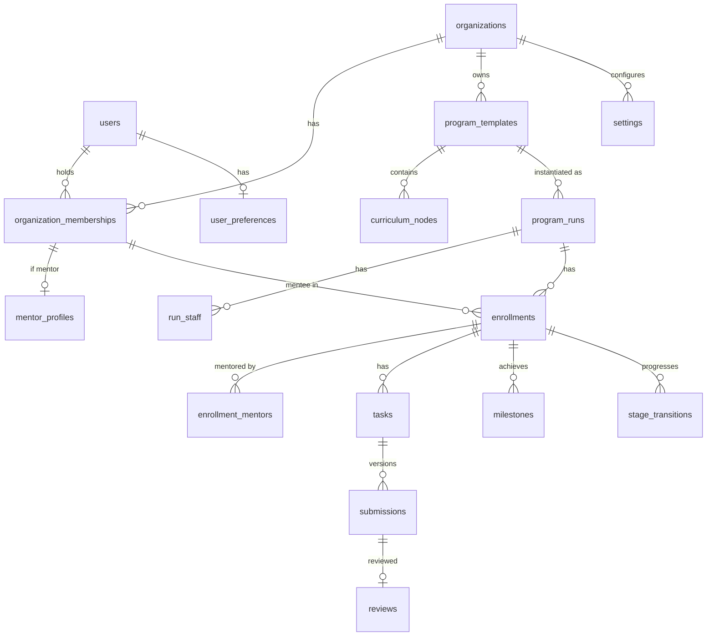

# Architecture review: turning "Coach Office" into a multi-organization coaching SaaS

- **Date:** 6 Aban 1405 (2026-10-28)
- **Input:** the founder's document "Coach Office — Product Evolution & Architecture Review"
- **Status:** proposal; **awaiting founder approval**. Until approved, no change is made to code or database.
- **Method:** direct reading of the code in `apps/web/src` and the migrations in `apps/web/drizzle`. Wherever something was not verified from the code, this is stated explicitly. Tests were not re-run in this review.

---

## 0. Advice before the plan (summary for the founder)

1. **Evolve, do not rewrite.** The current code is a tidy "modular monolith" (about 46 thousand lines of TypeScript, 13 domain modules, 80 test files). Access control is centralized in a single place (`modules/access/scope.ts`). The cycle "task → versioned submission → review → change request → resubmission" that you asked for in item 8 of the document **already exists almost completely today**. A rewrite would throw away several months of tested work.
2. **The biggest change is two things, not twenty:**
   - **Organization (tenant):** today all data is global and each user's role is a fixed column on `users`.
   - **Program:** today there is only **one global path**, and each mentee has **one primary mentor** and **one current stage**. The "template → run → membership" model must replace this.
   The rest of the requests (dashboards, review queue, progress, health) are more "extensions" than "built from scratch".
3. **Proposal: "multi-organization ready, with one organization in practice".** Add the `organization_id` column and organization membership **now**; this is the cheapest time while the data is small. But postpone automatic organization sign-up, the platform admin console, subscriptions and white-label until after the Takanesh pilot. For now the platform admin works through a command-line script (the same pattern as the current `admin:create`).
4. **I suggest simplifying your document in three places:**
   - **Template versioning:** instead of separate version tables, the template content is **copied (snapshot)** when a "run" is created. The same goal ("changing a template must not break active runs") with far less complexity.
   - **Cohort = group run:** every "run" (Program Run) is either a group or an individual one. "Multiple cohorts" means multiple runs of one template. Subgroups inside a run (a cohort inside a cohort) go after the MVP.
   - **Roles:** the six roles in the document are right, but for the pilot "owner" and "organization admin" have one access level (only the owner can remove another admin). "Program manager" is a **program-level** role, not an organization-level one.
5. **Risks you should know about before a contract with Takanesh (not technical, but they change the architecture):**
   - **Free Vercel (Hobby) is for non-commercial use only.** Takanesh is a commercial customer → the Pro plan (20 USD per month) or another host is needed.
   - **Free Supabase** has no restorable backups and pauses an unused project after a week. With a real academy's data, the Pro plan or an independent nightly backup is needed.
   - **The risk of international internet outages in Iran** (recorded in STATUS.md: an 88-day outage in 2026). For an Iranian academy with many mentees, this risk is the most serious of all. Fortunately the app was built "portable" from the start (Docker and standard Postgres), so a separate deployment for Takanesh on a server inside Iran is possible. This decision **must be made with Takanesh itself**.
6. **This is a change of product direction, not a sprint.** According to the project process (CLAUDE.md), before code the PRD, the MVP scope and the ADRs must be updated and you must approve. The plan below follows this (Sprint 0).
7. **What is not lost:** the special freelancing features (platform profiles, proposal review, the "first contract" indicator) are not removed. All of them become the "freelancing program add-on" that Takanesh's Upwork program uses.

### Questions only you (or Takanesh) can answer
| # | Question | Why it matters |
|---|---|---|
| Q1 | How many mentors and active mentees does Takanesh have? How many concurrent programs? | Database size, hosting plan, dashboard performance |
| Q2 | Pilot start date with Takanesh? Do you have a contract or formal agreement? | Prioritization and which sprints to compress |
| Q3 | Where should Takanesh's data live: abroad (Vercel/Supabase) or a server inside Iran? | Deployment architecture, outage risk, legal issues |
| Q4 | What happens to your own current mentees? A separate personal organization ("your Coach Office") or inside Takanesh? | Migration of existing data |
| Q5 | Who builds program templates: each mentor for themselves, or only the academy admin? | Scope of "template approval" and the program manager role |
| Q6 | Is English needed for the pilot or is only the "infrastructure" enough? | Translation workload (about 2500 lines of Persian text in the code) |
| Q7 | Should the academy admin see mentors' private notes? (the document says no) | Today the admin sees everything; changing it requires redesigning access |
| Q8 | Is login with a mobile number (current) enough for Takanesh? Is sending SMS needed? | Today invitation and password reset use a manual link and there is no SMS |

### Founder's answers (6 Aban 1405)
| # | Answer | Effect on the plan |
|---|---|---|
| Overall direction | **Approved:** evolve this same app; Sprint 0 first, then multi-organization | — |
| Q1 | Takanesh has 10 mentors and more than 3000 mentees; the pilot starts with **3 mentors and 100 mentees** | The pilot volume is small for the current plans; indexes and dashboards should be designed for 3000 mentees |
| Q2 | The pilot start date has not been given yet | Open |
| Q3 | For now on **Vercel and Supabase**; the server decision comes after completion | An independent backup and the Vercel commercial-plan decision are still needed |
| Q4 | The founder's current mentees **move into Takanesh** | The default migration organization is Takanesh itself; a separate personal organization is not needed |
| Q5 | **Admin and mentor** both build templates; a mentor's template needs admin approval to be used across the academy | Template visibility states: private, awaiting approval, organizational (ADR-0012) |
| Q6 | English is not needed for the pilot, but it will **soon be needed for presenting to investors** | Infrastructure in Sprint 2; translation of the main pages immediately after the pilot (or an English demo version) |
| Q7 | **No; a mentor's private note stays hidden from the admin** | Visibility level `private` (ADR-0011) |
| Q8 | Not answered yet | Open |
| New question | Session scheduling; and two types of "plan": one-on-one mentoring and program-based mentoring | Section 0-1 below |
| "Plan" | Means a **sellable package** (e.g. "one-on-one: 8 sessions in 2 months" or "an 8-week course") | Package = template with a session quota and validity period; payment remains out of scope (ADR-0012) |
| Scheduling | **Simple in the MVP**: record a session with time and link, status, notes and next action; no calendar sync and no automatic booking | ADR-0012; about 1 week added to the roadmap |

### 0-1. Session scheduling and the two types of mentoring (proposal, awaiting approval)
**Current state (from the code):** session scheduling **does not exist**. You can only record a note of kind "session" after a session (`notes.kind = 'session'`) and assign a task of kind "session preparation" (`session_prep`). In your document, "calendar and live session" was also P2.

**Proposal:** one-on-one mentoring without sessions makes little sense, so let us bring a **simple session scheduler** into the MVP and push the rest back:
- **In the MVP:** a `mentoring_sessions` table (time, duration, mentor, one mentee or one group run, link or location as text, status: planned / held / cancelled / no-show); a session note and "next actions" that turn into tasks; upcoming sessions on the mentor and mentee dashboards and on the "Today" page. Effort: about 1 week.
- **After the MVP:** Google Calendar sync, automatic booking from the mentor's free hours, automatic creation of online meeting links, SMS reminders.

**Two types of mentoring on one core** (item 4-2 of the document is respected):
| | Program-based mentoring | One-on-one mentoring |
|---|---|---|
| Basis | A run of a program template (stages, tasks, milestones) | A free-form mentoring relationship, with no fixed template |
| Participants | Group (cohort) or individual | One mentee and one or more mentors |
| Focus | Progress along the path | Goals, sessions, next actions |
| Progress | Completed required activities | Goals and approved milestones |
| In the data model | `program_runs.kind = 'program'` | `program_runs.kind = 'one_on_one'` (no template, or an optional template) |

Both use the same membership, task, submission, review, note, session and health machinery.

**"Plan" if it means a sellable package** (e.g. "one-on-one: 8 sessions in 2 months"): a one-on-one template can be defined with a "session count and duration" so that session consumption is counted. The selling and payment themselves stay out of scope per the earlier decision. **The meaning of "plan" must be clarified with the founder.**

---

## A. Assessment of the current state

### A-1. Architecture and stack (verified from the code)
| Layer | Technology | Location |
|---|---|---|
| Framework | Next.js 16 (App Router), React 19, TypeScript 6 | `apps/web` |
| Styling | Tailwind CSS 4, local Vazirmatn font | `src/app/layout.tsx`, `src/fonts` |
| Database | PostgreSQL 16+ with Drizzle ORM; 6 migrations | `src/modules/*/schema.ts`, `drizzle/` |
| Validation | zod 4 at the API boundary and in settings | `modules/*/contracts.ts` |
| Authentication | In-house: mobile + password (argon2id), random hashed session, invite and reset tokens, login lockout, reauth | `modules/identity`, `server/auth` |
| Scheduled jobs | pg-boss inside Postgres, or the `http-trigger` mode for a serverless host | `server/jobs` |
| Files | `FileStorage` port with adapters local, supabase (active in production), azure-blob and s3 (stubs) | `server/storage` |
| Structure | Modular monolith: thin `route` → `service(actor, …)` → `repo`; each module owns its own tables | `src/modules/*` |
| Tests | Vitest (unit and integration with embedded Postgres), Playwright (e2e); 80 test files, including the access matrix | `tests/`, `*.test.ts` |
| CI | Biome lint, typecheck, tests, `pnpm audit`, gitleaks, ban on Server Actions, Dependabot | `.github/workflows/ci.yml` |
| Current deployment | Vercel (Hobby) + Supabase (Postgres and Storage) | `docs/07-launch/supabase-storage.md` |

### A-2. Implemented features (verified from the `app/` and `api/v1` routes)
- **Account and team:** invitation by link, accepting an invitation, login and logout, password change, a reset link created by the admin, sessions, login lockout, reauth, the "Team" page (admin only).
- **Mentee:** full record (goal, level, skills, English, hours per week, niche, etc.), status lifecycle (active, paused, graduated, dropped), Persian search (trigram), CSV import and export.
- **Platform profiles:** several profiles per mentee, text versions (snapshots) and mentor approval.
- **Path:** one default path with configurable stages, a kanban board (`/api/v1/board`), stage transitions with a gate and mentor approval, an external content link for each stage.
- **Tasks (assignments):** several task types and several submission types (text, link, file, checkbox, proposal review, profile review), deadlines on Tehran day, deadline extensions with history, **versioned and non-editable** submissions, review with the result "accepted" or "changes requested", counting of revision rounds, the **review queue**, task templates, bulk assignment (`batchId`).
- **Communication:** question-and-answer thread with owner, priority and SLA; canned responses; weekly check-in with mood.
- **Follow-up:** notes and timeline (internal or shared), reminders, the "Today" page.
- **Mentee health:** 9 deterministic rules (inactivity, stagnation, overdue work, revision rounds, no work, extensions, flag, check-in, bad mood), thresholds in settings, a "stuck" list, hourly recalculation.
- **Milestones:** mentee proposal with evidence and mentor approval, the North Star indicator ("first contract" etc.) on the results page.
- **Security and privacy:** CSP with nonce, security headers, account erasure, data retention, audit log, private files limited to images.

### A-3. Half-done or only in the schema
| Item | State |
|---|---|
| Second and backup mentor | The roles `secondary` and `backup` are defined in `mentor_assignments` but **no code uses them**; access comes only from `primary_mentor_id` |
| Multiple paths | The `learning_paths` table exists but only one default path is used |
| Cohort | Only a free text field (`students.cohort`), not an entity |
| UI for several follow-ups | F-01, F-02, F-06, F-11, F-12, F-14 (backend ready, UI remaining; `docs/05-delivery/followups.md`) |
| Scheduled jobs on Vercel | `JOBS_MODE` is not set or unknown in production |
| Notifications | Only an internal reminder; no SMS, email or in-app notification sending |

### A-4. Database entities (29 tables)
| Module | Tables |
|---|---|
| identity | `users` (global role: admin/mentor/student), `auth_tokens`, `sessions`, `auth_throttle` |
| catalog | `settings` (global), `tracks`, `platforms`, `learning_paths`, `stages`, `task_templates`, `milestone_types`, `canned_responses` |
| students | `students` (one `primary_mentor_id`, one `current_stage_id`), `mentor_assignments`, `platform_profiles`, `profile_snapshots` |
| path | `stage_transitions` |
| tasks | `tasks` (directly to the mentee, one `reviewer_id`), `task_extensions`, `submissions`, `reviews` |
| timeline | `notes` (internal/shared), `timeline_events` |
| others | `reminders`, `question_threads`, `question_messages`, `checkins`, `milestones`, `student_flags`, `student_health`, `attachments`, `audit_log` |

**No table has an organization column.** Unique names (such as the platform name and the track code) are global.

### A-5. Multilingual support and right-to-left
- `<html lang="fa" dir="rtl">` is **fixed** in `app/layout.tsx`. No i18n library is installed.
- About **2500 lines of Persian text** in **227 files** sit directly inside the code, including server error messages (`server/http/errors.ts`) and zod messages.
- **Strength:** the components use Tailwind logical classes (88 occurrences of `ms-`/`me-`/`ps-`/`pe-`/`start-`/`end-`) and **no** physical classes (`ml-`, `left-`, …). So switching from RTL to LTR is cheap as far as layout goes.
- Dates: the in-house libraries `lib/jalali` and `lib/tehran-day`; times are stored in UTC (ADR-0008). But the time zone in settings is **`z.literal('Asia/Tehran')`**, meaning it is currently not changeable.
- Persian text normalization (`lib/text-fa`) and E.164 mobile numbers exist.

### A-6. Main technical limitations
1. The global role is on `users` (one person cannot be a mentor in one organization and a mentee in another).
2. A mentee means "one primary mentor + one current stage"; being in several programs is impossible.
3. A task is attached directly to the mentee, not to a "membership in a program run".
4. Settings, SLA, holidays and health thresholds are global.
5. The admin sees everything, including internal notes (contrary to item 5 of the document).
6. Texts are Persian and inside the code; the time zone is fixed to Tehran.
7. Some freelancing-specific concepts are in the core (`platforms`, `platform_profiles`, `proposal_review`).

---

## B. Gap analysis

Effort estimate: **S** = a few days, **M** = about 1 week, **L** = 2 to 3 weeks (one developer with agent help). These are initial estimates and become more precise after Sprint 0.

| Required feature | Current implementation | Gap | Action | Priority | Effort |
|---|---|---|---|---|---|
| Multiple organizations | None | Organization table, `organization_id` on all data tables | Build New | P0 | L |
| Organization membership and role | Global `users.role` | `organization_memberships(role)`; the actor includes the organization | Refactor | P0 | M |
| Tenant isolation in the backend | `scopeCondition` based on the mentor only | Organization condition in all queries + composite foreign keys to prevent cross-organization references | Extend | P0 | M |
| Platform admin | `admin:create` (script) | Platform-level flag; organization creation by script | Extend | P0 | S |
| Program-level access | None | Run roles (program manager, mentor) | Build New | P0 | M |
| Flexible mentor–mentee relationship | `primary_mentor_id` + history table (secondary unused) | Mentor at the run membership level; several mentors | Refactor | P0 | L |
| Program template | `learning_paths` + `stages` + `task_templates` (global, one) | Template inside the organization; several templates; draft and published | Refactor | P0 | M |
| Program run | None (everything is in one global path) | `program_runs` with a template snapshot | Build New | P0 | L |
| Template versioning | None | Snapshot when a run is created (not a version table) | Build New (simple) | P1 | S |
| Group and individual runs | None | `mode: group / individual` on the run | Build New | P0 | part of Run |
| Cohort | Text field `students.cohort` | Group run = cohort; the text field is migrated | Replace | P1 | S |
| Subgroup inside a cohort | None | — | Defer | P2 | — |
| Persian and English i18n infrastructure | None; 2500 lines of fixed text | next-intl, message files, error codes instead of text | Build New | P0 | M (infrastructure) + L (full extraction) |
| RTL and LTR | Fixed `dir="rtl"`; logical classes | `dir` based on language | Extend | P0 | S |
| User language preference | None | `user_preferences.locale` | Build New | P0 | S |
| Language-dependent dates and numbers | `lib/jalali` Persian only | Jalali for fa and Gregorian for en; organization time zone | Extend | P1 | M |
| Content source language | None | `source_locale` on template and run | Build New | P1 | S |
| Mentor directory | "Team" page (list, invite, deactivate) | Search, filter, workload, programs | Extend | P1 | M |
| Mentor profile | Only `displayName` | `mentor_profiles` (title, bio, expertise, language, avatar) | Build New | P1 | S |
| Mentee management | Complete (record, status, CSV) | Moved to the organization; freelancing fields optional | Keep + Extend | P1 | M |
| Program builder | Stage and task template management | Phase, activity (lesson, assignment, checklist, resource, milestone), ordering, relative deadline | Extend | P1 | L |
| Individual and group enrollment | None | `program_memberships` + bulk add | Build New | P1 | M |
| Task and submission | **Complete** (versioned, submission types, files) | Connection to the membership and the program node | Keep + Extend | P1 | M |
| Feedback and revision cycle | **Complete** (accepted / changes_requested, round count) | Review queue filter by program | Keep | P1 | S |
| Progress | Current stage + milestones + health | Deterministic progress formula for each membership | Extend | P1 | M |
| Milestones and outcomes | **Complete** (proposal, approval, North Star) | Milestone definition at the program template level | Extend | P1 | S |
| Mentee needing follow-up | **Complete** (health, 9 rules, stuck) | Thresholds per organization | Keep + Extend | P1 | S |
| Organization dashboard | Results page and "Today" | Aggregation of programs, mentor workload | Extend | P1 | M |
| Mentor dashboard | "Today", review queue, kanban | Program filter | Extend | P1 | S |
| Mentee dashboard | `/home`, my path, my tasks | Several programs, next action | Extend | P1 | M |
| Basic notification | Internal reminder | In-app notification (no SMS) | Build New | P1 | M |
| Private note hidden from the admin | The admin sees all | Visibility level `private` (only the author and the mentors of that membership) | Refactor | P1 | S |
| Q&A | **Complete** | Moved to the organization | Keep | P1 | S |
| Weekly check-in | **Complete** | Moved to the organization | Keep | P1 | S |
| Platform profiles, proposal review | **Complete** | "Freelancing add-on" that can be enabled per organization | Keep (isolate) | P1 | S |
| Private files | **Complete** (Supabase) | Key prefix with the organization | Extend | P0 | S |
| Audit, data export and erasure | **Complete** | Limited to the organization | Extend | P1 | S |
| Calendar, live session, private message, forms and quizzes | None | — | Defer | P2 | — |
| Payment, mentor marketplace, white-label, full Dutch, mobile app | None | — | Defer | P2 | — |
| AI | Designed in phase 1.0 | — | Defer | P2 | — |

---

## C. Target architecture

### C-1. Domain model
```
Platform
 └─ Organization ─┬─ OrganizationMembership (user, role: owner|admin|mentor|mentee, status)
                  │     └─ MentorProfile (for mentors)
                  ├─ Settings (SLA, holidays, health thresholds, time zone, default language, add-ons)
                  ├─ ProgramTemplate (draft|published|archived, source_locale, visibility)
                  │     └─ CurriculumNode (phase → activity: lesson|assignment|checklist|resource|milestone)
                  └─ ProgramRun (mode: group|individual, start date, template snapshot)
                        ├─ RunStaff (user, role: manager|mentor)
                        ├─ Enrollment / ProgramMembership (mentee, status, current node, progress)
                        │     └─ EnrollmentMentor (this mentee's mentor(s) in this run)
                        ├─ Task/Assignment (enrollment, node) → Submission (v1..n) → Review
                        ├─ Milestone (enrollment, type)
                        └─ Notes / Questions / Check-ins / Reminders / Health (on the enrollment or the organization's mentee)
```

**Key decisions:**
1. **Mentee = organization membership with the role mentee.** The current `students` table stays and becomes the "mentee record in the organization" (key: organization + user). Freelancing fields (niche, English, etc.) move to an optional add-on table or JSON column.
2. **The current stage moves from the mentee to the Enrollment.** The same gate logic and `stage_transitions` are kept; only the key changes.
3. **A task attaches to the Enrollment.** Free-form mentor tasks (follow_up) also attach to an Enrollment, or to the "organization record" if outside a program.
4. **A mentor gets access in three ways:** as a mentor directly on an Enrollment, as a mentor of the whole run (RunStaff), or through the organization setting "all mentors see everyone" (the same as the current `mentorScope = all`).

### C-2. Relationship diagram


### C-3. Access control structure
- **New actor:** `{ userId, orgId, orgRole, isPlatformAdmin }`. The active organization comes from the session (organization selection after login if the user is in several).
- **Three layers, all on the server:**
  1. **Tenant:** every query has the condition `organization_id = actor.orgId`. This condition is added inside the current `scopeCondition`, so all existing queries are covered in one place.
  2. **Organization role:** owner/admin manage; a mentor only the memberships related to them; a mentee only their own data (the current pattern of a separate mentee DTO is kept).
  3. **Record level:** the current `loadInScope` resolvers (which reach the mentee root from any resource) are extended to the **Enrollment** root.
- **Defense in depth in the database:** a composite foreign key `(organization_id, id)` on child tables, so a reference from one organization to another organization's record is **impossible in Postgres itself**. I suggest Postgres Row Level Security for later (it needs `SET LOCAL` in every transaction), not for the MVP.
- **Notes:** three visibility levels: `private` (the author and the mentors of that Enrollment), `staff` (all authorized staff, equivalent to the current `internal`), `shared` (the mentee sees it too). The organization admin does not see `private`, if Q7 is confirmed.
- **Access matrix** (`tests/integration/access-matrix.test.ts`) is extended to a two-organization matrix: every endpoint is tested with a user from the other organization and must return 404.

### C-4. Organization and program boundary
| Data | Level |
|---|---|
| User, password, session, language preference | Platform (one account for several organizations) |
| Membership, mentor profile, settings, platforms, milestone types, canned responses | Organization |
| Program template and its nodes | Organization (visibility: mentor-private, organization-shared, requires approval) |
| Run, membership, task, submission, review, milestone, stage transition | Program run (and therefore the organization) |
| Note, question, check-in, reminder, health | Mentee record in the organization (optional: one Enrollment) |

### C-5. Proposed modules
All inside the same modular monolith; **no new service or framework is added** (except next-intl).

| Module | Status |
|---|---|
| `identity` | Kept; the role is removed from the user |
| `organizations` (new) | Organization, membership, mentor profile, directory |
| `access` | Extended: tenant + run role + Enrollment |
| `catalog` | Split: settings and lists stay (organization level); path and stage move to `programs` |
| `programs` (new, from `path` and part of `catalog`) | Template, nodes, run, membership, transition |
| `tasks` | Kept; Enrollment and node keys |
| `students` | Becomes the organization's mentee record; mentor assignment moves to `programs` |
| `freelancing` (new, extracted) | Platform profile, snapshot, proposal and profile submission types, North Star |
| `health`, `today`, `milestones`, `questions`, `checkins`, `reminders`, `timeline`, `files` | Kept; organization added |
| `notifications` (new, simple P1) | In-app notification |
| `dashboards` (read-model) | Organization, mentor and mentee aggregation |

### C-6. Multilingual architecture
- **Library:** `next-intl` (compatible with the App Router and works in Server Components).
- **Language route:** no URL prefix for the pilot; the language comes from the user preference and then the organization's default language. A `/en/...` prefix only if a public SEO page becomes necessary.
- **`<html lang dir>`** is determined from the active language: `fa` → `rtl`, `en` and `nl` → `ltr`.
- **Messages:** `messages/fa.json` and `messages/en.json`, with a namespace per module. Server error messages are converted to **error codes** (`errors.ts` has 119 Persian strings today) and translation is done in the presentation layer. zod messages use a shared errorMap.
- **Formatting:** a `lib/format` module that, based on the language, gives Jalali (fa) or Gregorian (en and nl) and Persian or Latin digits. The current `lib/jalali` stays underneath it. Storage remains UTC.
- **Time zone:** from `z.literal('Asia/Tehran')` to an organization setting (default Tehran). The "end of day" of deadlines is based on the organization's time zone.
- **User content:** is not translated. `source_locale` is stored on template and run so that manual translation is possible in the future.
- **Extraction method:** infrastructure and the main pages (shell, login, dashboards, tasks) in the i18n sprint; the remaining pages **each time a page is opened for new features**. A lint rule blocks new Persian text in JSX.

### C-7. Data migration strategy
- **The expand → migrate → contract pattern:**
  1. **Expand:** new tables and columns are added as nullable; the old code keeps working.
  2. **Migrate:** a default organization is created; all existing data is assigned to it. The default path becomes a "template" and a "default run"; each mentee gets an Enrollment with the same current stage and the same primary mentor.
  3. **Contract:** after confirmation, the columns become `NOT NULL` and the old columns (`users.role`, `students.primary_mentor_id`, `students.current_stage_id`, `students.cohort`) are removed in a separate, later migration.
- **Before every migration on production:** a full backup with `pg_dump` (free Supabase has no restorable backup) and a trial run on a copy of the data.
- Each migration has an integration test that builds the "before data" and checks the "after data".

---

## D. Incremental roadmap

Total estimate: **about 14 to 17 weeks** for the full adoption scenario (item 16 of the document, plus packages and sessions). The shorter path for the pilot is in section F-4.

**Sprint 0 status (6 Aban 1405):** documents written: `prd-coach-office.md`, ADR-0011, ADR-0012, ADR-0013. Remaining: the answers to Q2 and Q8, founder approval of the documents, and infrastructure work (scheduled jobs on Vercel, an independent nightly Supabase backup, the Vercel commercial-plan decision).

### Sprint 0 — decision and documents (about 1 week)
- **Goal:** answers to Q1 to Q8, updating the PRD and MVP scope, recording the ADRs.
- **Tasks:** a PRD addendum for "Coach Office"; ADR-0011 multi-organization; ADR-0012 program model (template, run, snapshot); ADR-0013 multilingual support; the Takanesh hosting decision; setting up scheduled jobs on Vercel and the nightly backup.
- **Dependency:** the answers from you and Takanesh.
- **Acceptance criterion:** the ADRs and the MVP scope have your approval.
- **Risk:** unbounded scope; the way to control it: an explicit Defer list.

### Sprint 1 — multi-organization infrastructure (about 2 weeks)
- **Goal:** all data belongs to an organization; isolation on the server.
- **Tasks:** the `organizations` and `organization_memberships` tables; an actor with `orgId`; organization selection after login; an organization creation script; organization-level settings; organization prefix in file keys.
- **Database:** the `organization_id` column (expand) on all data tables; backfill to the default organization; composite foreign keys; organization-level uniqueness (e.g. platform name).
- **Dependency:** Sprint 0.
- **Acceptance criterion:** all current tests green; two-organization matrix: a user of organization B sees no record of A (404).
- **Tests:** extending `access-matrix`, a migration test.
- **Risk:** a query that omits the organization condition → the condition lives in `scopeCondition` plus a structural test that checks every query of a table with `organization_id`.

### Sprint 2 — multilingual infrastructure (about 1.5 to 2 weeks)
- **Goal:** Persian and English with correct RTL and LTR, on the main pages.
- **Tasks:** install next-intl; `user_preferences.locale`; dynamic `lang` and `dir`; error codes instead of text; an errorMap for zod; `lib/format`; the organization time zone; extraction of the shell, login, dashboards and tasks; the lint rule.
- **Database:** the user preferences table; language and time zone in organization settings.
- **Acceptance criterion:** the same pages in `en` are left-to-right and unbroken; Gregorian dates in en and Jalali in fa.
- **Tests:** e2e in both languages; RTL and LTR layout snapshots.
- **Risk:** missed texts; message bundle performance → splitting by namespace.

### Sprint 3 — program model: template, run, membership (about 3 weeks; the riskiest)
- **Goal:** multiple programs, multiple runs, group and individual runs.
- **Tasks:** the `programs` module; a template with phases and activities (lesson, assignment, checklist, resource, milestone); draft and publish; duplicate and archive; run creation with a snapshot; individual and group enrollment; moving the gate logic and stage transition to the Enrollment.
- **Database:** `program_templates`, `curriculum_nodes`, `program_runs`, `run_staff`, `enrollments`; converting `learning_paths` and `stages` to the default template; one Enrollment for every existing mentee.
- **Dependency:** Sprint 1.
- **Acceptance criterion:** an existing mentee sees the same stage and the same tasks; a new 8-week template is built and used in two runs (group and individual); editing a template does not change an active run.
- **Tests:** a migration test with real data (a copy), rewritten existing path and tasks tests.
- **Risk:** breaking the kanban, health (R-STALL) and "Today", which depend on `current_stage_id`.

### Sprint 4 — mentor relationship and directory (about 2 weeks)
- **Goal:** several mentors per mentee; a mentor directory with workload.
- **Tasks:** `mentor_profiles`; `enrollment_mentors` and `run_staff` as the access source (replacing `primary_mentor_id`); a directory with search, filter, mentee count, overdue reviews; assignment and reassignment; the `private` visibility level for notes.
- **Database:** migrating `mentor_assignments` to `enrollment_mentors`.
- **Acceptance criterion:** two mentors of a cohort see all of its mentees and a third mentor does not; the admin does not see a `private` note.
- **Risk:** rewriting the access resolvers; full coverage with the access matrix.

### Sprint 5 — tasks in the program and progress (about 2 weeks)
- **Goal:** tasks from the program, review with a program filter, deterministic progress.
- **Tasks:** a task from a program node for all members of a run; a deadline relative to the run start; review queue filter (program, mentee, status); the progress formula; milestones at the template level.
- **Proposed progress formula:** `progress = completed required activities ÷ required activities of the run`; "completed" for an assignment means status `accepted` (not `submitted`); for a lesson and a resource it means the "done" mark; for a milestone it means `approved`. This formula is implemented in a pure, tested function and all dashboards use it.
- **Database:** `tasks.enrollment_id` and `tasks.node_id`; an activity-completion table; (optional) `progress_events` — instead, the existing `timeline_events` is used.
- **Acceptance criterion:** steps 9 to 12 of the acceptance scenario.

### Sprint 5b — one-on-one: package, session, goal (about 1 to 1.5 weeks; added after the founder's answers)
- **Goal:** one-on-one mentoring and sellable packages (without payment) and simple session scheduling.
- **Tasks:** a `one_on_one` template with a session quota and validity; enrolling a mentee in a package; `mentoring_sessions` (record, cancel, held, no-show, group session); the next action as a task; `goals`; package consumption; upcoming sessions on "Today" and the dashboards; an internal reminder 24 hours before.
- **Database:** `mentoring_sessions`, `goals`, `tasks.session_id` (ADR-0012 items 4 and 7).
- **Acceptance criterion:** step 7 of the `prd-coach-office.md` scenario.
- **Risk:** session time zone; overlapping sessions of one mentor (warning only).

### Sprint 6 — dashboards, notifications, Takanesh readiness (about 2 weeks)
- **Goal:** three dashboards and Takanesh onboarding.
- **Tasks:** organization dashboard (programs, mentors, mentees, overdue, needing follow-up, overdue reviews, aggregate progress, workload); mentor dashboard (based on "Today"); mentee dashboard (several programs, next action); in-app notification; bulk mentee import by CSV into a run; English translation of the pilot pages (if Q6 requires); a full e2e of the item 16 scenario.
- **Acceptance criterion:** the full 16-step scenario in Persian and English.
- **Risk:** performance of aggregate queries → a read-model with indexes, measured with Takanesh-sized data.

---

## E. Risk assessment

| Category | Risk | Mitigation |
|---|---|---|
| Breaking features | The kanban, health (R-STALL, R-NOTASK), "Today", North Star and CSV export all depend on `current_stage_id` and `primary_mentor_id` | Change behind the services; current tests green before each change; remove old columns only in the contract step |
| Migration | Loss of the mentee–mentor relationship or stage | Deterministic, tested backfill; `pg_dump` before running; trial run on a copy |
| Migration | Free Supabase backups | Independent backup before every migration; upgrade to Pro before Takanesh data |
| Tenant security | Missing the organization condition in one query | Condition in the shared `scopeCondition`; composite foreign keys; two-organization matrix; structural test |
| Tenant security | Files | Organization prefix in the key and an organization check in the file service |
| Security | Organization admin and private notes | Visibility level `private` and a test |
| Security | A user in several organizations | Active organization in the session; switching organization with a membership check on every request |
| Performance | Organization dashboard with thousands of mentees | Composite indexes with `organization_id`; read-model; pagination |
| Performance | Hourly health recalculation for several organizations | The same job iterating over organizations; on free Vercel it needs an external scheduler |
| Multilingual | 2500 lines of fixed text; Persian error messages on the server | Error codes; gradual extraction; lint rule |
| Multilingual | Bidirectional text (English inside Persian, like proposal text) | `dir="auto"` and `<bdi>` on user content |
| Multilingual | Jalali and Gregorian in deadlines | Store UTC; "end of day" with the organization time zone; test |
| Complexity | A template version table, a cohort separate from the run, six organization roles | Snapshot, run = cohort, two organization roles + run role |
| Complexity | Building the platform console and organization sign-up before they are needed | A command-line script until the second customer |
| Infrastructure | Vercel Hobby is non-commercial; free Supabase; Iran internet outage | Hosting decision in Sprint 0 |
| Product | Building a general SaaS before proving value for Takanesh | Measure each sprint against a real Takanesh scenario |

**Features that must definitely be preserved:** authentication and session security, versioned submission and the review cycle, the review queue, mentee health and its 9 rules, stage gate with mentor approval, milestones with evidence, Q&A with SLA, working hours and holidays, check-in, data erasure and retention, separate mentee DTOs, Persian search, private files.

---

## F. Recommendation

1. **Is evolution more practical than a rewrite?** Yes, by a wide margin. The current architecture is exactly the modular monolith the document asked for, and the hardest parts of items 8 and 9 (versioned submission, review, health) are already built and tested.
2. **How much is reusable?** An estimate based on the code reviewed:
   - Infrastructure, authentication, security, files, jobs, UI components, date and text libraries: **about 90%** (with changes for the organization).
   - Tasks, submissions, review, questions, check-in, milestones, reminders, timeline, health: **about 75 to 85%** (adding organization and Enrollment).
   - Path, stage, mentor assignment, access: **about 40 to 50%** (model redesign, logic preserved).
   - Overall **about 70%** of the current code stays. This number is an estimate, not a line-by-line measurement.
3. **The most important architecture changes:** (1) organization and membership with an organization-level role; (2) the template, run and Enrollment model instead of the global path and the stage on the mentee; (3) mentor access from membership instead of `primary_mentor_id`; (4) i18n infrastructure with error codes.
4. **The smallest usable version for Takanesh:**
   - one organization (multi-organization schema, no organization sign-up);
   - several program templates and several runs (group and individual) with a snapshot;
   - several mentors per run and per mentee;
   - the existing task, submission and review, connected to the program;
   - deterministic progress and the existing health;
   - three simple dashboards;
   - Persian UI on the i18n infrastructure (English only if Q6 says so).
   This means Sprints 1 to 6 without full English translation, notifications and the advanced directory: **about 10 to 12 weeks**.
5. **What to postpone:** automatic organization sign-up and the platform console, subgroups in a cohort, a template version table, template approval (if Q5 says only the admin builds templates), SMS and email notifications, calendar and live session, private messaging, forms and quizzes, advanced analytics, payment, marketplace, white-label, Dutch, mobile app, AI.
6. **What the first sprint should be:** first **Sprint 0** (decisions and ADRs, about one week, no code change), and immediately after it **Sprint 1 (multi-organization infrastructure)**. Reason: all later tables and features depend on `organization_id`, and now that the production data is small is the cheapest and lowest-risk time for this migration.
